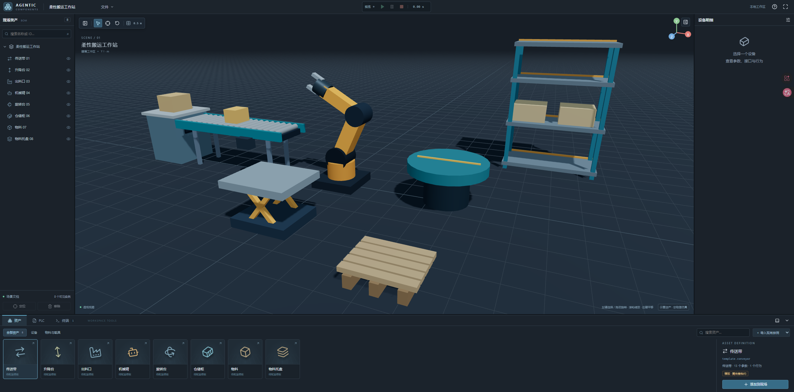

# Agentic Components 工作台

Next.js App Router + TypeScript + React Three Fiber 的工业设备前端。项目根目录为 `AgenticComponents/apps`。

## 开发目标

Agentic Components 面向工业设备的结构化建模、三维场景搭建和动作契约验证，目标是把模型几何、设备参数、信号接口、行为及执行条件组织为可复用的设备定义，为工艺规划、PLC 合成和运行时调度提供统一的数据基础。

开发按三个方向推进：

1. **设备建模与契约验证**：用 DeviceSpec 描述设备参数、节点、能力和约束，将设备定义与现场实例、运行状态分别管理；通过三维工作台检查模型绑定与动作结果。
2. **场景理解与工艺生成**：后续接入专家智能体，结合三维场景、设备接口和生产目标规划工艺路径，再交由契约驱动的编译模块生成可执行 PLC。
3. **运行时调度与派工实验**：后续结合设备、感知和控制状态，研究资源竞争、时序约束与学习型派工，比较不同策略的可行性和执行效果。

当前代码实现前端工作台和预览接入框架；智能体工艺规划、PLC 自动合成及学习型调度属于后续开发目标。

## 应用场景

| 场景                 | 工作台的作用                                                                                 |
| -------------------- | -------------------------------------------------------------------------------------------- |
| 单设备建模与标定     | 导入 GLB 和 DeviceSpec，检查参数、模型节点、信号接口及行为契约，为迁入 IK 或运动驱动做准备。 |
| 小型产线与工作站搭建 | 组合传送带、机械臂、升降台、旋转台和仓储等资产，编辑实例布局并查看现场 BOM。                 |
| 工艺与控制原型开发   | 组织设备能力和接口映射，编辑 ST 草稿，为后续智能体规划与 PLC 编译接入提供可视化环境。        |
| 仿真研究与教学演示   | 展示设备结构、场景关系和预览状态；后续接入执行与调度模块，支持契约、工艺生成及派工算法实验。 |

## 界面预览



截图文件位于 [public/assets/image.png](public/assets/image.png)。三维区域由 React Three Fiber / three.js 实时渲染；示意设备可以替换为导入的 GLB 模型。

## 启动

需要 Node.js 22 LTS 或更新的受支持版本。

```powershell
cd E:\project\AgenticComponents\apps
npm ci
npm run dev
```

打开 `http://127.0.0.1:3000`。已有依赖时直接 `npm run dev`。

生产构建：`npm run build`，随后 `npm start`。本地数据按浏览器和地址（包括端口）隔离，`localhost` 与 `127.0.0.1` 不共用存储。

## 可用功能

- 暗色工业工作台：BOM、3D 视口、右侧明细、资产 / PLC / 终端底部面板。
- 面板拖动调整、折叠、底部最大化；浏览器全屏。
- 八类参数契约模板，程序生成的示意模型；明确标记为待配置，不代表已标定实物。
- 添加、删除、重命名、显隐、搜索、三维/BOM 联动选择和相机定位。
- 实例位姿、类型化参数表单、默认值与覆盖值、范围/条件必填/参数引用等校验。
- 实际四份旧 DeviceSpec 的导入样例；保留原始定义并呈现迁移诊断。
- DeviceSpec JSON 与自包含 GLB 2.0 导入（GLB 最大 100 MB）；同定义实例共享模型，节点列表可查看。
- IndexedDB 项目保存与模型 Blob 持久化；`Ctrl+S` 保存；JSON 导入/导出。
- ST 文本编辑、导入/导出及 I/O 绑定查看；PLC 编译和执行服务尚未接入。
- 应用日志、过滤、复制/导出和白名单命令（`help`、`clear`、`inspect <instanceId>`、`save`、`export`、`focus`）。终端不运行系统命令。
- 动作预览生命周期：准备、运行、暂停、继续、停止、恢复基线、错误诊断。固定 1/60 秒逻辑步长，标签页隐藏后暂停。

## 预览与动画边界

本次没有迁移 IK、输送运动、物料抓放或 PLC 执行器。已注册的执行器只有 `builtin.mock`，必须在右侧明确勾选“演示模式”才能运行。它仅报告六秒演示会话进度，不驱动模型，也不代表真实动作完成。

真实动画通过 [`AnimationAdapter`](src/contracts/preview.ts) 接入，在 [`registerAgentAdapters.ts`](src/runtime/adapters/agent/registerAgentAdapters.ts) 注册。具体步骤、节点坐标、结果证据与取消语义见 [动画接入指南](doc/动画接入指南.md)。

工作台目前一次只允许一个活动会话（全局串行）；预览期间文档只读，选择与底部标签仍可切换。真实实时设定值通道、跨设备资源调度、物理引擎和在线 PLC 都是后续集成项。

## 文件与模型

“保存到浏览器”存储项目及已导入 GLB；“导出项目数据”只下载 JSON，不含模型二进制。跨浏览器导入时，模型显示缺失提示，需要重新关联。支持资源嵌入式 GLB；外部纹理/buffer 路径被拒绝，压缩资源所需的额外解码器尚未配置。

模板来自 `../test1/docs/parameter_contract_examples.json` 的快照，四份实际样例来自 `../test1/docs/scene1/device_specs/`。可用 `npm run catalog:sync` 重新生成这些发布副本，源目录仍是维护位置。

坐标约定：右手系、Y 向上、米；项目旋转存弧度，属性输入显示度。旧设备定义完整保留在 `source`；其 process port、关节/TCP 原始坐标不进行猜测式转换。真实模型需要显式校准。

## 结构

```text
src/app/                 Next 服务端外壳、客户端入口、主题
src/features/            工作台、BOM、资产、明细、预览、PLC、终端
src/components/ui/       参数输入与设备图标
src/contracts/           设备、参数、行为、场景、预览 TypeScript 契约
src/domain/              设备规范化和模板/实例构建
src/validation/          结构与跨引用校验
src/runtime/             控制器、时钟、条件、执行器注册、观测源
src/runtime/adapters/    Mock 与后续 agent 迁入入口
src/renderer/            R3F 视口、示意模型、节点注册与变换桥
src/stores/              文档与 UI 状态；不持有 three 对象
src/services/            浏览器项目/资源存储
src/commands/            文件操作、应用命令
tests/                   契约、预览生命周期回归
e2e/                     生产服务上的 Edge 浏览器回归
doc/                     原开发计划与动画接入说明
```

## 检查

```powershell
npm run typecheck
npm run lint
npm test
npm run build
npm run test:e2e
```

E2E 默认使用本机 Microsoft Edge，在 `127.0.0.1:3011` 启动生产服务；运行前需完成 build。其他平台可将 `playwright.config.ts` 的 channel 改为已安装浏览器。浏览器回归覆盖新增/导入资产、参数拦截、预览暂停和取消、底部切换、本地保存恢复、GLB 持久化、错误导入及桌面布局。测试生成的截图与 trace 位于忽略提交的 `test-results/`。

框架边界参考：[Next.js 客户端与服务端组件](https://nextjs.org/docs/app/getting-started/server-and-client-components)、[R3F 安装与 React 版本匹配](https://r3f.docs.pmnd.rs/getting-started/installation)。
