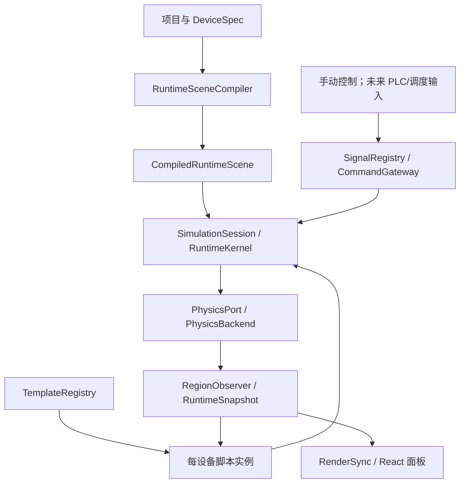

# 003 Runtime engine and device templates

日期：2026-10-30  
阶段：开发计划，待实施  
首个闭环：Conveyor_aankws + 一个被动物料 + 接触式输送 + 实际到达观测。

## 1. 架构评价与决策

采用“通用执行模板 + 设备专属扩展 + 统一场景运行时”。这兼顾同类设备复用与特殊机构表达，也与 Open-Industry 的统一 step(ctx)、设备脚本和宿主物理 API 的分工接近。统一的是模板接口、能力描述和运行协议；不把八类设备的所有逻辑写进一个大型 switch。

引擎定位为可复用、有状态的运行时工具包。它需要持有时钟、物理世界、信号表、任务关联和资源生命周期，适合放在 runtime/engine，通过清晰 API 被编辑器调用。无状态数学计算继续放 domain 或 math；不能将引擎单例和 React store 混在 utils 中。

通用脚本由 DeviceTemplate 接口和 TemplateRegistry 集中管理。每个模板工厂创建独立设备脚本实例，模板共享代码，设备实例不共享可变状态。特殊设备选择显式注册的专属实现，或组合通用机制；相同动作/驱动不得同时有模板和专属脚本两个写入者。

八种设备类型用于资产分类；执行机制按能力划分，例如接触输送面、直线轴、旋转轴、轨迹跟踪、夹具、缓存和资源事务。类型相同不意味着运动机制完全相同，模板选择须由明确标识、版本和能力检查决定。

## 2. 已有基础与需要跨越的边界

- 公共模型发现、GLB 加载、参数明细、空间接口可视化、移动旋转与接口吸附已实现。
- Conveyor_aankws 为契约 1.1 / 设备 0.4.1，11 个参数、21 个设备信号、7 个行为；输送面接触和三个观测区域仍为 pending。
- 两个空间端点位置分别为 [-0.749,0.700,0]、[0.751,0.700,0]；仅用于连接。端点间距 1.500 m，不等于有效皮带长度约 1.400 m。
- PreviewController 目前一次运行一个单实例有限行为，会要求 completionChecks，默认 affectedInstanceIds 只有当前设备；不能直接承担持续输送和跨设备载荷物理世界。
- PreviewClock 当前以 requestAnimationFrame 驱动 1/60 s 固定逻辑步。它不能与新引擎再各自启动一套物理时钟。
- ObservationSource 是按实例保存的轻量观测接入槽，没有 tick 新鲜度、有效性和物料请求作用域；不能直接充当完整信号引擎。
- 当前 apps 没有物理引擎依赖，public/modles 只有 Conveyor 的完整发布包。旧 workpiece_1 是历史定义，几何与坐标约定需迁移，不能当作已标定的运行物料。
- contracts/conveyor.ts 目前只接受 pending_engine/pending 等字面量。不得删除运行拦截就宣称支持真实执行，需同步扩展契约、校验器和实际能力注册。

参考代码：Open-Industry/examples/parts/belt-conveyor/part.js 的表面速度输出、src/sim/conveyorContacts.ts 的接触速度设置，以及 examples/parts/box/behavior.ts 的被动物料定义。它们提供架构依据；本轮不复制完整仿真世界或对方项目全部特殊逻辑。

## 3. 本轮功能范围

必须打通：场景准备 → 建立一个输送面和一个动态载荷 → 手动运行/调速/停带 → 接触物理带动物料 → 发布实际速度和区域观测 → 指定物料到达出口区 → 暂停、恢复、停止会话与恢复基线。

物料没有运输任务也可以被已运行的输送面带动；transport_to_exit 任务跟踪到达事实，不独立插值载荷位置。首期验证的是到达出口观测区，不等于已交接给下游设备。

本轮暂不实现：完整 PLC 编译执行、Agent 自动规划、学习型调度、多设备资源竞争、机械臂 IK、独立分区积放、弯道输送、主动货架搬运。其他模板保留有类型的描述与注册入口，状态为 reserved/unsupported，不注册假完成执行器。

## 4. 总体调用结构



依赖规则：contracts 定义纯数据和窄接口；编译器解析声明；engine 管理时序和生命周期；templates 依赖 contracts 和 mechanisms；physics 后端只通过 PhysicsPort 被调用；renderer 消费快照。engine/templates 不导入 React、Zustand、DOM 或视口对象。具体 WASM/物理库类型不得泄漏到设备脚本 API。

初期运行在浏览器本地线程，优先降低调试复杂度。接口以纯数据/句柄设计，方便以后移入 Worker；本轮不预先引入多线程同步、SharedArrayBuffer 或远端运行服务。

## 5. 模块边界和输入输出

| 模块 | 拥有的状态与职责 | 所需输入 | 输出/边界 |
| --- | --- | --- | --- |
| RuntimeSceneCompiler | 解析定义、实例覆盖、单位、节点/碰撞/区域配置，生成执行图 | schema、项目实例、模板描述、标定配置 | CompiledRuntimeScene 或带字段路径的诊断；不推进运动 |
| TemplateRegistry | 模板与专属脚本工厂的版本、能力登记 | templateId/version、实现与支持能力 | 精确选择工厂；缺失或冲突拒绝，不猜名字 |
| RuntimeKernel | 一个会话的一套物理世界、设备脚本、步进顺序 | 编译结果、PhysicsPort、时钟配置 | tick 快照、事件与故障；不承担工艺优化 |
| SimulationSession | prepare/start/pause/resume/stop/reset/dispose 和取消代次 | 项目修订、场景配置、控制请求 | 会话状态与最终记录；不直接操作作者文档 |
| SignalRegistry | instanceId/portId 信号值、类型、有效性、写入者、tick | 设备信号声明、外部命令队列、脚本输出 | 不可变输入快照与提交后的输出；无空间接口绑定 |
| DeviceScript | 单设备局部状态机、驱动目标、设备语义 | 解析参数、信号快照、物理/区域观测、动作请求 | 受限执行命令、派生反馈、行为结果；不能自授资源许可 |
| Mechanisms | 可组合算法及其每实例状态 | 明确的目标/限值/dt，例如速度坡道 | 算法结果，不访问全局 store，不自行启动计时器 |
| PhysicsBackend | 碰撞体、接触、摩擦、重力、刚体积分 | 编译后的物理描述、驱动表面速度、固定步长 | 载荷实际位姿/速度/接触；是动态载荷位姿唯一写入者 |
| RegionObserver | 区域重叠、支承与进入/离开事件 | 世界坐标物理状态、标定区域、主体 ID | 带 tick 和 subjectId 的事实，不施加运动约束 |
| ActionGateway | 请求去重、参数冻结、结果关联 | requestId/behaviorId/subjectId、契约条件 | accepted/busy/终态；持续运行不虚构 done |
| RunOwnership | 当前会话对设备驱动/节点/物料的执行所有权 | 会话 ID、参与对象集、声明资源 | 访问许可；不是优化调度器，不代替工艺预留服务 |
| RenderSync | 世界姿态到渲染节点父坐标的投影 | RuntimeSnapshot、模型绑定表 | 更新视图；不重新积分、不写项目 transform |
| RuntimeController/UI | 准备场景、提交操作、展示状态和错误 | 用户操作、会话状态 | 调用窄 API；不计算接触或直接写物料位置 |

## 6. 模板统一管理方式

建议结构分三层：模板协议、模板目录、可复用机制。

```ts
// 设计示意，实际类型在实施时补齐。
interface DeviceTemplate<Config, State> {
  id: string;
  version: string;
  supportedDeviceTypes: string[];
  capabilities: string[];
  validate(config: Config): Diagnostic[];
  create(config: Readonly<Config>): DeviceScript<State>;
}

interface DeviceScript<State> {
  state: State;
  initialize(ctx: SetupContext): void;
  beforePhysics(ctx: StepContext): void;
  afterPhysics(ctx: ObservationContext): void;
  dispose(): void;
}
```

create 必须生成独立状态。initialize 在已建好的资源上做初始绑定，不能偷跑物理时间。beforePhysics/afterPhysics 是同步、有界执行；脚本不创建 requestAnimationFrame、setInterval 或 Promise 驱动的步进。

StepContext 包含只读 dt/simulationTime/tick、已解析设备参数、当前输入快照、前一轮实际观测和经授权的动作请求，以及限定的驱动写接口。ObservationContext 提供本轮求解结果，允许发布该设备的输出和行为结果。资源句柄由宿主分配、销毁，脚本不持有 three.Mesh 或 Jolt 原生对象。

注册表示意：

```text
conveyor.continuous-contact@1 → ConveyorTemplate
workpiece.rigid-body@1       → PassiveMaterialTemplate
lift.linear-axis            → reserved
rotary.indexed               → reserved
robot.articulated           → reserved
source.buffered             → reserved
storage.passive-rack         → reserved
carrier.slotted             → reserved
```

当前模板 ID 与行为 executorRef 属于两个不同层次：一个设备模板可以实现多个行为。Conveyor 既有的 agent.conveyor.* 引用通过能力映射进入同一个设备脚本实例，不为七个行为建立七个物理世界。

特殊设备可注册 custom.<name>@version：优先组合机制，按明确扩展点增加状态/动作；若替代某项驱动，先声明该能力的唯一所有者。schema 只保存实现引用和数据，不嵌入待 eval 的脚本文本；首期专属脚本为开发者纳入项目构建的 TS 模块。

## 7. 参数、标定与状态分别保存

### 7.1 参数来源

| 来源 | 内容 | 谁负责解释 |
| --- | --- | --- |
| params_schema + paramOverrides | 已声明的设备可配置量 | 编译器验证，设备脚本使用解析值 |
| type_specific_contract | 节点/输送面/关节/区域结构及参数引用 | 对应类型编译器 |
| runtime_execution_contract | 模板引用、能力映射、信号接入和执行约束 | 编译器与运行时 |
| RuntimeProfile | 重力、步长、子步、求解预算、诊断策略 | 引擎/后端 |
| CalibrationProfile | 碰撞体、接触属性、区域体积与判据 | 编译器/物理后端/观测器 |
| ActionRequest | 本次主体、目标、请求编号 | 动作网关与设备脚本 |
| RuntimeSnapshot | 实际速度、接触、姿态、占用、请求结果 | 引擎发布，UI 读取 |

标定配置需要稳定 ID/version 和来源，参与编译结果指纹；不是一组隐藏默认常量。数值来源可以是模型测量或明确标注的仿真实验设定，但不得冒充真实设备认证值。

不重新把 speed_tolerance_mps、position_tolerance_m、minimum_gap_m 强制加回所有设备的 params_schema。到速阈值、区域边界、接触容差分别由适用的执行器/标定配置声明；缺失时拒绝相应能力，不能偷偷使用未经说明的值。

### 7.2 传送带脚本需要的量

| 字段/数据 | 本轮用途 |
| --- | --- |
| speed_mps | 未绑定外部速度输入时的显式初始设定；手动控制通过信号通道提交，不直接覆盖运行状态 |
| runTag / speedTag | 持续运行许可与速度命令；选定一个控制写入者 |
| accel_time_s / decel_time_s | 速度坡道；使用现有 motion_model.reference_speed_mps=2 作为固定仿真参考速度 |
| length_m / width_m / surface_height_m | 有效输送面尺寸和高度，结合 surface_center 定义物理表面基准 |
| conveying_surface.flow_axis / normal | 局部输送方向和有效支承面法向，随实例/导入变换进入世界坐标 |
| node_binding_role | 校验模型对应部件；物理碰撞体采用明确形状，不默认直接使用完整渲染网格 |
| 碰撞体厚度与中心偏移 | 根据表面高度构造实际支承体；顶面位置不能误当碰撞体中心 |
| 接触摩擦、反弹及组合规则 | 后端输入，需明确来源并验证，运行脚本不自行拟合接触力 |
| capacity / resume_threshold | 业务接收与积压状态；数量容量不保证几何无碰撞 |
| allow_reverse / transport_mode | 首期严格限制 false / continuous，拒绝反转和分区驱动请求 |
| encoder_pitch_m | 可选表面里程反馈；核心闭环可先使用 encoderTag，BOOL 脉冲需另通过采样验收 |
| observation_regions | entry/exit/support 区域的显式位置、体积与判定规则 |

速度坡道应明确公式：加速度为 reference_speed_mps / accel_time_s，减速度同理；时间为零表示声明的理想即时表面速度变化，不表示载荷瞬间同速。当前 0.4 m/s 命令在参考速度 2 m/s、加速时间 0.5 s 的设置下，表面约 0.1 s 达到命令值。不得把坡道参考量随目标变化而悄悄改写。

actual_speed 表示物理后端实际接受并应用的输送表面速度；物料速度从动态刚体读出，可能因打滑和阻挡而不同。无有效支承接触时不直接推进物料。

### 7.3 被动物料需要的量

首期采用一个可标定的简单箱体 fixture，而不是把旧 cylinder workpiece_1 当作已迁移完成。fixture 在独立实验描述中声明：长宽高、正质量、碰撞形状、初始位姿、摩擦/反弹、质心与显示模型的偏移、初始线/角速度。单位采用 m/kg/s/rad，Y-up。

允许首期通过程序几何渲染这个真实动态刚体 fixture，需明确标为“实验箱体”，与没有物理意义的 MOCK 区分。若后续发布成用户资产，再补完整 DeviceSpec/GLB；不能为了演示假造一个不存在的模型路径。

实验配置采用保守的小型载荷，例如 0.10 × 0.10 × 0.10 m、0.2 kg，可作为 P0 的候选值，仍需在实验定义中确认并记录。初始质心必须高于带面半个载荷高度并留有合理间隙，不能把质心直接放在 y=0.700。摩擦数值、碰撞体厚度和区域边界在 P0 验证后确定，本计划不宣称已标定。

## 8. 物理后端与第一道验证门

通过 PhysicsPort 隔离后端：创建/销毁世界、创建静态支承体和动态物料、设置接触表面速度、固定步进、读取实际位姿/速度/接触及释放资源。

优先对照本地 Open-Industry 的 Jolt 接触输送机制做最小可行性验证。具体 npm 包、版本、WASM 产物及其暴露的接触 API 在 P0 核实并锁定。Open-Industry 包含项目专用的接触处理，不能假定安装任意同名依赖就等于拥有其全部能力。

P0 必须独立证明：静态带面可以施加接触表面速度；动态箱体在有效接触下被带动；离开接触不继续被驱动；有障碍时遵守碰撞；暂停不推进；重启不泄漏对象。无法满足这些条件时应调整后端适配，不允许静默退回两点插值并将结果标为真实接触仿真。

先使用单线程后端，动态加载 WASM，保证 Next 服务端不执行浏览器初始化。物理库文件同源发布，具体加载配置以选定包实际要求为准。客户端时钟只是宿主调度来源，物理计算只接受固定 dt。

## 9. 固定步与信号时序

一个场景会话只有一个 RuntimeClock。首期逻辑 tick 建议 1/60 s，物理后端可配置两个 1/120 s 子步；这些是待基准测试的初始配置，不是精度保证。

每个 tick 按固定顺序执行：

1. 消费截至当前步边界的外部命令，验证类型、范围、控制权及请求序号。
2. 冻结输入快照；脚本读取上一 tick 的物理/区域观测。
3. 按稳定实例顺序执行 beforePhysics，生成驱动缓冲，检查重复写入。
4. 提交表面速度等驱动，物理后端执行固定子步。
5. 采集本轮刚体/接触，RegionObserver 更新带主体身份的进入、离开与占用事实。
6. 执行 afterPhysics，发布设备反馈，检查持续条件和动作终态；条件失效的停带命令进入下一 tick，不追溯改写已经求解的状态。
7. 原子提交本轮信号/观测快照和事件，渲染消费最新结果。

因果链存在明确的一步反馈延迟，采样顺序写入测试。需要立即中止的会话异常由宿主冻结/终止会话并报告原因，不虚构已执行物理制动。

信号键为 instanceId/portId，区分设备输入、设备输出和内部观测。每个输入只有一个授权写入者，控制权切换需要确认；事件采用带序号队列或锁存协议，不能用任意短 BOOL 脉冲保存多次事件。每条观测附 tick、validity、来源，涉及物料/动作时附 subjectId/requestId。未初始化、过期或来源断开不等价于 false，更不能直接当作 true。

rAF 积累器限制每帧补算步数，超出预算记录落后并丢弃墙钟积压或进入暂停，不使用一个巨大 dt 追赶。标签页隐藏暂停整个物理会话，恢复后重置墙钟基准，不补跑隐藏期间的时间。

## 10. 持续运行与离散任务的生命周期

场景会话与设备任务分开：SimulationSession 可以持续运行，某个 transport_to_exit 完成不意味着场景结束。start_conveying 是持续控制，不因缺少 completionChecks 而被当作非法有限动作，也不自动生成 done。

建议入口：RuntimeController.prepare(scene, profile) → start() → enqueueSignalCommand()/requestBehavior() → pause()/resume() → stop() → reset()/dispose()。

prepare 完成静态校验、异步加载、资源构建和初始观测注册；任何失败回收已分配资源。设备就绪由已完成的初始化检查产生，不能要求尚未创建的引擎先提供 device_ready。接触与支承状态可在会话启动后的固定物理步中建立；连续运行允许空带，只有需要物料的离散任务等待有效接触观测。

操作语义：

| 操作 | 语义 |
| --- | --- |
| runTag=false | 设备命令，驱动按减速规则降为零；世界与载荷物理仍继续 |
| pause | 冻结整个会话的模拟时间和物理状态；不声称设备已制动到静止 |
| resume | 恢复同一会话，不重复接受已有请求 |
| stop | 结束会话，取消未终止任务，保留最后一份状态记录并释放会话资源；不返回任务成功 |
| reset | 恢复作者基线、移除会话生成的物料与姿态覆盖，重新准备需重新校验 |
| dispose | 幂等清理时钟、信号订阅、物理资源与渲染投影引用 |

模型物理位置不写入 project.instances[].transform。作者文档中只有初始位姿；运行中的动态物料、占用和结果属于 RuntimeSnapshot。模板/配置变更需停止并重建会话，在线速度设定通过命令通道；禁止直接修改作者参数绕过控制权。

## 11. 首个 Conveyor 实验流程

1. 用户从公共资产添加 Conveyor_aankws，选择“输送实验”准备运行；输入实验配置中明确的被动物料参数。
2. 编译选中输送机、实验箱体和地面/必要静态支承体；作者场景其余未参与设备保持编辑视图，不假称已具备碰撞。参与对象集合显式列出，空间隔离验收区域。
3. 创建静态输送面和动态箱体，验证模型/碰撞体一致、轴向有效。此时 runTag=false，所有观测有效性按初始化进度发布。
4. 启动场景固定步，箱体落下并建立支承；运行面板显示接触、表面实际速度、物料实际速度和区域状态。
5. 用户通过唯一的手动输入通道提交 runTag=true、speedTag=0.4；通用模板执行速度坡道，后端通过接触带动物料。
6. 可选提交一次 transport_to_exit 观察任务，冻结 requestId/subjectId；该任务不取得物料位姿写入权，也不重复启动输送面。
7. 箱体进入标定后的 exit_zone，本次到达任务才返回成功。独立实验控制策略可在到达后发出停带命令，不用任务成功直接冻结物料。
8. 验证停带时表面减速与物料响应，暂停/恢复/停止/重置语义；若箱体掉落地面、超时或缺少观测，返回对应事实/失败，不把到期当成功。

第一版只验证到达出口区，不承诺下游交接。accept_material/release_material 保留服务定义，但没有真实接收方及预留/确认提供者时不可调用。禁止给所有授权条件统一填 true 来打通演示。

单物料、平直水平、单位缩放为首个验收基线；第二阶段再加入同带多物料、连接的第二条传送带及高度差。空间吸附成功不自动证明表面连续，尤其当前端点间距与有效带面长度不同，跨带支承必须重新检验。

## 12. 与现有预览框架的兼容

新增 RuntimeController/SimulationSession 负责真实场景会话。保留现有 PreviewController 和 MockAdapter，用于现有单行为演示及迁移测试；真实场景运行与旧预览互斥，共用编辑锁入口，不能同时写同一对象。

RuntimeSessionAdapter 负责未来把有限行为请求转交给已存在的场景会话。适配器只转交/观察结果，不创建自己的物理世界、不再运行独立物理 tick；需要修改当前 PreviewController 的多对象所有权和“全部行为必须有限完成”的假设后再接入。

原 ObservationSource 可作为 UI 兼容投影，权威数据改由引擎带 tick/主体作用域的快照维护。现有只按 instanceId/key 查询的 ConditionEvaluator 需在真实路径扩展作用域与有效性检查；不能因另一个物料已在出口，就满足当前任务完成条件。

实际运行支持以注册的模板能力、已验证标定和后端能力交集判断。Conveyor 的持续条件有提供者并经监控验收后，才能替换当前“一律阻止真实执行”的临时门控；不要全局删除所有 pending 防护。

## 13. 契约演进与待确定数据

计划增加契约 1.2 的可执行分支；1.1 草稿继续只读展示/编辑。具体字段名在实现前与 [设备契约](../../../test1/docs/设备契约.md) 同步确定。需表达 templateRef/version、能力映射、标定引用及实现状态，禁止同时在多处维护同一权威参数。

CompiledRuntimeScene 必须是经过类型验证的具体结构，不能直接把 definition.source 的任意对象交给脚本。编译指纹包含设备版本、模型哈希、实例覆盖、模板版本、RuntimeProfile 和 CalibrationProfile。

Conveyor 待补：静态输送碰撞体的局部尺寸/偏移，摩擦与反弹组合，接触法向、entry/exit/support 区域体积及主体参考点，速度/到达/稳定判据。模型顶面约 y=0.700 的数据只确定几何参考，不能单独证明这些配置完整。

物料待补：动态碰撞体、质量与接触属性、质心/模型关系、初始状态、有效支承参考。旧 cylinder workpiece_1 的 Z 方向放置点需明确迁移到本轮 Y-up，不能直接混用。

模板保留的其他入口：直线轴目标/限位/到位反馈、旋转轴角度/工位、机器人链/TCP/求解器、物料源生成配置、仓储和载具资源服务。首期只定义必要类型和 unsupported 诊断，不填虚假默认限位或完成结果。

## 14. 建议文件架构

以下均为 apps 下路径；多数为新增。最终可合并过小的文件，但保持职责边界。

```text
src/contracts/
  runtime.ts                         # 会话、快照、命令、诊断
  device-template.ts                 # 模板/脚本生命周期与上下文
  physics.ts                         # PhysicsPort、句柄、碰撞描述
  runtime-signals.ts                  # 信号、控制权、有效性、事件
src/domain/runtime/
  compileRuntimeScene.ts
  compileConveyor.ts
  compileMaterial.ts
  runtimeCapabilities.ts
src/runtime/engine/
  RuntimeKernel.ts
  SimulationSession.ts
  RuntimeClock.ts
  SignalRegistry.ts
  ActionGateway.ts
  RunOwnership.ts
  RegionObserver.ts
  RuntimeSnapshot.ts
src/runtime/templates/
  DeviceTemplateRegistry.ts
  registerTemplates.ts
  conveyor/ConveyorTemplate.ts
  conveyor/ConveyorState.ts
  workpiece/PassiveMaterialTemplate.ts
  reservedTemplates.ts
src/runtime/mechanisms/
  SpeedRamp.ts
  Encoder.ts
src/runtime/physics/
  createPhysicsBackend.ts
  jolt/JoltPhysicsBackend.ts           # 后端通过 P0 后建立
  jolt/ConveyorContacts.ts
  jolt/BodyRegistry.ts
src/runtime/adapters/
  RuntimeSessionAdapter.ts
src/services/
  RuntimeController.ts
src/renderer/
  RuntimeSceneBridge.tsx
  RuntimeMaterialView.tsx
src/features/runtime/
  SimulationPanel.tsx
  RuntimeSignalsPanel.tsx
src/data/runtime-fixtures/
  conveyor-box.json
  conveyor-calibration.json
```

reservedTemplates.ts 集中声明未实现模板及所需能力，首期不为七类预留模板各建一个空执行脚本。模板协议统一，文件仍按机制和设备族拆分。专属实现未来可放 runtime/templates/custom/<device>/，必须走相同注册和验证入口。

## 15. 现有文件改动表

| 文件 | 计划改动 |
| --- | --- |
| src/contracts/device.ts | 增加明确的执行模板/标定引用，区分作者与运行数据 |
| src/contracts/conveyor.ts | 新增可执行分支与完整标定结构，保留 pending 草稿分支 |
| src/contracts/preview.ts | 声明场景会话与有限请求的适配边界，多对象所有权 |
| src/domain/normalizeUnifiedDevice.ts | 新版本解析、映射；不从名字推断模板或自动升级草稿 |
| src/validation/contracts.ts | 模板依赖、信号方向、区域/主体/节点引用及单位检查 |
| src/runtime/services.ts | 组装 RuntimeController、模板注册表、物理后端和旧预览互斥关系 |
| src/runtime/PreviewController.ts | 有限行为委托及观测作用域；阶段性保留旧 MOCK 路径 |
| src/runtime/PreviewClock.ts | 旧预览保留用途；真实会话只由 RuntimeClock 推进 |
| src/runtime/ObservationSource.ts | 作为兼容投影，保留新鲜度和主体关联，停止提供无来源真值 |
| src/runtime/ConditionEvaluator.ts | 真实执行路径检查状态有效性与 subject/request 作用域 |
| src/renderer/SceneCanvas.tsx / SceneObjectRegistry.ts | 接入运行态姿态投影和独立动态载荷组，避免写入作者位置 |
| src/features/workspace/TopBar.tsx / WorkspaceClient.tsx | 场景运行/暂停/停止/重置入口，避免与单行为预览混淆 |
| src/features/preview/BehaviorPanel.tsx | 持续控制与有限任务分别展示，unsupported 明确禁用 |
| src/features/inspector/Inspector.tsx | 参数定义与实时信号分栏，在线设定走命令通道 |
| src/stores/workspace.ts / src/editor/transformActions.ts | 场景运行期间编辑锁，准备/重置/切换时统一取消拖动 |
| src/services/BrowserProjectRepository.ts | 只保存作者配置；实验配置按明确格式保存，运行快照不混入自动保存 |
| package.json 与锁文件 | P0 后增加并锁定物理依赖及必要测试命令 |
| public/modles/Conveyor_aankws/schema.json | 发布经验证的新版本，不只修改 pending 字符串 |
| ../test1/modles/Conveyor_aankws/schema.json | 同步建模源；保持与发布版本的一致性 |
| ../test1/docs/设备契约.md / 参数契约.md / schema.md | 文档先明确新增字段归属、能力适用条件与状态语义 |
| docs/动画接入指南.md | 更新为设备行为执行接入说明，说明新旧路径和物理位姿所有权 |

## 16. 分阶段实施与退出条件

| 阶段 | 交付 | 进入下一阶段的依据 |
| --- | --- | --- |
| P0 物理最小验证 | 单输送面、动态箱体、地面；锁定后端/版本与实验标定 | 有效接触输送、无接触不驱动、障碍响应、清理通过 |
| P1 契约与编译 | Runtime/Template/Physics 类型、1.2 分支、编译器和 fixture | 缺参/错轴/无标定/未支持模板均有明确拒绝路径 |
| P2 引擎内核 | 一个固定时钟、信号快照、设备实例状态与生命周期 | 暂停/恢复/取消、信号单写者、不同实例隔离通过 |
| P3 通用输送模板 | 速度坡道、表面驱动、被动物料、区域观测 | 单带运输与手动调速/停带闭环通过，无端点插值 |
| P4 UI 与任务反馈 | SimulationPanel、渲染同步、有限到达任务 | 当前 request/subject 的实际到达可核验，作者文档不变 |
| P5 回归与记录 | 回放记录、异常案例、浏览器验收 | 性能/稳定性基线、无假完成、无资源泄漏与原编辑功能回归 |

P0 不通过，不将非物理近似替代品算作 P3 成功。首期任务关注一个可靠闭环，不同时扩展全部设备模板。

## 17. 验证矩阵

新增测试建议：tests/runtime-compiler.test.ts、template-registry.test.ts、signal-registry.test.ts、runtime-lifecycle.test.ts、speed-ramp.test.ts、conveyor-contact.test.ts、region-observer.test.ts、runtime-ownership.test.ts；新增 e2e/conveyor-runtime.spec.ts。

- 参数/绑定：缺碰撞体、错误节点/单位、无效质量、缺区域、模板版本不符拒绝；能力未实现不能只改 implemented 标记绕过。
- 接触运动：停带无驱动力；运行有支承接触时物料前进；悬空/在旁边的物料不随带平移；与障碍碰撞不穿透；低摩擦与高摩擦实验体现不同响应。
- 实际反馈：actual_speed 来自已应用的表面驱动，物料速度独立；物料被挡停时表面可以仍在运行；blocked 依据真实存在的等待物料。
- 时序：相同配置、输入序列和固定步数，在相同后端/版本/平台上结果在指定误差内可复现；不宣称跨浏览器位级一致。
- 生命周期：prepare 取消无迟到世界；暂停不推进；runTag=false 与会话 pause/stop 语义不同；reset 恢复基线；反复创建/销毁不增加遗留刚体和订阅。
- 条件/任务：完成须匹配 requestId/subjectId；其他物料到达不能完成当前任务；超时、掉落、观测未知与物理故障不能报成功；持续输送没有全局 done。
- 作者隔离：准备、运行、调速、暂停和重置均不修改项目实例初始位姿，不产生自动保存的物理轨迹；运行中拖动/吸附被禁用。
- 资源/多实例：同一模板两个实例的速度、里程、信号和任务状态互不串扰；实际载荷只能由一个物理所有者写姿态。
- 集成回归：已有资产目录、模型选择、高亮、接口显示、移动吸附和项目恢复继续通过。

最终运行 npm test、typecheck、lint、build 与相应 Playwright 流程。验收截图/日志应显示实际载荷位姿、接触、表面速度和区域状态；测试等待有效状态，不以固定墙钟延时代表成功。

## 18. 本轮文档交付状态

本轮只完成架构评价和开发计划。尚未安装物理库、创建执行脚本、修改设备 schema 或解除真实运行门控。后续按 P0 开始实施，并将实际选择、标定参数、验证结果和范围变更回写本文件。
