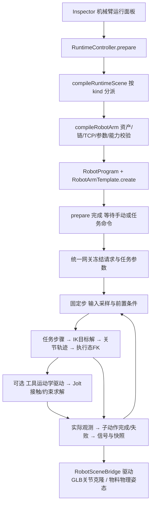

# 005 robot_UR10 建模与机械臂运行脚本

日期：2026-10-30。项目根目录：`E:/project/AgenticComponents/apps`。

本文保留本轮开发设计与验收目标，实际实现及范围见第19章。已有直线输送实验继续作为回归基线。

## 1. 目标与实施范围

以 `public/modles/robot_UR10/robot_UR10.glb` 为首个真实机械臂模型，建立符合参数契约与接口行为契约的 DeviceSpec，接入统一模板管理和会话时钟，完成关节运动、TCP 定位、任务执行及抓放物料的分阶段验证。

采用“通用机械臂模板 + 模型校准配置 + 可替换运动学求解器”的方式。robot_UR10 的节点、静止变换、轴和 TCP 放在 schema；通用行为放在 TypeScript 模板；特殊模型可注册另一个模板工厂。schema 不嵌入可执行 JavaScript，也不根据模型名字动态执行脚本路径。

本轮最终闭环为一台机械臂搬运一个已声明动态刚体的物料，到一个明确配置的支承面。先完成不带物料的关节/FK/IK 预览，再开放物理抓放。首版只实现有明确限位的六轴串联旋转关节、位置 IK、关节空间点到点运动和已验证的实验路径。不宣称支持直线 TCP 轨迹、姿态 IK、动力学力矩控制、自动避障或多设备调度。

## 2. 依据与现状

| 依据 | 用途 |
| --- | --- |
| `test1/docs/参数契约.md` 第 4 类 robot_arm | 参数、关节拓扑、节点映射、TCP、IK 和轨迹配置 |
| `test1/docs/schema.md` 第 4 类机械臂及通用任务协议 | 信号、行为 ID、前置/持续条件与完成判据 |
| `test1/docs/设备契约.md` | interfaces 仅空间连接、signal_ports 独立、状态不进入静态定义 |
| `test1/docs/scene1/device_specs/robot_arm_1.json` | 历史结构参考，不直接复制旧节点和数值 |
| `E:/project/agent/frontend/lib/ik/{IKChain,IKSolver,ccdIKSolver,buildFromConfig}.ts` | 既有 Agent 运动学迁移候选；迁入前逐项适配和测试 |
| apps 的 `RuntimeKernel`、`ConveyorTemplate`、Jolt 后端 | 已有会话、固定步长、模板注册、物理和快照基础 |

当前 `robot.articulated` 只在 `reservedTemplates.ts` 中预留。`CompiledRuntimeScene`、`DeviceObservation`、`PhysicsPort`、`SignalRegistry`、`ActionGateway`、`RuntimeController.prepare()` 均带有输送实验专用语义：必须选物料、默认写 runTag/speedTag、观察出口、到达后停带。增加一个 RobotTemplate 文件并不足以接入机械臂，必须同时收敛这些边界。

已有 Agent CCD 实现接收位置目标，求解时会操作 Object3D，并有直接写 GLB 的分支；IKChain 在未给限位时会采用默认范围。新运行器不能原样依赖这些副作用或默认值：求解器须返回明确结果，所有限位由校准配置提供，只有渲染桥可以写实例克隆节点。

## 3. robot_UR10 资产检查结果

检查对象为当前文件字节及 GLB JSON，未修改模型：

- 大小：3,728,844 bytes。
- SHA-256：`75b9d773c59f477fcf3667ecd3f54e8c96fc3fa964b5e89a0ca6cce04215ea5a`。
- 48 个源节点、25 个 mesh、0 个 animation、0 个 skin。动作需要驱动节点层级，不能播放现成动画片段。
- 根节点：`robot(UR10)(1)(center)`，源节点索引 0。
- 根矩阵包含约 0.01 的均匀缩放和约 +π/2 的 Y 旋转，不能在 import_transform 中再次重复换算。
- `Link1_001n`，索引 6，位于基座/支架层，其源局部 Y 位移为 50，根缩放后对应约 0.5 m；不能因为名字含 Link1 就认作第一运动关节。

实际候选运动链如下。节点与层级已经从文件确认；“轴候选”来自旧模型结构参考，尚不是校准结论。

| 逻辑关节 | 当前 GLB nodeName | 源索引 | 轴候选（joint_local） | 逻辑父关节 |
| --- | --- | --- | --- | --- |
| joint_1 | `Link1_003n` | 14 | +Y，待核验 | null |
| joint_2 | `Link2_004n` | 18 | +Z，待核验 | joint_1 |
| joint_3 | `Link3_005n` | 26 | +Z，待核验 | joint_2 |
| joint_4 | `Link4_006n` | 33 | +Z，待核验 | joint_3 |
| joint_5 | `Link5_007n` | 37 | +X，待核验 | joint_4 |
| joint_6 | `Link6_008n` | 41 | +Y，待核验 | joint_5 |

末端存在 `mountplate_009n`，索引 45，可作为法兰参考候选；其子节点 46 没有 mesh。它不是已建模夹具或已校准抓取点。旧定义中的 `UR10_00Hn`、`Link1_00In`～`Link6_00Nn` 与本资产不匹配，旧 TCP `[0,0,0.8]` 也不得照搬。节点索引用于资产检查与消歧，运行绑定以校验后的稳定节点路径/名称和资产哈希为准。

## 4. 校准门控与数据来源

先新增 `robot_UR10/schema.json` 展示草稿，再逐项开放能力。结构合法、运动学可运行、物理抓放可运行分开判断。

| 项目 | 获取方式 | 未完成时处理 |
| --- | --- | --- |
| 节点唯一性、父链、完整静止变换 | 解析当前 GLB；保留中间固定节点 | 阻止运动编译 |
| 关节转轴、正方向、旋转中心 | 局部坐标轴可视化与单关节小角度扰动核验 | 草稿可查看；仅允许明确标识的校准预览，不能执行工艺任务 |
| q=0 含义、关节限位 | 校准记录或明确的仿真关节范围 | 不用旧示例或厂商名称推断数值 |
| 法兰、TCP、工具偏移 | 显示坐标标记并验证 FK；安装夹具后重新标定 | 可选虚拟法兰探针只用于预览，禁止宣称可抓取 |
| 速度、加速度、载荷 | 用户资料或有记录的仿真实验配置 | 软件示例值须标来源；不宣称真实 UR10 参数 |
| 夹具代理、抓取容差、接触/重叠策略 | 显式虚拟工具配置及场景标定 | 禁用 grip/release/pick_and_place |
| 机械臂连杆碰撞代理 | 手工或离线生成并逐段对齐验证 | 不宣称有全臂碰撞或自动避障 |

校准状态存于类型专属 `calibration`，按 kinematics、tooling、grasp_physics 分项记录，附资产哈希与来源。运行器检查完成项，不能仅凭一个 `calibrated: true` 字段跳过节点和数值验证。资产字节变化后重新检查绑定，已保存项目不静默升级到新配置。

## 5. 设备 schema 的字段组织

目标文件为 `apps/public/modles/robot_UR10/schema.json`，首个定义版本建议 `0.1.0`。拟以契约 `1.4` 记录机械臂强类型扩展；先更新校验器再发布目录，不改变已有 1.1/1.2/1.3 解释。导入接受待校准草稿，运行前严格门控。

| 字段 | robot_UR10 内容 |
| --- | --- |
| schema_id / device_spec_id | 同一稳定 ID，例如 `robot_UR10` |
| schema_type / device_type | `DeviceSpec` / `robot_arm` |
| asset | 相对路径 `robot_UR10.glb`、实际根节点、哈希；外层导入变换初始为单位变换 |
| params_schema | 第 6 节选用的参数；配置默认值与实例覆盖分开 |
| interfaces | 首版可为空；安装吸附点核验后再补，不从包围框随意编造 |
| signal_ports | 第 8 节中的实际受支持信号，独立于空间接口 |
| transport_behaviors | 保留兼容字段名，记录第 9 节逐行为契约 |
| type_specific_contract | 坐标、链、静止变换、轴、限位、TCP、工具、IK 和运动配置 |
| runtime_contract | 观测、授权、错误策略及未知条件阻塞策略 |
| runtime_execution_contract | 模板引用、支持能力、请求/任务协议、控制来源和校准门控 |

`runtime_execution_contract.template_ref` 拟为 `robot.articulated@1`。行为先标记 `pending_adapter`；对应执行器、校准与验收全部完成后，才逐项改为 `implemented`。声明了行为名称不等于已经实现。

## 6. params_schema 参数选择

沿用已有机械臂参数契约，不把实时关节角、当前任务或目标坐标写成设备默认参数。

| 参数 | 单位 | 本轮用途/条件 | 修改时机 |
| --- | --- | --- | --- |
| joint_speed_rad_s | rad/s | 所有运动必需，作为各关节的默认速度上限 | stopped_only |
| joint_accel_rad_s2 | rad/s² | 所有运动必需，作为默认加速度上限 | stopped_only |
| settle_speed_rad_s | rad/s | 完成动作及受控保持的关节速度阈值 | stopped_only |
| ik_position_tolerance_m | m | move_to_pose 必需，使用真实 TCP 误差 | stopped_only |
| ik_max_iterations | integer | IK 的迭代预算，不用于定义动画时长 | stopped_only |
| ik_mode | enum | 首版只接受 position_only；pose 明确拒绝 | stopped_only |
| max_payload_kg | kg | grip/pick_and_place 必需；无实测资料时无默认真实额定值 | stopped_only |
| lift_height | m | 抓放路径生成所需默认抬升高度，沿明确的场景上方向 | stopped_only |
| cartesian_speed_mps | m/s | 为未来笛卡尔轨迹预留；首版不启用，不作为关节 PTP 速度输入 | runtime_setpoint（启用该能力后） |
| orientation_tolerance_rad | rad | 仅未来 pose 模式必需；位置模式不假称姿态收敛 | stopped_only |

关节速度/加速度上限可由各关节更严格的声明收紧，实际取较小值。关节范围写在关节结构里，不设无来源的统一 ±π。若增设 settle 的位置阈值、抓取容差等标定参数，须先补入参数契约或作为工具/执行器标定配置，不隐式加入基础必填参数。

## 7. type_specific_contract 运动学范式

保持已有 `urdf` 命名兼容，`format: project_urdf_like` 明确它是项目内部格式，不是完整 URDF 文件。关键结构为：

```text
coordinate_system
  up_axis=Y, length_unit=m, joint_angle_unit=rad
  asset_root_transform_source=glb
calibration
  asset_sha256, kinematics/tooling/grasp_physics 的状态与来源
rootNodeName
urdf
  format, structure_mode=serial, rest_transform_source=glb_calibrated
  joints[]
    name, nodeName（必要时 node_path）, parent_joint, type=revolute
    axis, axis_frame=joint_local
    limit.lower/upper, zero_reference=asset_rest
    velocity_limit_param, acceleration_limit_param
tooling
  flange_node_name, tcp_node_name, tcp_local_frame（相对 tcp_node_name）
  calibration_required
trajectoryConfig
  motion_mode=joint_ptp
  joint_speed_param, joint_acceleration_param, lift_height_param
ik
  solver=ccd_position, mode_param, position_tolerance_param
  max_iterations_param, completion_requires_convergence=true
gripper（启用抓放才必需）
  type=virtual_fixed_grasp, supported_material_classes, max_payload_param
  calibrated_capture_region, constraint_policy
workspace（可选）
  coarse_candidate_filter，不能据此认定可达或无碰撞
```

首版以资产静止姿态为 q=0，角度是相对该姿态的增量，不宣称等于实机编码器角。关节轴定义在节点静止局部坐标系，建议统一采用：

```text
M_node(q) = M_rest_node × R(axis_local, q)
M_TCP_world = M_instance × M_import × M_asset_root × … × M_TCP_local
```

GLB 的中间固定节点、根缩放、支架偏移和关节间非零旋转都必须参与父链相乘。运行运动学数据在编译时统一为米；渲染侧保留源 GLB 层级和原始平移单位，只应用对应关节旋转增量，不能把转换后的米制平移再写回带 0.01 根缩放的源节点。FK 与渲染必须得到同一个 TCP 世界位姿。

默认禁止外层非单位/非均匀实例缩放；资产内已知的 0.01 变换由机械臂编译器显式处理，不用现有盒刚体编译器忽略它。节点路径、父链和变换由编译器检查，缺失/重复/剪切等不支持情况给出诊断。

## 8. 信号、命令与任务数据

信号均以设备为参照；所有设备实例的端口按 `instanceId + portId` 隔离。

| 方向 | 信号 | 首版语义 |
| --- | --- | --- |
| in | commandTag: INT | 选择实验任务表中的任务编号；任务表不是设备固有几何 |
| in | start_pick: BOOL、request_id: DINT | 唯一 execute 入口；保持到 accepted，再撤销；新请求必须有新标识 |
| in | enableTag: BOOL | 在途运动许可；失能受控减速保持，恢复继续原阶段 |
| in | pause_pick: BOOL | 持续禁止接受新抓取任务，不自动停止已有任务 |
| in | reset: BOOL | 故障原因解除且可复位时清错，不擅自清除持有物料 |
| in | gripperTag: BOOL | 仅显式手动工具模式开放；任务模式不能同时写夹具 |
| in | in1Tag～in4Tag: BOOL | 选用 wait_signal 时按任务实际需要开放 |
| out | accepted/busy/done/error: BOOL | accepted 保持至 execute 撤销；busy 覆盖保持阶段；done/error 对应本次任务并锁存至下次接受 |
| out | result_id: DINT、error_code: INT | 结果关联和故障编码，范围与映射明确 |
| out | holding_material: BOOL | 来自持有注册/物理约束观测，不复制 gripperTag |
| out | out1Tag～out4Tag: BOOL | 按任务实际需要开放；声明跨步骤保持、任务开始/复位时清除规则 |

`resume_pick` 兼容事件可由控制适配器转为同一个暂停状态的更新，首版不再开放第二个竞争写入口。API 和未来 PLC 必须走同一命令网关，每个实例只允许一个活动控制来源。

手动预览使用强类型 RobotCommand，不把目标向量/关节数组塞入 REAL。命令至少含 requestId、instanceId、behaviorId 和带类型的 payload：MoveJ 的 jointTargets、move_to_pose 的目标位置与 frame、抓放的 materialInstanceId/取放目标/支承面引用。任务参数在接受时冻结，重复 requestId 不再执行。

现有 `ParameterSpec` 只表达标量，`arguments_schema` 无法直接验证 Pose/数组。实施时为机器人请求新增独立 Zod 联合校验器，并让契约的 `payload_contract_ref` 引用它；不为此把所有设备参数改成任意 JSON。commandTag 选择的实验任务表在 session 编译时冻结，场景目标可用显式 frame=world 或 robot_base；不得猜测坐标系。

SignalRegistry 改为按声明注册端口，检查 BOOL/有限 REAL/INT/DINT 的范围和写权限，保留 valid/tick/writer。未接入的外部信号/授权为 unknown，阻塞相关动作，不能默认 true。

## 9. 行为与逐行为执行契约

以下为唯一行为清单，schema 与模板从此逐项对应。内部 MoveJ 是 move_to_pose 和关节预览的执行机制，不额外冒充生产调度任务。

| behavior_id | 类型 | 前置/持续条件 | 完成依据/阶段 |
| --- | --- | --- | --- |
| execute_job | composite | 任务存在、参数完整、空闲、请求唯一、具备本任务所需能力/授权 | 所有必需子步骤成功；结果关联当前请求 |
| pick_and_place | composite | 指定物料存在、归属/源许可有效、夹具为空、目标支承与容量预留有效、路径预检查通过 | grip、转运、release 及后退全部完成，物料交接已确认 |
| move_to_pose | action | 目标 frame 明确、IK 收敛、关节限位有效、enableTag 有效；几何预检查通过不等于自动避障 | 执行态 FK 的 TCP 误差和关节速度满足阈值；位置模式不判断未支持的姿态 |
| grip | action | 工具已校准、夹具为空、物料身份/质量/兼容性/许可有效、进入捕获区域、相对运动满足抓取标定 | 持有事务提交、固定约束存在且约束误差满足标定；holding_material=true |
| release | action | 持有指定物料、目标已预留、实际释放位姿满足条件 | 约束撤销、物料获得目标有效支承且位置/速度满足交接判据，归属提交 |
| wait_time | action | 非负有效时长，等待计时策略明确 | 仿真累计时间达到要求；会话暂停或失能保持不累计 |
| wait_signal | action | 端口已声明、类型和值合法；配置仿真时间超时 | 有效信号满足期望；超时为失败而非成功 |
| set_output | action | 输出已声明、值合法、本任务有写权 | 输出提交；按端口保持/清除规则反馈 |
| pause_pick_intake | action/control | 接单模式有效 | 新抓取请求被阻塞；在途任务继续 |
| resume_pick_intake | action/control | 暂停许可解除、无冲突、无阻断故障 | 允许新请求，不重放旧任务 |
| hold_motion | action/control | 当前任务有效、轨迹具备减速保持实现 | 各关节速度低于阈值后进入 holding；busy 保持，工件与资源继续持有 |
| resume_motion | action/control | enableTag 恢复、原任务/授权有效、故障解除 | 从当前实际 q 重新规划剩余运动，不重复 grip/release |
| publish_robot_state | observer | 运行实例、运动学和所需物理观测有效 | 每步发布 q/qdot/TCP/阶段/握手/持有观测，没有一次性 done |

动作条件不全都能用当前 `key equals value` 表达，例如 payload_mass<=max_payload、TCP 距离和指定物料身份。比较与几何检查由编译器、机器人模板和持有服务执行，产出有来源的布尔观测供契约引用；不把自然语言说明或字符串表达式当已执行校验，不引入 eval。

## 10. 运行脚本与求解器的边界

| 模块 | 职责 | 输入与输出 |
| --- | --- | --- |
| RobotArmTemplate | 各实例脚本工厂；动作状态机、使能/保持、任务步骤与反馈 | 编译配置和上下文 → 独立 RobotState；不持有 DOM/React 对象 |
| RobotJobRunner | 解释有类型的 Move/Grip/Release/Wait/Set 实验任务；只推进已满足条件的步骤 | 冻结任务、观测 → 当前子动作/终态 |
| RobotKinematics | 唯一 FK，实现静止链与 TCP 变换 | 校准链、q → 节点/TCP 位姿 |
| PositionIK | 有限迭代、有界关节、位置求解；首版采用经适配的 CCD | target、seed q → qTarget、converged、误差、迭代数与失败原因 |
| JointTrajectory | 有速度/加速度上限的同步关节 PTP、受控保持和恢复 | q/qdot、目标、上限、dt → 下一执行态 q/qdot |
| GraspService | 物料占有事务、工具/物料约束、交接确认 | 工具/物料/目标引用、物理观测 → holding/transfer 状态 |
| RuntimeKernel/Session/Clock | 生命周期、命令采样、固定步长、调用顺序、快照与资源释放 | 不解释机器人每一步工艺，也不计算专用 IK |
| Jolt 后端 | 运动学工具位姿更新、约束、动态物料运动与接触反馈 | 世界位姿/约束请求 → 物理状态，不负责工艺步骤规划 |
| RobotSceneBridge | 把执行态关节角投影到该实例 GLB 克隆节点，显示 TCP/目标 | 快照 → 本实例渲染变换；不参与求解或任务完成判定 |

IK 只求目标关节解，不在每帧直接跳到 qTarget。先生成满足关节速度/加速度限制的轨迹，再逐步推进执行态；实际 TCP 来自执行态 FK。首版 Move 是关节 PTP，其 TCP 轨迹通常不是直线，不能把 cartesian_speed_mps 当成已保证的末端速度。

旧 Agent 求解器可迁入数学部分，但要移除共享渲染状态副作用、隐式限位和无结果的 solve；修正 maxIterations 的边界，返回明确收敛状态，并把完整 TCP 偏移加入误差计算。距离误差统一在米制计算坐标中评估，不能沿用带缩放 endEffector.worldToLocal 后的长度当作世界米误差。每个机器人实例独立 seed/缓存，不能让两个实例共享一个正在修改的链。

## 11. 引擎扩展方式

1. `CompiledRuntimeScene` 改为按 kind 区分的类型联合：conveyor_experiment、robot_experiment。机器人配置不伪造 entry/exit/materialSize 等输送字段；无物料的运动预览也合法。
2. 提取 `RuntimeProgram` 接口，由 ConveyorProgram 和 RobotProgram 分别拥有设备脚本、观测器、请求状态与快照扩展。Kernel 只调用 beginTick → beforePhysics → physics.step（如有）→ afterPhysics → snapshot；一个会话只有一个时钟、一个物理世界、每步只积分一次。
3. 保留 `DeviceTemplateRegistry` 的工厂职责，用带 kind 的编译配置与上下文区分 ConveyorTemplate/RobotArmTemplate；模板与能力不匹配时拒绝注册/创建，避免 any 或强制断言吞掉错误。
4. 把 Kernel 当前的出口观测和到达后 runTag=false 策略迁入 ConveyorProgram；不能让机器人遇到任意成功结果也触发停带命令。
5. 提取通用 RequestLedger，处理去重、接受、结果锁存、超时、取消；当前运输专用 ActionGateway 通过 ConveyorProgram 使用它，机器人以实际任务执行结果结束请求，不调用运输 observe(support,exit)。
6. 运动学预览由 RobotProgram 推进 q 并测量 FK，不必创建一个假的 Jolt 箱体。启用抓放后才创建同一会话的物理世界。可选物理后端不是把缺失的物理反馈标为有效。
7. RuntimeController 按设备/实验类型 prepare；手动按钮通过 submitAction 发命令。自动启动输送观察任务的逻辑进入输送程序，机械臂准备后默认 idle 等待命令。
8. 快照使用 devices[instanceId]、bodies[bodyId]、requests[requestId] 等有类型记录；机器人包含 q/qdot、TCP 世界位姿、误差、求解状态、阶段和持有 ID。现有输送 UI 通过明确兼容投影读取旧字段，逐步迁移，不能同步维护两份会漂移的状态。

RuntimeProgram 是实验执行策略，DeviceTemplate 是单设备脚本工厂，PhysicsPort 是物理能力接口，三者不合并为一个万能工具。求解/变换数学可放 mechanisms/kinematics；会话与引擎是有状态服务，不适合全部移入 utils。

## 12. 物理抓放与运行所有权

现有 JoltBackend 明确拒绝 kinematic；抓放开放前必须单独验证新增接口，不能只把 schema 的枚举改为 kinematic 就声称支持。

首版拟采用显式标注的 `virtual_fixed_grasp`：基座 static，工具代理 kinematic，物料始终保持 dynamic；捕获通过后在工具与物料之间建立固定约束。每步先根据 FK 给出工具下一位姿及 dt，再推进 Jolt，读取物料实际结果和约束误差。具体 Jolt 调用以本地安装版本的 API/类型和探针验证为准。

抓取不瞬移物料到 TCP。约束以当前工具/物料相对变换建立；物料必须已在经校准的捕获区域内。工具碰撞和被抓物料间必要的过滤按配对登记，其他碰撞仍正常；不设置全局“被抓物料不碰撞”。这是虚拟刚性抓取近似，不证明夹爪指尖闭合、吸盘气路或真实夹持力。

释放时撤销约束，保留物理求解得到的线/角速度；物料继续受重力和接触作用。只有确认目标支承、放置容差及速度判据后，才提交归属/占用并完成 release。目标未接住时继续观察或超时失败，不能在 gripperTag=false 的同一步直接宣布完成。首版位置 IK 不保证工具姿态；抓取/放置仍要检查实际姿态是否落入工具允许范围。仅选用能通过该检查的预标定实验目标，其他目标拒绝执行，不能忽略姿态条件。

`RunOwnership` 负责本次运行拥有的实例与写入者；新增持有记录负责 materialInstanceId → owner/tool/task。二者不能混为一份“资源已授权”字段。资源授权来自场景/上层服务；实验可以显式提供本地单任务许可，不默认为所有设备争用均获准。

本轮只在显式声明的工具与环境代理范围内处理碰撞。未标定全臂连杆代理时界面提示实验范围，不宣称避障。抓放物理世界包含机械臂工具、指定物料、选定的目标支承和地面；如果目标为 Conveyor_aankws，应复用其已声明承载体，明确该实验中它是否静止。同步输送与机器人协作不默认包含在单臂首验中。

会话暂停冻结整个世界。enableTag 失能是机器人受控减速保持，物理世界继续，持有关系保留。停止/重置销毁约束和运行世界，恢复作者模型与物料基线；它是仿真会话结束，不制造成功放置结果，也不修改保存的作者文档。

## 13. 启动链路与每步数据流



无物理预览跳过 Jolt 分支。渲染不再次求解 IK，不根据 wall time 再推进运动；两次 rAF 之间仍按现有固定 1/60 s 逻辑步运行。计算预算包括每次 IK 迭代数、任务预检查节点数与每帧最大步数；预算耗尽给出可识别失败，不无限循环。

抓放步骤建议为 approach_pick → descend_pick → grip → lift → transfer → descend_place → release/confirm → retreat。开始前对全部目标做可达性预检查，执行时每步仍检查实际状态和有效授权；预检查不宣称整条路径无碰撞。保持后从当前 q/qdot 重新规划剩余阶段，不重复已经提交的持有或交接事务。

## 14. 文件架构与模块注释

以下路径相对 apps。除表中明确标为已有的模块，其余均是拟新增文件。

```text
public/modles/robot_UR10/
  robot_UR10.glb                        # 已有，保持原始资产
  schema.json                          # 模型参数、真实节点链、TCP、行为/信号和门控
  README.md                            # 校准记录、参数来源、虚拟工具与能力范围
scripts/
  inspect-robot-model.mjs               # 离线提取层级、矩阵、候选关节和资产哈希
src/contracts/
  robot.ts                             # 强类型 robot 类型专属契约和校验
  robot-command.ts                     # MoveJ/MoveToPose/Job/Grip 等命令载荷与结果
  runtime-program.ts                   # 实验程序生命周期，不含设备专用算法
  device-template.ts                   # 已有，扩展模板配置/能力上下文
  runtime.ts                           # 已有，按 kind 的编译配置与设备快照
  physics.ts                           # 已有，补工具运动学、约束和角速度反馈
src/domain/runtime/
  compileRobotArm.ts                   # schema→米制串联链、参数和能力门控
  compileRobotExperiment.ts            # 组合任务、物料、目标支承与物理描述
  compileRuntimeScene.ts               # 已有，按实验类型分派，不再默认必须有物料
src/runtime/programs/
  RuntimeProgramFactory.ts             # 为当前实验创建正确的执行策略
  ConveyorProgram.ts                   # 提取现有输送观测及到达停带策略
  RobotProgram.ts                      # 单臂程序、机械臂观测与命令入口
src/runtime/templates/robot/
  RobotArmTemplate.ts                  # 通用机械臂脚本工厂，使用编译参数
  RobotState.ts                        # 每实例 q/qdot、任务阶段、保持与故障状态
  RobotJobRunner.ts                    # 有类型任务步骤的解释执行与阶段推进
src/runtime/kinematics/
  RobotKinematics.ts                   # 唯一 FK，完整父链与 TCP 变换
  PositionIK.ts                        # 无渲染副作用的求解器端口与收敛结果
  CcdPositionIK.ts                     # 从 Agent 方案适配的位置 CCD 实现
src/runtime/mechanisms/
  JointTrajectory.ts                   # 同步关节轨迹、速度/加速度限制、保持恢复
src/runtime/engine/
  RuntimeKernel.ts                     # 已有，调用 RuntimeProgram、固定步与快照
  RequestLedger.ts                     # 请求去重、接受、结果关联、锁存与取消
  SignalRegistry.ts                    # 已有，改为实例/端口注册与类型/写权校验
  ActionGateway.ts                     # 已有，收敛运输专属逻辑，复用 RequestLedger
  RunOwnership.ts                      # 已有，运行对象与写权限；不替代工艺授权
src/runtime/services/
  GraspService.ts                      # 持有/释放事务、约束引用及交接确认
src/runtime/physics/jolt/
  KinematicToolDriver.ts               # 工具目标世界位姿、速度与 Jolt 更新
  GraspConstraints.ts                  # 固定约束和成对碰撞过滤的创建/回收
  JoltPhysicsBackend.ts                # 已有，增加上述能力并保留输送路径
  BodyRegistry.ts                      # 已有，扩展 tool/base 等角色与物体映射
src/renderer/
  RobotSceneBridge.tsx                 # 运行关节角→实例克隆局部旋转，停止时恢复
  RobotDebugOverlay.tsx                # 关节轴、法兰/TCP、目标与求解误差可视化
  SceneCanvas.tsx                      # 已有，将机器人桥挂到实际 ImportedModel 实例
src/features/runtime/
  RobotSimulationPanel.tsx             # 校准诊断、关节目标、TCP目标与任务启动
  RobotStatePanel.tsx                  # 实际 q/qdot/TCP、阶段、误差、握手和持有状态
src/data/runtime-fixtures/
  robot-ur10-calibration.json          # 已核验的数据/来源；不充当第二份设备定义
  robot-ur10-joint-preview.json        # 确定性关节预览命令与期望值
  robot-ur10-pick-place.json           # 实验任务表、坐标系、物料和支承引用
tests/
  robot-contract.test.ts              # 字段、节点/链/单位/能力与草稿门控
  robot-kinematics.test.ts            # FK、CCD、TCP、根变换和实例变换
  robot-runtime.test.ts               # 握手、任务、保持、速度约束和实例隔离
  robot-grasp.test.ts                 # 真实 Jolt 的约束、释放、支承与资源回收
e2e/
  robot-runtime.spec.ts               # 真实 GLB 运行、状态展示和作者文档不变
```

注册与目录还需修改 `registerTemplates.ts`、`reservedTemplates.ts`、`DeviceTemplateRegistry.ts`、`normalizeUnifiedDevice.ts`、`normalizeDeviceSpec.ts`、`runtimeCapabilities.ts`、`validation/contracts.ts`、`RuntimeController.ts`、`SimulationSession.ts`、`RuntimeSnapshot.ts`、`ModelRepository.ts` 及 Inspector/运行面板入口。ModelRepository 仅在需要提供离线节点描述时扩展；几何缓存与实例克隆策略继续复用。

`public/modles/index.json` 由 `npm run catalog:models` 生成，不手工维护。新机器人 schema 同现有定义一样随项目保存完整快照；校准 fixture 只保存验收输入/期望及来源，运行仍只读当前项目采用的 schema，避免两个定义源竞争。

## 15. 文档与契约同步范围

| 文件 | 计划修改 |
| --- | --- |
| `test1/docs/参数契约.md` | 补关节零点、完整静止链、单位转换、joint_ptp 与位置 IK 能力条件；已有参数不随意重命名 |
| `test1/docs/设备契约.md` | 记录 1.4 机器人扩展、校准分项、命令载荷引用、草稿与运行门控 |
| `test1/docs/schema.md` | 保持本次逐行为语义与执行器一致，明确位置模式和虚拟夹持的支持范围 |
| `test1/docs/parameter_contract_examples.json`、`apps/src/data/parameter-examples.json` | 同步机器人范式，保留其他七类设备，校验两份内容一致 |
| `apps/docs/动画接入指南.md` | 补单一时钟、RobotSceneBridge、关节快照及物料所有权 |
| `apps/docs/development-plans/README.md` | 登记本方案；实施后另记真实完成项，不提前标完成 |

本次只新增本方案并更新索引；上述契约与代码在实施阶段一起修改和验证。

## 16. 实施顺序与阶段门槛

| 阶段 | 交付 | 开放能力 |
| --- | --- | --- |
| P0 资产与校准 | 源节点检查工具、草稿 schema、关节轴/TCP 标记、小角度核验；记录全部待确认值 | 可查看模型与诊断，不执行未校准工艺动作 |
| P1 关节运行 | 类型契约、FK、关节轨迹、RobotProgram/Template、渲染恢复 | 经校准的单关节/多关节 PTP 预览 |
| P2 位置与任务 | CCD 结果、请求协议、Move/Wait/Set、保持/恢复、任务面板 | 空载位置目标和可验证预定义任务；grip/release 仍禁用 |
| P3 物理抓放 | 先验证 Jolt 运动学工具/固定约束，再接物料与支承、持有事务 | 已标定虚拟工具对指定物料的单次抓放 |
| P4 综合验收 | 回归输送、实例隔离、保存恢复、错误路径与文档同步 | 发布本轮实际支持的 schema/模板版本 |

P0 数据不全不阻止实现通用代码和测试，但阻止将对应 robot_UR10 能力标为可执行。工具参数可以选择有明确来源的实验配置；需要用户资料的额定值保留未知，不因节点存在而推定。

## 17. 验收标准

### 17.1 建模与运动学

- 实际源节点完整匹配，无重复关节和拓扑环；中间固定节点、0.01 根缩放及根旋转只计算一次。
- q=0 的 FK 与 GLB 静止 TCP 在同一世界坐标下吻合；实例平移/绕 Y 旋转后仍吻合。
- 逐关节 ±小角度核验旋转中心、正方向及下游传播；第二个机器人实例不随之改变。
- 实际工具偏移进入 FK 和 IK；不能用最后关节原点误当 TCP。
- 已知可达目标返回 converged；不可达、越限、非法数值和迭代耗尽给出失败；pose 模式明确拒绝。
- 逐逻辑步检查关节速度和有限差分加速度上限；动画时间走完但实际误差不满足时不能 done。

### 17.2 行为与生命周期

- 同一 requestId 不重复启动；接受后修改 UI 参数不改变当前冻结任务；done/result_id 只关联已接受任务。
- pause_pick 只阻止新抓取；enableTag 失能受控保持并保留 busy、物料及资源；恢复不重复抓放。
- wait_signal 的缺失/无效输入阻塞，超时失败；wait_time 只累计有效仿真时间。
- 停止、重置、切项目、异步准备取消和初始化失败均回收资源并解锁；不会残留第二个时钟或 GLB 写入者。
- 启动前与停止/重置后的 ProjectDocument 导出相等，运行关节角与物料位姿不写回作者文档。

### 17.3 物理抓放

- 超距、超载、未知质量/授权、物料已被占有、空夹具不兼容等均不能建立约束。
- grip 完成来自有效持有/约束状态，不能直接由夹具命令得到；建立约束不瞬移物料。
- 工具固定后移动能够带动物料；释放后物料保留合理速度并由 Jolt 接触/重力继续求解。
- release 只有在指定目标确认支承、位置和速度判据满足时成功，落地到错误对象不算成功交接。
- 约束/碰撞过滤销毁后可重新抓取；停止时不泄漏约束、刚体或物料持有记录。

### 17.4 集成验证

新增模型运行的单元测试与真实 Jolt 探针，验证实际 GLB 的单臂运动/抓放浏览器流程；继续运行已有输送实验回归、类型检查、lint、生产构建和 `git diff --check`。浏览器截图同时显示实际 robot_UR10、TCP/阶段与指定物料；截图不能替代数值误差、速度限制及握手检查。

## 18. 待确认项与交付判断

当前确认了源资产、节点层级和根变换。尚待校准：六轴方向/正号、各轴仿真或真实限位、目标 TCP、工具捕获区/代理、允许载荷与运动上限、实验取放目标和支承引用。

首个验收应先完成 P1 关节运动及 P2 空载定位，再用明确的虚拟工具实验配置完成 P3 抓放。若夹具或轴参数尚未校准，交付中明确显示待校准/未支持，不能以“脚本运行结束”替代设备行为实际完成。

## 19. 实施与支持范围

已建立 robot_UR10 0.1.0 / 契约1.4。源GLB未改写；六轴真实节点和完整静止矩阵提取为米制串联链，源根缩放/旋转与TCP只应用一次。准备时校验资产哈希、节点、源静止旋转、轴心及FK零点。轴与±π限位、运动上限、5kg允许载荷为明确的实验配置，状态simulation_configured，不宣称实机校准。

RobotArmTemplate经DeviceTemplateRegistry登记；RobotProgram、RobotJobRunner、RobotKinematics、CcdPositionIK和JointTrajectory承接请求、任务、求解与执行。RuntimeKernel组合ConveyorProgram/RobotProgram，出口观察与到达停带不再进入机械臂路径。信号按单会话实例注册、校验类型/方向及INT/DINT范围；原输送握手行为保留。现有CompiledRuntimeScene名称保留为输送配置兼容类型，RuntimeScene是实验联合类型；现有快照字段继续作为单实例会话投影，尚未实现多设备快照/调度。

支持位置IK、受速度/加速度限制的同步关节PTP、Wait/Set任务、缺失信号阻塞、请求去重、减速保持与恢复。当前网关负责手动请求握手，commandTag任务表的PLC投影预留，不能直接写信号启动PLC任务；不提供手动gripperTag第二写入口。复杂条件由类型执行器验证，schema记录各行为的前置/完成观测，未加入通用条件表达式解释器。

物理实现采用Kinematic工具+Dynamic物料固定约束，没有采用接口附着。固定约束以抓取时相对位姿创建；工具/持有物料的碰撞过滤按配对生效，释放恢复。实际物料姿态来自Jolt并用逆刚体绑定恢复GLB根；物理世界单会话独占指定物料、目标静态支承和地面，不创建全臂刚体。抓取成立后等待约束反馈，释放后等待指定支承、位置/速度与外形适配。携物阶段按抓取偏移求解物料中心，并按旋转外形计算释放高度，避免只规划TCP使物料穿入目标承载面。

工具为虚拟球形捕获，显式接受所有朝向，不模拟实体夹爪闭合/吸盘或夹持力。position_only不保证朝向；姿态受限的真实工具必须后续标定并补相应求解能力才能启用。没有自动避障、全臂碰撞、任意分支链、同步输送协作或真实力矩控制。

界面接入实际robot_UR10资产、关节/TCP目标、空载任务、保持恢复、物料/支承选择和固定约束抓放。RobotSceneBridge驱动实例克隆节点并恢复源姿态，RobotDebugOverlay显示TCP坐标系。运行与重置不写回作者文档；用户先手动摆放物料并填写质量。示例布局见模型README和robot-ur10-pick-place.json。

最终验证：90项单元测试、9个Edge浏览器流程、类型检查、lint、生产构建和git diff --check通过。浏览器覆盖实际GLB关节运动、受控保持/恢复、TCP定位、空载任务、engine_block固定约束抓放及作者文档不变；已有资产/吸附/输送流程全部回归。截图：test-results/robot-runtime.png、test-results/robot-grasp.png。两份参数范式JSON语义一致，保留八类设备。
