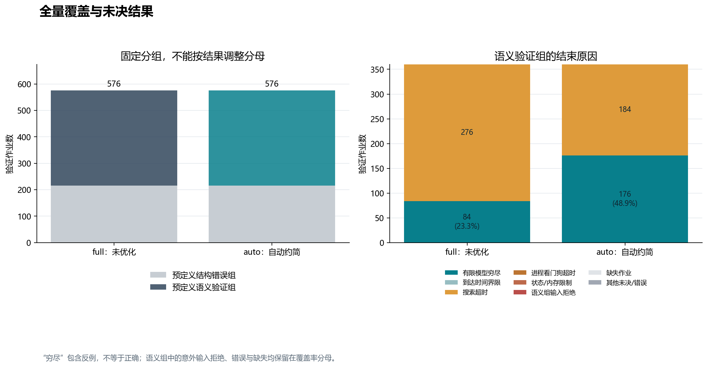
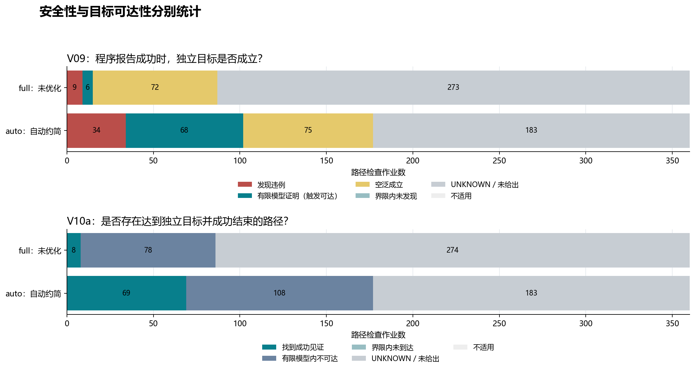
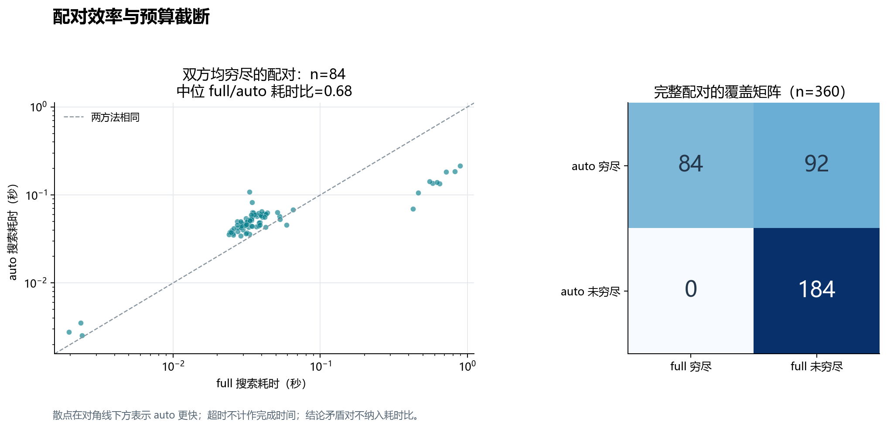
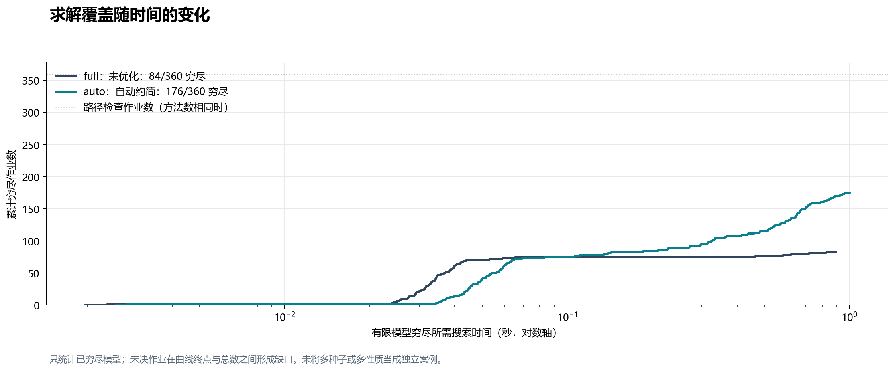
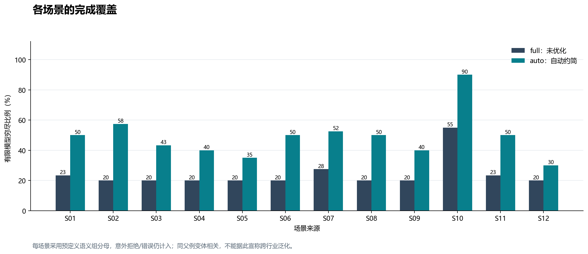
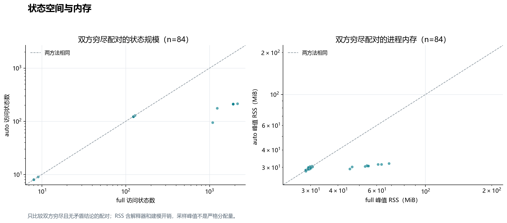

# 方法一全量 full / auto 对比

主图环境：`nominal`。时间界限：[3000] tick；搜索预算：[1] 秒/作业。计数以实际运行记录为准，输入拒绝和路径检查分开。

配置中的状态预算为 20000，内存预算为 512 MiB，重复次数为 1。实际方法顺序：shuffled cases, balanced alternating AB/BA per case。

本轮是有预算的探索性实验。没有独立真值，因此不计算准确率、精确率或召回率；同结论比例仅衡量同一问题下的结果兼容性。PLC/ST 对比未纳入。

| 指标 | full | auto |
| --- | ---: | ---: |
| 作业数 | 576 | 576 |
| 去重案例 ID 数 | 576 | 576 |
| 结构错误组中实际拒绝 | 216 | 216 |
| 语义组意外输入拒绝 | 0 | 0 |
| 语义组固定分母 | 360 | 360 |
| 有限模型穷尽 | 84 | 176 |
| 穷尽率（路径作业为分母） | 23.3% | 48.9% |
| 搜索超时 | 276 | 184 |
| 进程看门狗超时 | 0 | 0 |
| 状态/内存限制 | 0 | 0 |

“穷尽”不等于“正确”，其中可以包含反例；`PROVED_ON_FINITE_MODEL` 只针对当前声明的抽象模型。V09 在根成功从未发生时可空泛成立，必须与 V10a 分开解读。

## 配对一致性

语义组分母由配置中的案例清单固定，不能因为意外拒绝、模型错误或进程超时而缩小。结构错误组单独统计。

只比较相同案例、环境、重复编号、时间界限与预算的作业；输入/模型摘要缺失、摘要不一致或算法源码哈希不一致的对从比较中排除。有限模型证明与同界限的无违例结论可兼容，但强度不同。

| 性质 | 双方有可比较结论 | 兼容结论对 | 矛盾对 |
| --- | ---: | ---: | ---: |
| V09 | 87 | 87 | 0 |
| V10a | 86 | 86 | 0 |

缺少另一方法的配置：0；输入/模型摘要不匹配：0。没有可比较结论的 UNKNOWN 对不会被算成一致。

双方均穷尽时的 vacuous / trigger_reachable / applicable 元数据差异共 0 条，已单列诊断；它们不自动等于逻辑矛盾。

## 效率口径

双方均穷尽、且没有矛盾结论的 84 个可计时配对中，中位 `full / auto` 搜索耗时比为 **0.68**。这一数字只描述该子集，不能外推到全体案例；超时不是实际完成耗时。

图中使用搜索阶段耗时；jobs.csv 另存工作进程内总耗时。配置给出的计时口径为：search timer from solver; worker total includes binding/build/search/replay, excludes process startup and JSON serialization。内存为进程采样 RSS，含解释器和建模开销。

## 全量覆盖与未决结果

[矢量 SVG](01_coverage.svg)

## 安全性与目标可达性分别统计

[矢量 SVG](02_properties.svg)

## 配对效率与预算截断

[矢量 SVG](03_efficiency.svg)

## 求解覆盖随时间的变化

[矢量 SVG](04_cactus.svg)

## 各场景的完成覆盖

[矢量 SVG](05_scenes.svg)

## 状态空间与内存

[矢量 SVG](06_state_memory.svg)

## 限制与后续实验

- 本轮未提供独立真值；模板构造保障的性质不能冒充任意控制器缺陷检出率。
- 单次运行或少量重复只用于探索。正式效率结论需要随机化顺序、重复计时、固定预算和受控负载。
- 同父案例的变体、多个性质与多个界限相关，不能当作独立工业场景样本做显著性推断。
- 更高穷尽率表示在本次预算下覆盖更好；它不自动说明真实工业系统更安全。
- 数据、精确预算与完整指标分别保存在 jobs.csv、stats.json 和实验配置记录中。PNG 用于预览，SVG 用于后续排版。
