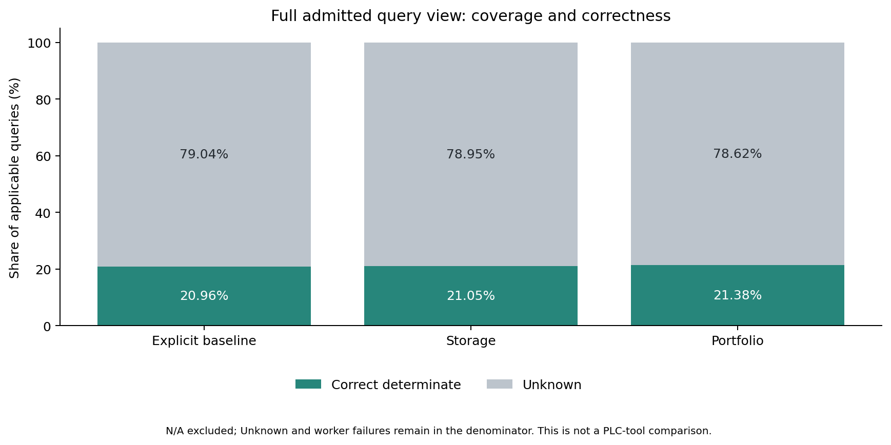
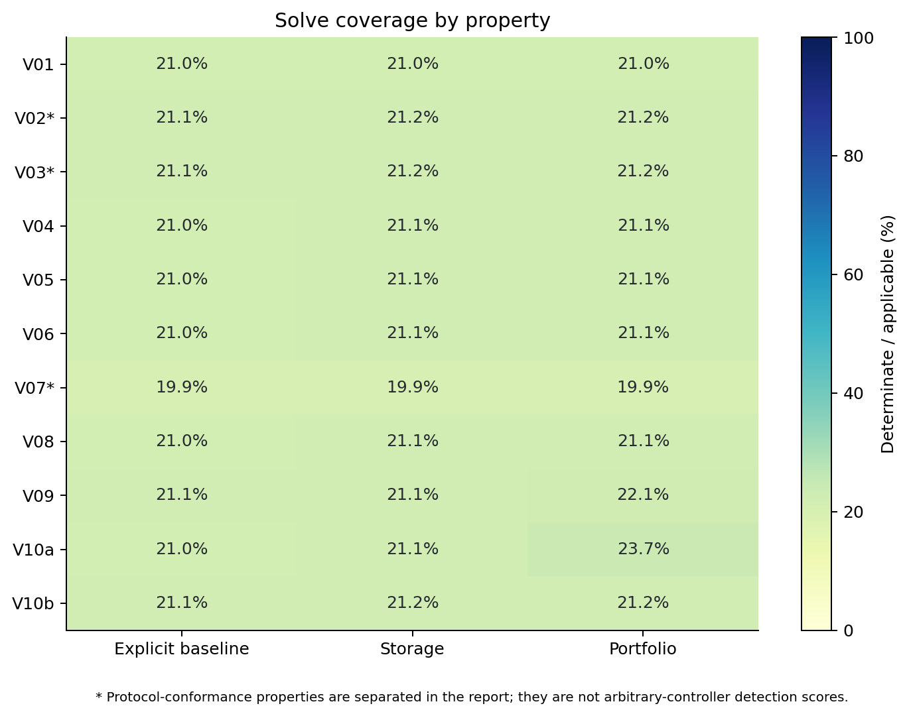
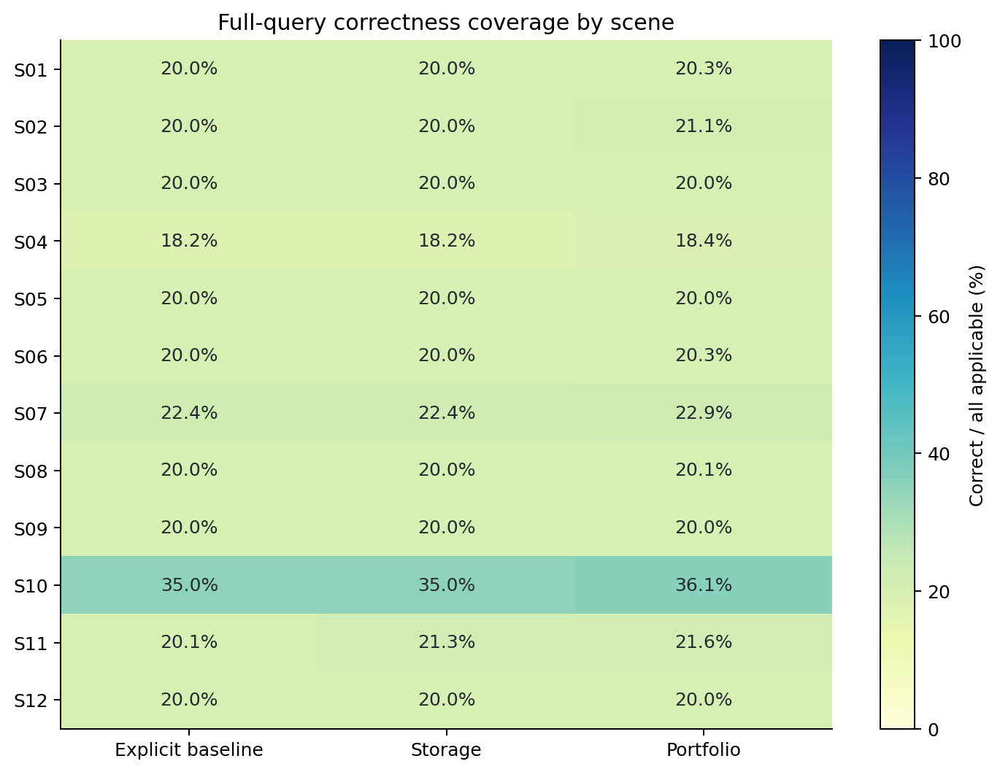
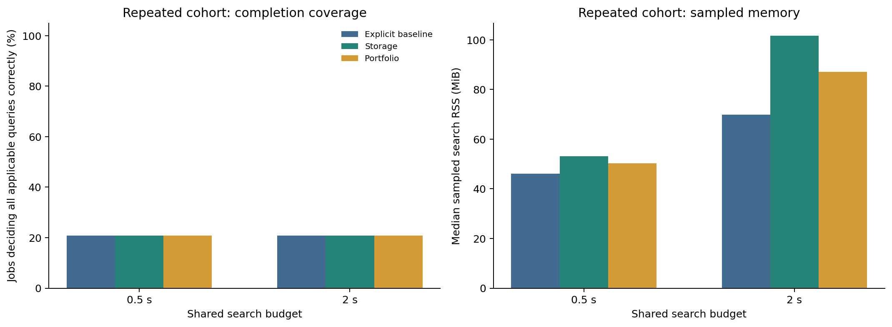
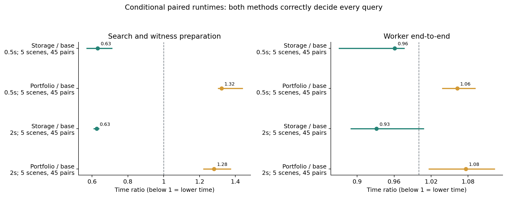
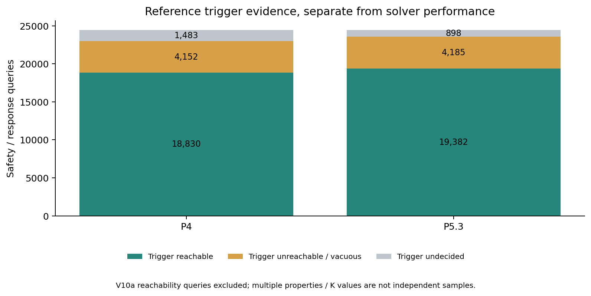

# 方法一 P5：实验结果与最终审计

最终审计状态：**通过**。本轮完成 P5.3 的条件对应/真值审查、P5.4 的冻结实验和 P5.5 的独立评分及见证审计。以下结果适用于固定的共同查询视图和已审核语义，不代表任意 PLC 程序、真实硬件或几何可达性。

## 1. 范围、来源与实验计划

- 原语料 576 份案例、72 个父案例；360 份语义案例，216 份前端负例。结构检查结果：`{'VALID': 360, 'INVALID_SYNTAX': 72, 'INVALID_TYPE': 72, 'UNKNOWN_CAPABILITY': 72}`，非预期分类 0。前端结果不并入动态查询准确率。
- 动态共同视图 27,495 条查询，其中 26,970 条适用且具有参考结论，525 条不适用。原有 1,065 条窗口不足查询留档，以不同 ID 的显式扩展查询替换；不能把新答案回填为旧问题答案。
- 新引擎为 acverify v0.3；none 是同语义显式基线，storage 和 portfolio 为复制/存储和搜索策略消融。没有将历史 v3/v4 成绩混入本次比较。
- 冻结 4,536 个独立子进程作业：3,240 个全量作业和 1,296 个重复作业，单实验 worker 串行运行。全量覆盖 1,080 个案例/环境组合 × 三方法，搜索预算 0.5 秒；分层重复覆盖 24 个父案例各选一个语义成员、各环境、0.5/2 秒、三次重复。
- 样本按场景与父案例的固定哈希选择，案例块顺序固定随机种子 20261103，块内轮换六种方法顺序。所有算法使用同一 K、触发截止、尾部和故障预算。solver 墙钟预算与模型的 60 Hz tick/响应期限是不同概念。
- 实现、问题、运行顺序和主要指标定义在运行前冻结。独立见证审计与效率区间程序在运行中补齐、在读取正式预测前固定；绘图样式随后验证。没有依据中途结果更改样本、预算或方法。

P5.3 的准入基于 `ADMITTED_CONDITIONAL_REVIEW`：逐阶段源码条件论证、1,080 个实例前提、3,144 个观察帧边界及先前有限双向检查。它不是机器验证整个 Python 实现的无界精化证明，可信边界须随论文结果一起说明。

执行环境：`Windows-10-10.0.22631-SP0`；处理器标识 `Intel64 Family 6 Model 183 Stepping 1, GenuineIntel`；物理核心 24、逻辑 CPU 32；可见内存 31.7 GiB。硬件信息在运行期间记录，未用于改变预算或选择案例；本机不是独占实验主机。

## 2. 全量动态结果

| 方法 | 适用查询 | 确定回答 | 正确 | 错误 | Unknown | worker 失败 | 求解覆盖率 | 已回答准确率 | 全范围正确比例 |
| --- | --- | --- | --- | --- | --- | --- | --- | --- | --- |
| none | 26970 | 5653 | 5653 | 0 | 21317 | 0 | 20.96% | 100.00% | 20.96% |
| storage | 26970 | 5677 | 5677 | 0 | 21293 | 0 | 21.05% | 100.00% | 21.05% |
| portfolio | 26970 | 5767 | 5767 | 0 | 21203 | 0 | 21.38% | 100.00% | 21.38% |

**已回答准确率只针对确定回答；全范围正确比例仍把 Unknown 和 worker 失败留在分母。** 没有确定回答时准确率显示“—”，不会显示 100%。本轮 worker 状态为 `{'COMPLETED': 4536}`。

在本次全量 0.5 秒搜索预算下，三种方法的求解覆盖率为 20.96%–21.38%，其余约 78.62%–79.04% 仍未决定或执行失败。相对 none，storage 增加 0.089 个百分点，portfolio 增加 0.423 个百分点。因此当前主要限制仍是求解覆盖，不能只凭已回答准确率判断方法已经充分验证整线。

## 3. 协议一致性与工艺性质分开评价

| 方法 | 维度 | 适用查询 | 求解覆盖率 | 已回答准确率 | 全范围正确比例 |
| --- | --- | --- | --- | --- | --- |
| none | process_property | 19985 | 21.03% | 100.00% | 21.03% |
| none | protocol_conformance | 6985 | 20.76% | 100.00% | 20.76% |
| portfolio | process_property | 19985 | 21.57% | 100.00% | 21.57% |
| portfolio | protocol_conformance | 6985 | 20.84% | 100.00% | 20.84% |
| storage | process_property | 19985 | 21.12% | 100.00% | 21.12% |
| storage | protocol_conformance | 6985 | 20.84% | 100.00% | 20.84% |

V02/V03/V07 含生成协议的构造保证，单列为 protocol_conformance；不能据其正确率宣称能检出任意 PLC 实现错误。process_property 的统计也只涵盖这里登记的有限符号环境和性质。逐父案例、环境、性质、空真状态的明细保存在 metrics.json 和逐查询评分文件中，不把重复 K 或性质行当作独立样本。

以下是对总体覆盖的描述性分解，不作新的性能假设检验：

| 方法 | 参考空真标记 | 适用查询 | 确定回答 | 求解覆盖率 |
| --- | --- | --- | --- | --- |
| none | False | 21887 | 2136 | 9.76% |
| none | None | 898 | 0 | 0.00% |
| none | True | 4185 | 3517 | 84.04% |
| portfolio | False | 21887 | 2247 | 10.27% |
| portfolio | None | 898 | 3 | 0.33% |
| portfolio | True | 4185 | 3517 | 84.04% |
| storage | False | 21887 | 2157 | 9.86% |
| storage | None | 898 | 3 | 0.33% |
| storage | True | 4185 | 3517 | 84.04% |

空真标记 True 表示已证明触发不可达；None 表示触发待定。False 包含非空真的安全/响应性质，也包含按定义不使用空真解释的 V10a 目标可达性查询，不能把整个 False 行都称为“发生过成功动作”。

| 方法 | 参考结论类别 | 查询数 | 正确决定 | 该类正确比例 |
| --- | --- | --- | --- | --- |
| none | HOLDS | 22866 | 5096 | 22.29% |
| none | REACHABLE | 1021 | 0 | 0.00% |
| none | UNREACHABLE | 1484 | 526 | 35.44% |
| none | VIOLATED | 1599 | 31 | 1.94% |
| portfolio | HOLDS | 22866 | 5117 | 22.38% |
| portfolio | REACHABLE | 1021 | 65 | 6.37% |
| portfolio | UNREACHABLE | 1484 | 529 | 35.65% |
| portfolio | VIOLATED | 1599 | 56 | 3.50% |
| storage | HOLDS | 22866 | 5117 | 22.38% |
| storage | REACHABLE | 1021 | 0 | 0.00% |
| storage | UNREACHABLE | 1484 | 529 | 35.65% |
| storage | VIOLATED | 1599 | 31 | 1.94% |

不同参考结论的覆盖需分别考察；只解决大量容易的保持/不可达问题，不能说明对可达目标或违规反例具有相同能力。

## 4. 重复与效率

| 方法 | 预算 | 重复作业 | 全部适用查询正确决定 | 中位采样 RSS / MiB | 最后阶段状态中位数 |
| --- | --- | --- | --- | --- | --- |
| none | 0.5 | 216 | 45 | 46.2 | 680 |
| none | 2.0 | 216 | 45 | 69.8 | 1826 |
| portfolio | 0.5 | 216 | 45 | 50.2 | 915 |
| portfolio | 2.0 | 216 | 45 | 87.0 | 2554 |
| storage | 0.5 | 216 | 45 | 53.1 | 1004 |
| storage | 2.0 | 216 | 45 | 101.6 | 3026 |

| 方法/基线 | 预算 | 共同正确完成作业 | 场景簇 | 搜索时间比 | 95% 场景簇区间 | worker 时间比 |
| --- | --- | --- | --- | --- | --- | --- |
| storage/none | 0.5 | 45 | 5 | 0.632 | 0.569–0.714 | 0.961 |
| portfolio/none | 0.5 | 45 | 5 | 1.323 | 1.302–1.441 | 1.062 |
| storage/none | 2.0 | 45 | 5 | 0.626 | 0.607–0.641 | 0.931 |
| portfolio/none | 2.0 | 45 | 5 | 1.281 | 1.220–1.375 | 1.076 |

时间比为“方法 / none”，低于 1 表示耗时较低。只对双方都正确决定全部适用查询的配对作业计算完成时间比；这个条件子集不能代表全部难例，必须与完整求解覆盖和超时率一起解释。少于三个场景簇时不计算区间。区间按父案例中位数、场景中位数分层，再进行 2,000 次场景簇自助重采样，仅描述本次选定样本。

内存为搜索期间采样 RSS，不是操作系统强制保留的内存上限，也不保证捕获每个瞬时峰值。模型构造、搜索与见证整理、重放、worker 总耗时和父进程墙钟分别保存；超时不是正常完成耗时。portfolio 的阶段状态数可能包含重访，不将其直接解释为发现更多不同状态。

重复明细和每个案例/环境的三次最小/最大确定回答比例在 repeat-stability.json 中。测量来自一台非独占工作站；随机配对顺序减轻趋势影响，但不能据此给出硬件无关的绝对性能保证。

## 5. 参考证据与见证审计

- P4 已封存证据重新核查，无需改写性质 verdict；P5.3 额外确定 587 条全包触发记录，其中本视图使用 585 条更新。
- 本视图当前空真统计：`{'False': 21887, 'None': 898, 'True': 4185}`。其中 898 条性质有结论但触发可达性待定；不会将其当作已覆盖故障处理。
- 下图只统计安全/响应性质，排除不适用空真解释的目标可达性 V10a。
- 逐查询分歧/已知触发冲突共 0 条。55 份不同的正向见证，经新引擎重放及参考状态/历史对应检查，验证 55 份，问题 0 份；共核对 154 个去重后的查询声明。见证只用于审计预测，没有反过来改写 gold。

## 6. 结论的使用限制

这些表格首先说明在给定预算下能决定多少问题，再说明已决定结论的准确性。即使已回答准确率很高，也不能据此宣称全场景都已验证；Unknown 是实际实验结果，需要保留。效率比只适用于共同完成的样本；若区间跨过 1 或簇数很少，不宣称稳定性能优势。

当前未建立已准入的 PLC 代码转换、性质映射和外部 PLC 工具基线，因此 **PLC 工具对比未实施**。none/storage/portfolio 不是 PLCverif、PLCopen 或其他 PLC 工具的成绩。几何可达性、真实物理和后续学习调度不属于本次方法一验证。

P4 对源任务元数据的范围说明继续有效：`required_environment_gates` 等未被定义为可执行公式的字段，不会自动变成“全部必须为真”的时序义务。本轮核查的是明确登记的独立 goal、清理和 V01–V10b；额外业务时序要求需要另行公式化后建立新查询版本。

## 7. 冻结与复现

入口和完整路径见 [README-final-p5.md](../../README-final-p5.md)。最终包链接 P5.3 admission、查询/真值、P5.4 计划与原始作业、P5.5 评分、效率、见证映射及本报告，各自以 manifest 绑定。实现与运行源码快照保留；恢复必须匹配原计划，已封存作业不因重新运行更换答案。

审核类型为 AI 技术审核，不冒称第三方人工签字。最终完成条件按作业结束、证据有效、共同范围真值完整和算法确定回答率分别核查；前三者不意味着所有算法已决定所有问题。
