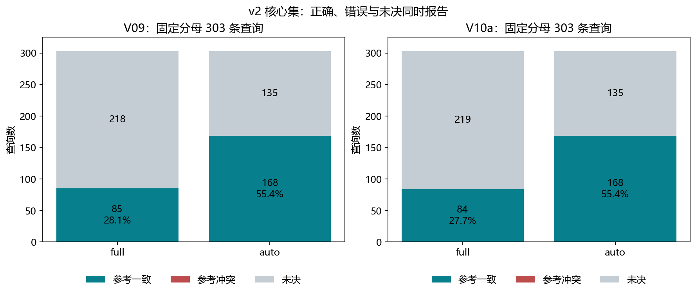
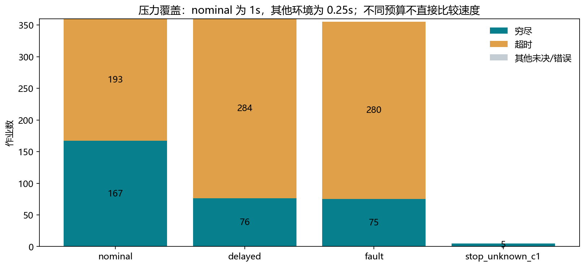

# 方法一实验 v2 结果

采用统一的保持型反馈语义。固定核心集先于算法运行建立；核心仅含 V09/V10a 的参考认证查询，不能外推为全部性质的人工审定 gold。

| 查询 | 方法 | 参考一致 | 冲突 | 未决 | 覆盖率 |
| --- | --- | ---: | ---: | ---: | ---: |
| V09 | full | 85 | 0 | 218 | 28.1% |
| V09 | auto | 168 | 0 | 135 | 55.4% |
| V10a | full | 84 | 0 | 219 | 27.7% |
| V10a | auto | 168 | 0 | 135 | 55.4% |

静态检查 576/576 与参考一致；路径作业 1383 全部有结束记录。核心集 303 个案例、606 条查询；协议独立参考另有 61 个有限枚举配置。

已回答的核心查询中未发现与参考答案冲突，但未决保留在总分母中；不能把这写成“全量准确率 100%”。单次短预算结果不作为最终性能结论。

普通 fault 与 pilot 的 stop_unknown_c1 分别记录；压力图中的 nominal/其他环境预算不同，图只描述各自覆盖，不能由柱高推断环境间性能优劣。

完整配置见 config.json；逐作业结果见 jobs.jsonl 与 jobs/；指标与矛盾清单见 summary.json。源码在本次运行期间未变化。
