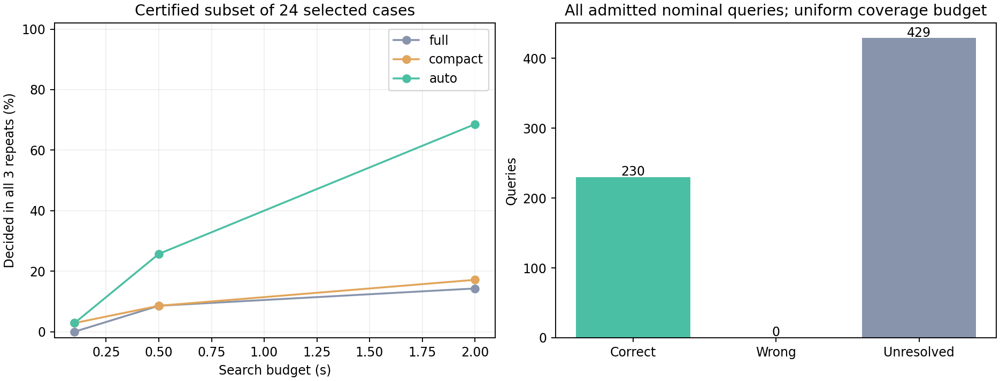

# 方法一 v3 验证与改进结果

审核类型：AI 技术审核；未声称独立第三方人工审定。

**作业执行完成、证据准入完成、整线真值完整和全部查询已求解是不同结论。**

| 验收项 | 结果 |
| --- | --- |
| `execution_complete` | 通过 |
| `evidence_integrity` | 通过 |
| `static_checks_pass` | 通过 |
| `all_47_universal_claims_reproved` | 通过 |
| `finite_kernel_checks_pass` | 通过 |
| `no_observed_reference_conflicts` | 通过 |
| `whole_line_truth_complete` | 未通过 |
| `all_queries_decided` | 未通过 |

计划 1728 项，记录 1728 项；静态检查 576/576。
v3 核心为 356 个案例、659 条选定查询，证据均保存在冻结定义中。
这不是全部属性和环境的准确率分母；v3 未准入的旧参考项也未被改写为错误。

| 配置 | 正确 | 冲突 | 未决 | 已回答准确率 | 覆盖率 |
| --- | ---: | ---: | ---: | ---: | ---: |
| coverage / nominal / auto / 0.5 | 230 | 0 | 429 | 100.0% | 34.9% |
| ablation / nominal / auto / 2.0 | 72 | 0 | 33 | 100.0% | 68.6% |
| ablation / nominal / full / 0.5 | 9 | 0 | 96 | 100.0% | 8.6% |
| ablation / nominal / full / 2.0 | 15 | 0 | 90 | 100.0% | 14.3% |
| ablation / nominal / compact / 2.0 | 18 | 0 | 87 | 100.0% | 17.1% |
| ablation / nominal / auto / 0.5 | 27 | 0 | 78 | 100.0% | 25.7% |
| ablation / nominal / full / 0.1 | 2 | 0 | 103 | 100.0% | 1.9% |
| ablation / nominal / auto / 0.1 | 3 | 0 | 102 | 100.0% | 2.9% |
| ablation / nominal / compact / 0.5 | 9 | 0 | 96 | 100.0% | 8.6% |
| ablation / nominal / compact / 0.1 | 3 | 0 | 102 | 100.0% | 2.9% |

重复实验表中的计数包含三次重复，不作为独立数据集样本数。图中稳定覆盖要求同一查询三次均给出一致非未知答案。



## 本次补强

- 47 条普遍性结论全部改为结构化成功后态过近似证明；新输入或证书篡改会拒绝准入。
- 逻辑证明、计时见证和证明树保存本次重算对象，不再仅链接旧文件。
- 9 个独立并发/故障内核配置，共 3274 个有限状态，完整穷举；三个故意破坏协议的变异均被检出。
- 保留 61 个独立通道配置检查，并新增并发资源竞争及故障传播的小模型检查。
- 全量环境检查使用同一预算；性能样本在读取实验结果前冻结，三个方法、三个预算、三次独立进程重复。

## 仍不能宣称完成的内容

整条产线的独立计时同步积与具体实现到抽象参考的普遍精化证明尚未建立。内核穷举与回归测试不能替代它。
因此 delayed/fault 的完整整线真值、其他性质的完整准入仍未闭合；求解器的资源受限查询也保持 UNKNOWN。
详细缺口见 `remaining-obligations.json`、`unresolved-queries.json` 和定义目录的 `coverage.json`。

## 性能解释

full 为无归约基线，compact 仅做状态压缩，auto 在适用时增加时钟平移归约。它们属于本算法消融，不是 PLCverif 或 PLC 方法对比。
耗时与配对比值见 audit.json。配对比值只计同一案例、重复和预算下两者均回答业务查询的作业；不能外推到所有案例。
进程 RSS 为采样值，不是操作系统保证的真实峰值。结果来自单台开发机，未对背景负载做硬隔离。

## 复现

从 algorithm 目录运行：

```powershell
python -B tools/build_experiment_v3.py --workspace . --output experiments/method1-v3
python -B tools/run_experiment_v3.py --workspace . --definition experiments/method1-v3 --output artifacts/method1-v3-new
python -B tools/audit_experiment_v3.py --workspace . --definition experiments/method1-v3 --output artifacts/method1-v3-new
```

旧输出可恢复，但输入定义、算法源码、运行器或配置变化时必须使用新输出目录。
