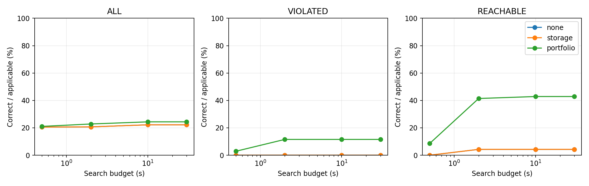

# R1 实验报告

本报告由已封存预测及独立真值生成。预算实验复用 P5 分层样本；重复计时不增加独立案例数。

计划作业 2757，状态分布：{'COMPLETED': 2757}；结论/触发冲突 0。

| 方法 | 搜索预算/秒 | 三次均正确决定 | 适用独立查询 | 稳定覆盖率 |
| --- | ---: | ---: | ---: | ---: |
| none | 0.5 | 371 | 1806 | 20.54% |
| none | 2.0 | 374 | 1806 | 20.71% |
| none | 10.0 | 401 | 1806 | 22.20% |
| none | 30.0 | 401 | 1806 | 22.20% |
| portfolio | 0.5 | 380 | 1806 | 21.04% |
| portfolio | 2.0 | 410 | 1806 | 22.70% |
| portfolio | 10.0 | 440 | 1806 | 24.36% |
| portfolio | 30.0 | 440 | 1806 | 24.36% |
| storage | 0.5 | 371 | 1806 | 20.54% |
| storage | 2.0 | 374 | 1806 | 20.71% |
| storage | 10.0 | 401 | 1806 | 22.20% |
| storage | 30.0 | 401 | 1806 | 22.20% |

## 资源限制

| 作业类型 | 原因 | 数量 |
| --- | --- | ---: |
| bound_diagnostic | None | 6 |
| bound_diagnostic | TIMEOUT | 30 |
| budget | MEMORY_LIMIT | 352 |
| budget | None | 558 |
| budget | STATE_LIMIT | 249 |
| budget | TIMEOUT | 1433 |
| memory_sensitivity | None | 3 |
| memory_sensitivity | STATE_LIMIT | 9 |
| memory_sensitivity | TIMEOUT | 15 |
| profiling | None | 15 |
| profiling | TIMEOUT | 60 |
| state_sensitivity | MEMORY_LIMIT | 6 |
| state_sensitivity | None | 3 |
| state_sensitivity | STATE_LIMIT | 3 |
| state_sensitivity | TIMEOUT | 15 |

## 解释边界

图中为本次样本的逐运行正确比例；稳定覆盖另表要求三次均正确。资源敏感性、K 子集实验与预算主表分开。
剖析开启追踪/cProfile，不能把剖析耗时与正式运行速度比较。阶段 yield 计数包含上游组合，不可当独立分支因子相乘。
规模清单为现有案例观察分布，K 实验仅使用已有准入查询。尚未新增受控节点/物料规模族，不能据此声称完成所有扩展性实验。
PLC 编译/类型检查不等于外部模型检查或语义准入；具体支持状态见 plc-pilot/compatibility.json。
本轮不自动实施 R2。核心机制需要结合 profiling、资源截断和关键类别覆盖审阅后选择。

独立参考模型中的见证复核及图表人工检查仍需单列完成；本报告生成不自动代表 R1 最终验收通过。

## 结果复核与解释

本轮预测和评分文件的 manifest 已重新核查。15 份不同正向见证已在独立参考模型中逐步匹配，45 项去重后的查询声明均成立，问题 0；预算图已实际查看，标签和图例可读。复核回执见 [独立审计摘要](../../datasets/ac-path-v1/experiments/next-round-v1/audit/result-review-v1/summary.json)。原 analysis-completion.json 是自动评分结束时的状态，后续审阅以此独立回执为准。R1 的其他范围义务仍未全部完成。

以下均为 24 个分层案例、三个环境中的 1,806 条适用查询，稳定覆盖要求三次运行均正确，不能直接视作 P5 全量 26,970 条查询的覆盖率。

| Portfolio 搜索预算 | 全体稳定覆盖 | 违规查询稳定决定 | 可达目标稳定决定 |
| --- | ---: | ---: | ---: |
| 0.5 秒 | 380/1806，21.04% | 3/104，2.88% | 6/70，8.57% |
| 2 秒 | 410/1806，22.70% | 12/104，11.54% | 27/70，38.57% |
| 10 秒 | 440/1806，24.36% | 12/104，11.54% | 30/70，42.86% |
| 30 秒 | 440/1806，24.36% | 12/104，11.54% | 30/70，42.86% |

同为 30 秒，none/storage 的稳定覆盖为 22.20%，违规查询 0/104，可达目标 3/70。Portfolio 的整体稳定覆盖高 2.16 个百分点；优势主要体现在见证搜索，不能据此宣称所有性质都显著改善。none/storage 覆盖相同不表示两者运行时间或状态吞吐相同。

Portfolio 的新增稳定回答全部来自 nominal：168/774 → 198/774 → 228/774 → 228/774。delayed 和 fault 各为 106/516，在四档预算下均未变化。这是下一轮必须重点解决的范围。

### 平台期与资源

30 秒档 Portfolio 的 216 个作业中，98 项触及内存上限、61 项触及状态上限、9 项超时、48 项完成搜索。159/216（73.61%）触及资源上限；在 168 项未完成搜索的作业中占 94.64%。因此 10→30 秒的覆盖平台期不能只解释为搜索时间不够。

开发集单轴敏感性试验中，增加状态上限可能改为触及 512 MiB 内存，增加内存后又可能受 20,000 状态上限限制；在本批次的查询正确决定数量上没有新增收益。该组每配置仅一次，不提供稳定性或加速比结论，也不表示联合放宽资源一定无效。

### 剖析与 R2 优先方向

独立插桩结果中，state_store.py 占所选引擎及复制/JSON 编码函数 self-time 的约 79.3%。分母不是端到端墙钟；递归复制包含大量 Python 调用，cProfile/追踪可能放大这类开销。因此这是状态复制值得优先改进的线索，不能直接预测 79% 的生产加速空间。

R2 可优先研究精确状态表示、按改动复制和共享，先解决完整状态反复复制及驻留成本。随后在实际实例化依赖上评估契约驱动的性质分组/切片，判断其是否能减少与查询无关的状态；闭包包含全部依赖时必须回退完整模型。共享物料、全局故障预算、资源和响应时限均参与闭包，不能只按设备拆分。

复制优化是实现基础；若作为论文的核心算法贡献，还需证明契约信息如何支持性质保持的状态/路径缩减。Portfolio 仍可保留为反例/目标见证策略，但本轮结果不支持仅扩大其时间预算即可解决 delayed/fault。

受控节点/并发/物料规模族及其独立证据、PLC 外部工具链和共同语义准入仍是未完成义务。当前可认定本次诊断预算批次和正向见证审阅完成，不能认定整个 R1 方案已全部验收。

