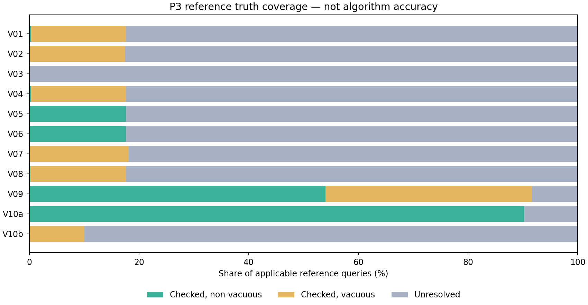

# P3 证据准入验收报告

**本轮生成的是冻结参考语义下的逐查询答案，不是旧算法的准确率结果。** 原 P1 查询、P2 模型、旧答案与实验输出未被覆盖。

| 项目 | 数量 |
| --- | ---: |
| 查询记录 | 27,495 |
| 已核验参考答案 | 7,807 |
| 仍未决 | 19,163 |
| 不适用 | 525 |
| 已核验且非空真 | 4,519 |
| 已核验但为空真 | 3,288 |
| 逐份重新检查的证据文件 | 2,364 |
| 证据结论冲突 | 0 |
| P3 测试 | 31 项通过 |

真值确定率为 **28.95%**，分母是全部适用查询。空真项单列，不作为已覆盖正常执行的安全样本；非空真中也包含初态不变量证明，不等于执行场景已充分覆盖。

| 参考结论 | 数量 |
| --- | ---: |
| HOLDS | 5,066 |
| REACHABLE | 1,021 |
| VIOLATED | 481 |
| UNREACHABLE | 1,239 |

## 性质覆盖

| 性质 | 已核验 | 未决 | 不适用 |
| --- | ---: | ---: | ---: |
| V01 | 435 | 2035 | 35 |
| V02 | 434 | 2051 | 0 |
| V03 | 0 | 2485 | 0 |
| V04 | 442 | 2063 | 0 |
| V05 | 442 | 2063 | 0 |
| V06 | 442 | 2063 | 0 |
| V07 | 365 | 1650 | 490 |
| V08 | 442 | 2063 | 0 |
| V09 | 2295 | 210 | 0 |
| V10a | 2260 | 245 | 0 |
| V10b | 250 | 2235 | 0 |

V03 尚没有本轮准入的实际查询答案；没有因为接收器看起来会拒绝坏证据，就将全部 V03 填成 HOLDS。V10b 的通过答案主要来自未接受任何请求的空真证明，不能解释为正常执行的响应保障。

## 两条有界响应反例

| 案例 | 环境 | 首次接受 tick | 期限 tick |
| --- | --- | ---: | ---: |
| S01-P01 | delayed | 7 | 1807 |
| S01-P01 | fault | 7 | 1807 |

这两条路径先确认新鲜 accepted，再选择 profile 允许但超过 max_age 的结果交付时延。保持值持续采样并不保证接收端最终获得新鲜证据。到期限时请求仍未完成合格响应，停止命令或 stopping 状态不能替代确认终态/合格隔离。
反例在参考模型上逐步检查，绑定到对应 V10b 查询的范围。它们不自动证明旧执行器存在同一问题；修订预算或异常处理后也必须生成新模型/查询版本，不能反向修改本轮答案。

## 实现与证据边界

- 轨迹：核对初态、每一步合法转换、事件、身份与查询边界，仅支持存在性/违规结论。
- 图：重新计算合法后继多重集合及可达性，不信任自报 closed；区分有界覆盖与完整闭合。
- 逻辑证书：检查必经条件矛盾、最终条件蕴含目标、初始无生产者阻塞等规则前提。
- 成功效果证书：无外部事件、无 par 的成功路径过近似；保留所有分支、擦除等待，只作普遍性推导。
- 最终准入重新检查全部证据并独立聚合，比较结果与构造阶段一致；参考语义核心仍是可信基础，不是设备精化证明。

## 下一阶段缺口

仍有 19,163 条查询未决，主要需要并发/外部变化下的更强证书、V03 消费证据证明、更多故障和响应样本及完整图。P4 应按这些缺口扩展，不把未决当作错误或通过。
另有 85 个案例涉及 required_environment_gates 元数据。生成器实际用它记录初始为 false 的事实，包含分流条件，不能直接当成必须全部变 true 的业务公式。本版只验证 V01–V10b 的正式义务、TaskSpec.goal 与清理；详见真值包 source-scope-notes.json。
所有答案仍标记 sut_comparison_eligible=false。完成相应语义对应后，才能用同一查询定义评价被测算法，不能直接重算旧 v3/v4 准确率。

证据规则见 ../../docs/P3证据准入规则.md，正式答案见 ../../datasets/ac-path-v1/oracle/whole-line-p3-v1/answers.jsonl。
