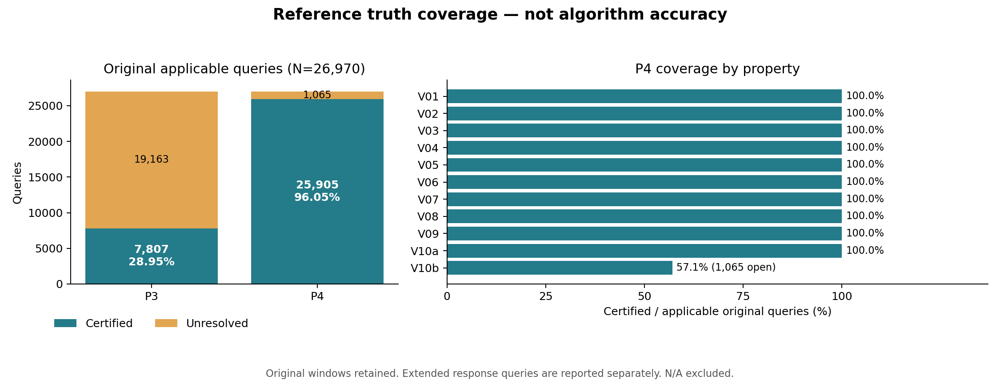

# P4 整线参考真值覆盖验收

P4 已处理 360 个语义案例、1,080 个案例/环境组合。保留 P3 的全部原查询，同时接纳 P1 预先登记的 V10b 扩展窗口查询。新增证据经过单独进程复查和独立汇总，未发现冲突。

这是参考真值覆盖报告，**不是被测算法准确率或 PLC 对比实验结果**。所有答案的 `sut_comparison_eligible` 仍为 false。

## 1. 查询范围与覆盖

| 范围 | 总查询 | 已认证 | 未决 | 不适用 | 适用查询真值确定率 |
| --- | --- | --- | --- | --- | --- |
| P3 原始范围 | 27495 | 7807 | 19163 | 525 | 28.95% |
| P4 同一原始范围 | 27495 | 25905 | 1065 | 525 | 96.05% |
| P4 新增扩展窗口 | 2485 | 2485 | 0 | 0 | 100.00% |
| P4 合计（两种范围） | 29980 | 28390 | 1065 | 525 | 96.38% |
| 建议评价视图（已改变窗口） | 27495 | 26970 | 0 | 525 | 100.00% |

同一原始范围新增认证 18,098 条。1,065 条旧 V10b 查询的 K 小于完整响应窗口 D，保留 `NO_FULL_RESPONSE_WINDOW`。其他原因未决 0 条。不能据扩展窗口有答案就回填旧查询。

建议评价视图仅将 1,065 条窗口不足查询替换为明确检查到 K+D 的新查询，仍保留旧档案和映射。该视图总数为 27,495，但与原范围不是同一问题集合；被测算法和基线必须先适配相同尾部检查、触发范围及故障预算。

## 2. 按性质划分（仅原查询）

| 性质 | 已认证 | 未决 | 不适用 |
| --- | --- | --- | --- |
| V01 | 2470 | 0 | 35 |
| V02 | 2485 | 0 | 0 |
| V03 | 2485 | 0 | 0 |
| V04 | 2505 | 0 | 0 |
| V05 | 2505 | 0 | 0 |
| V06 | 2505 | 0 | 0 |
| V07 | 2015 | 0 | 490 |
| V08 | 2505 | 0 | 0 |
| V09 | 2505 | 0 | 0 |
| V10a | 2505 | 0 | 0 |
| V10b | 1420 | 1065 | 0 |

## 3. 空真、触发和结论

全部已认证查询中：非空真 22,455、空真 4,450、空真状态尚未确定 1,485。最后一类已有性质证明，但尚无足以决定触发可达性的证据；不能把它们当作实际触发覆盖。可达性性质按自身语义单独处理，不能从安全性质 HOLDS 推出工艺成功。

| 结论 | 查询数（原始及扩展合计） |
| --- | --- |
| HOLDS | 23726 |
| REACHABLE | 1021 |
| UNREACHABLE | 1484 |
| VIOLATED | 2159 |

| 代表证据类别 | 已认证查询数 |
| --- | --- |
| conditional_inductive_preservation | 10086 |
| construction | 6073 |
| event_stability | 1079 |
| graph_certificate/0.1 | 90 |
| logical_certificate/0.1 | 5938 |
| p4_macro_trace/0.1 | 1678 |
| request_absence | 33 |
| success_effect_certificate/0.1 | 303 |
| successful_poststate_overapproximation | 203 |
| timed_contract_bound | 1405 |
| trace_certificate/0.1 | 1502 |

V02/V03/V07 等结论含参考执行协议的构造保证；其他条件归纳结论依赖固定模板、初态、资源隔离和容量前提。这些结论没有证明任意 PLC 实现会遵守协议，不能直接作为错误控制器的检出率。分类依据代表证据，其他辅助证据仍保存在逐查询引用中。

延迟/故障环境存在合法的“接受反馈新鲜，但结果/停止反馈每次到达时都陈旧”的调度，因此部分 V10b 被判为 VIOLATED。保持型反馈每周期重新采样并不保证送达时仍新鲜。该结果来自固定环境与时间预算，不能为得到正例而事后调宽窗口或改写环境。

## 4. 证据审查与复现

- 新增 12,112 份证据全部重新检查。
- 复用 2,364 份 P3 已封存证据；先核对 P3 整包、内核和证据摘要，本阶段未重新逐步执行所有旧轨迹。
- 重新绑定全部模型和查询，核对原查询 ID/内容、扩展查询来源、输入与依赖锁；结束时再次检查输入文件。
- 独立汇总与构造器标签差异 0，证据冲突 0。
- 规则测试涵盖真实互锁/容量反例、模板变化、并发投影拒绝、循环前序写入、短窗口、FIFO/时间戳/边界篡改及准入冲突。

规则、准入与正式包完整性测试：33 项，失败 0、错误 0、跳过 0。

对首轮规则仍不能决定的非窗口查询，另外尝试完整参考图。以下图的每个状态和所有合法后继在准入时重新核对；闭合证明覆盖分支不调用动作的情况，不能用一条没有请求的轨迹代替。

| 剩余项完整图 | 环境 | 状态 | 边 | 闭合 |
| --- | --- | --- | --- | --- |
| S10-P03-DV04 | delayed | 9 | 8 | True |
| S10-P03-DV04 | fault | 9 | 8 | True |

新增证据复查耗时 302.7 秒。这是单次参考证据构造流程的运行记录，不是算法对比中的配对效率或加速比。

| 新增证据类型 | 文件数 |
| --- | --- |
| graph_certificate/0.1 | 2 |
| p4_event_frame/0.1 | 1074 |
| p4_goal_projection/0.1 | 1080 |
| p4_invariant/0.1 | 8385 |
| p4_macro_trace/0.1 | 562 |
| p4_response_bound/0.1 | 355 |
| trace_certificate/0.1 | 654 |

正式数据：`datasets/ac-path-v1/oracle/whole-line-p4-v1/`。其中 `coverage.json` 给出性质、环境、场景和查询集合计数；`construction-features.json` 登记每个组合的控制结构、外部事件、反馈与故障预算；`remaining-obligations.json` 保留未决查询与跨阶段义务；`manifest.json` 绑定文件和代码。

## 5. 验收边界与 P5 输入

P4 的覆盖扩展、证据准入及范围登记已完成。**原查询范围仍未闭合**：窗口不足查询不被删除。建议评价视图必须被明确采纳并与被测语义对齐，才能作为另一版本的评价范围。

此外，1,485 个已认证条目的空真状态待定，不能用“所有性质都有答案”替代“所有义务都实际触发”。P3 中 85 个案例的 `required_environment_gates` 元数据范围说明继续保留，未将其解释为额外时序目标。

P5 需要完成参考与被测系统的接受身份、反馈采样/新鲜度、停止与隔离、并发和窗口映射，区分协议构造保证与可检错性质，再在共同范围重跑算法/基线。真实 PLC 映射、几何可达性和设备合规性不在本次结果内。

这些查询按性质、K 和环境展开，且原查询与扩展查询共享案例，不能把 29,980 条记录当作独立样本。后续统计推断和数据划分应保留场景/父案例分组，避免同源变体跨集合泄漏。

审核属于 AI 技术审核。条件证明模式已给出论证、实例前提与反例测试，但不是证明助手对 Python 内核的全语义证明。详见 [P4 证明边界](../../docs/P4覆盖扩展与证明边界.md)。
