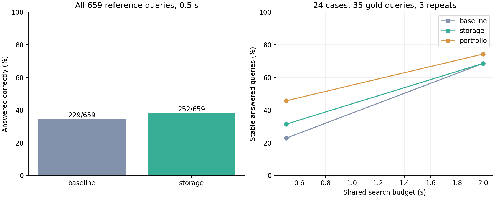

# 求解器优化 v4 实验报告

本轮实现 O0 剖析、O1 的专用状态复制/按需图边存储，以及 O2 的定向见证搜索组合。语义保持 method1-semantics/0.2；参考答案沿用 v3。

计划 1248 项，记录 1248 项；参考冲突 0 条，完整性错误 0 条；静态分类 576/576。

## 全量 nominal 对照

| 方法 | 正确 | 错误 | 未决 | 覆盖率 |
| --- | ---: | ---: | ---: | ---: |
| baseline | 229 | 0 | 430 | 34.7% |
| storage | 252 | 0 | 407 | 38.2% |

每个方法遍历全部 360 个语义案例，准确率和覆盖率只使用其中有独立参考的 659 条查询。baseline 是本轮重跑的冻结 v3 源码，不把历史机器负载下的耗时当作当前基线。

## 三次重复的稳定覆盖

| 方法 | 0.5 秒 | 2 秒 |
| --- | ---: | ---: |
| baseline | 8/35 (22.9%) | 24/35 (68.6%) |
| storage | 11/35 (31.4%) | 24/35 (68.6%) |
| portfolio | 16/35 (45.7%) | 26/35 (74.3%) |

固定沿用 v3 的 24 个案例，其中 35 条查询有参考标签。重复次数不增加独立样本数。portfolio 的见证阶段最多使用总搜索预算的 15%，完整搜索使用剩余预算。

## 共同闭合搜索的耗时比

| 配置 | 配对数 | baseline/优化 中位数 | Q1 | Q3 |
| --- | ---: | ---: | ---: | ---: |
| ablation / storage / 2.0 | 39 | 1.321 | 1.207 | 1.359 |
| ablation / portfolio / 2.0 | 39 | 0.836 | 0.666 | 1.002 |
| full_nominal / storage / 0.5 | 111 | 1.265 | 1.162 | 1.396 |
| ablation / storage / 0.5 | 12 | 1.328 | 1.235 | 1.426 |
| ablation / portfolio / 0.5 | 12 | 0.967 | 0.899 | 1.014 |
| stress / storage / 0.5 | 2 | 1.153 | 1.111 | 1.195 |

比值大于 1 表示优化较快。只纳入同案例、环境、预算、重复下双方都闭合的搜索；不能外推到全部案例。重复配对存在同父案例相关性，这不是独立样本置信区间。

## 资源、压力与审核边界

audit.json 另含每组超时/闭合数量、搜索时间、整个 worker 时间、状态数和采样 RSS 的中位数及四分位数。压力实验在同一批 24 个案例的 delayed/fault 环境中对照 baseline 与 storage，不报告尚无完整整线真值的准确率。

参考核心与输入锁保持不变；各方法的输入摘要和模型摘要一致。所有已给出的共有性质结论逐项比较，见证由 worker 在模型上重放，审核重新核对见证摘要与重放记录。该审核不是独立整线物理/计时真值证明。

## 本轮未实现的内容

O1 的不可变分块/搜索检查点、O2 的生产侧证明预处理，以及 O3–O6 的消息、时间、偏序和直接符号求解仍未实现。当前优化只降低状态处理成本、改变有预算搜索顺序，不减少允许故障或消息选择。

优化入口为 --optimization storage 或 --optimization portfolio，默认 none 保留旧搜索路径。若组合策略损失稳定覆盖或耗时退化，应继续单列为消融，不自动启用。

整线独立计时参考与精化证明仍是单独的未完成义务，不能因本轮提速而将 whole_line_truth_complete 改为 true。
