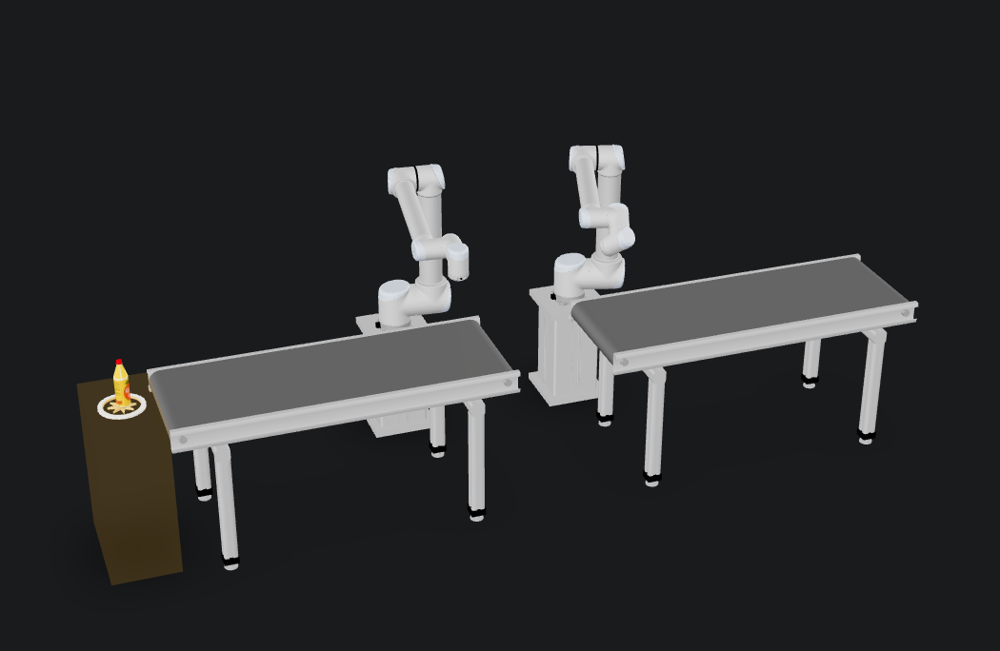

# 研究点一 工艺契约与领域语言建模及设备契约驱动的工艺执行路径验证

版本：研究方案 0.2。日期：2026-11-01。

本方案将研究点一收敛为执行前的工艺语义分析与路径验证。建模分为“工艺契约”和“领域语言”，既有设备契约作为工艺契约的基础；算法为“设备契约驱动的工艺执行路径验证方法”。本文描述拟实现方法、数据集及对比设计，不报告尚未开展的求解或实验结果。

[此前四层实验方案](../method.md) 保留工作台、编译、运行和物理闭环的总体路线；本页明确其中研究点一的算法边界。语言与案例继续沿用 [ac-process/0.1](../01-language.md)、[ProcessIR](../02-ir.md) 和 [T0 正式源码](../examples/t0-two-robot/process.acp)。

## 1 研究定位

### 1.1 要解决的问题

给定一份已经明确动作组织的工艺，语法合法和接口绑定正确仍不足以说明它满足业务要求。设备调用跨越多个周期，反馈可能延迟或失配，物料交接具有中间状态，并行分支还会争用设备、区域和控制写入权。需要在执行前检查：在明确的设备模型、初始状态和环境假设下，工艺允许的执行路径是否违反约束，以及目标是否能够达到。

研究问题不是“PLC 无法检查工艺”，而是：能否利用显式设备与工艺契约，更系统地构造验证模型、生成验证义务、降低人工建模成本，并将反例定位回工艺节点与领域对象。

### 1.2 输入、输出与范围

输入为已给定工艺 P、设备/工艺契约 C、具体问题数据 E、执行配置 A 和验证请求 Q。P 可以由人工或方法二生成，但本方法不搜索新的工艺顺序，不修改用户目标，也不求最优派工。

输出包括结构/绑定诊断、所建转换模型、待验证性质、逐性质结论、适用边界、反例或目标见证路径，以及来源/依赖信息。模型验证通过与运行器接入完成分别报告。

| 内容 | 研究点一的处理 |
| --- | --- |
| 类型、接口、能力、引用、作用域 | 直接检查 |
| 工序顺序、状态变化、请求/反馈关联、资源和异常路径 | 核心模型验证对象 |
| 设备与物料空间可达、碰撞、实际支承几何 | 后续章节或外部服务提供；本轮只检查其事实类型、引用及使用条件 |
| 自然语言理解、三维拓扑推断、目标驱动规划 | 属于方法二；本轮固定候选工艺 |
| 最优任务分配和吞吐量优化 | 属于方法三；本轮固定资源仲裁策略 |
| 运行时真实反馈监测 | 输出监测义务与关联接口，作为后续实现及辅助复核；不将其当作编译器 |
| 完整 PLC 生成、实机部署 | 可选后端，未实现时不作相关结论 |

可以在真实执行器尚未全部接入时进行符号模型验证，前提是抽象模型完整且假设明确。`model_verification_supported=true` 不推出 `deployment_ready=true`，不能通过修改 implemented 标志把设计样例变成真实运行样例。

## 2 建模内容的划分

### 2.1 工艺契约：由设备能力到跨设备约束

“工艺契约”是作用于工艺执行的语义层，包含设备能力契约的实例化引用及必要的跨设备规则。它不另复制一份可独立修改的设备定义。

| 子模型 | 主要内容 | 权威位置 |
| --- | --- | --- |
| 设备能力契约 | 参数、信号、行为、前置/持续条件、完成依据、执行接口 | 现有 DeviceSpec 及版本化能力适配定义 |
| 公共状态与关系 | 物料、位置、持有、支承、预留、占用、资源许可 | 公共领域词汇及谓词定义 |
| 动作状态转换 | 成功/失败可能改变的状态、作用范围、未变状态、阶段边界 | 能力语义扩展，引用设备行为 ID |
| 组合与资源契约 | 跨设备互锁、唯一 writer、交接事务、容量和释放要求 | 公共规则＋场景中的具体实例绑定 |
| 协议与时间契约 | 请求接受、执行、反馈、暂停、停止、超时及初始化 | 执行配置和对应能力协议 |
| 任务要求 | 初态、目标、必须满足的任务级性质 | 独立 TaskSpecification，不由候选程序自报成功条件替代 |

设备字段继续参考 [设备契约](../../docs/设备契约.md)、[行为契约](../../docs/schema.md)、[参数契约](../../docs/参数契约.md)。下面的形式化字段是算法设计，不表示当前 schema 或工具已经实现。

一个能力可抽象为：

```text
C(a) = <Types, Params, Pre, Hold, Effects, Outcome, Resources,
        Protocol, CompletionEvidence, StopRelease, Footprint>
```

- Pre/Hold 分别表示启动和持续要求，不互相替代。
- Effects 是所选符号层上的成功状态变化；Outcome 描述成功、失败和未知结果的允许后继，不把失败默认为恢复初态。
- CompletionEvidence 指明怎样确认结果有效，包括主体/请求/代次/时间关联。
- Footprint 指明读写哪些对象及状态；未声明改变的状态应有明确的保持规则。外部可变事实由环境模型更新，不适用随意保持假设。
- StopRelease 将停止确认与资源可释放分开；物料实际占用可持续到任务结束之后。

### 2.2 状态、效果和观测的区别

| 概念 | 示例 | 在算法中的作用 |
| --- | --- | --- |
| 抽象状态 | holder(M)=C1，drive(C1)=moving | 形成状态空间 |
| 预测效果 | 抓取并移离后 holder(M)=R2，源区域释放 | 推导可能后继 |
| 结果报告 | request r 的 done=true | 协议输入，可能失配或失真 |
| 观测证据 | r/M 对应的持有、离开和支承事实有效 | 检查程序是否有充分依据推进 |
| 任务目标 | M 位于 C2.out，holder(M)=C2，两带停稳 | 独立验收性质 |

`grip` 不必等于“已经离开输送区域”；若能力承诺抓取并移离，应将成功边界定义到移离完成。实际支承与业务 holder 在交接中可暂时不同，但不能出现两个权威 holder。

未知 U 与 false F 分开，尤其不能把缺失观测填成预期值。形式化模型中的“物料位于目标”是抽象事实；本轮不将它解释成已经通过三维/物理验证。

### 2.3 领域语言：表达给定工艺

使用现有 Lisp 风格 ac-process/0.1，编译为统一 ProcessIR。保留 seq、par、branch、repeat、await、delay、invoke、with-control、fail 九种节点及显式条件来源。

DSL 的正文声明所用能力、物料、位置和控制依赖。动作协议、默认预算、资源及事实提供者通过契约/环境绑定，绑定器不得削弱设备条件。空间吸附接口不作为物料交接或信号连接的替代物。

具体执行语义沿用 [语言规范](../01-language.md)：同一快照条件求值、T/F/U、确定的 tick 阶段、后继最早下一 tick 提交、超时边界及停止隔离。模型构造必须使用同一版本的语义，不能在验证器里另定更有利的执行顺序。

### 2.4 领域模型、问题数据与算法分离

领域模型定义可复用规则；问题数据提供具体实例、初态、目标和已知关系；工艺程序给出候选动作组织；验证算法判断该工艺在约束下的路径性质。相同设备库可以用于多个场景，改变实例不能隐式改变能力语义。

规划器未来可从同一状态/效果模型取得输入，但“工艺验证”不是“自动规划”。本轮只验证给定 P，并保留导出规划模型的接口。

## 3 验证问题的形式化

### 3.1 转换系统

将绑定后的工艺和设备/环境模型组合为：

```text
M(P,C,E,A) = <S, Init, T, Obs>
```

S 是状态集合，Init 是允许初态，T 是状态转换关系，Obs 是向领域事实和诊断事件的投影。建议首轮状态向量包含：

```text
s = <node_status, activation, request_status, request_identity,
     feedback_identity, fact_validity_and_age, drive_mode,
     gripper_holding, material_holder, region_state,
     reservations, resource_owners, clocks, attention_required>
```

对象集合固定且有界；repeat 次数、容量、时钟和请求身份范围必须由验证配置约束。当前值不完整、关键协议不支持或范围无法建模时，返回明确的未支持/未知原因，不创建任意默认状态。

物理过程先抽象为诸如 stopped/moving、at_source/at_exit/in_transfer、held/released 的有限状态及非确定结果。抽象的范围与状态转换假设需登记，例如正常停止在指定上限内确认；不能默认每次发命令就立刻成功。

### 3.2 区分三类问题

1. **违例路径检查**：在允许的输入和设备响应下，是否存在违反指定性质的路径？
2. **目标可达性**：是否存在符合候选工艺与环境模型、并在边界内达到任务目标的路径？
3. **有界响应/退出**：在规定前提下，相关触发是否在限定时间内进入允许的结果，例如成功、受控失败或 attention_required？

存在成功路径不表示所有路径都正确；未发现违例不表示一定完成；故障模式下允许 attention_required 也不等于目标达成。三类结果分别报告。

### 3.3 环境假设

设置可组合且版本化的环境配置：

- A-nominal：请求/反馈按约定响应，设备在指定区间内完成或返回明确失败；空间可达等外部事实由人工标定输入或显式假设提供。
- A-delay：允许指定范围的接受/完成延迟及抖动。
- A-fault：允许过期事实、错身份反馈、丢失确认、交接失败等被研究的故障。

被研究的故障不能又被环境假设排除。完成性结论需要响应/公平性假设；在设备可以永不响应的模型中，不应要求所有路径都生产成功。停止确认永久缺失时，正确行为可以是保留隔离并请求处理。

空间条件引用不存在属于本方法能检查的绑定问题；空间事实本身是否真实，由后续章节验证。若以 geometry_reachable=true 作为假设，应在结果中显式显示，并限制结论为该假设下的控制正确性。

## 4 算法设计

方法由轻量结构分析、契约组合建模、性质生成、路径求解及反例解释构成。SMT/模型检查器是可替换后端；并非所有检查都需要求解器。

### 4.1 阶段 A：解析、绑定与快速拒绝

解析 DSL 得到 AST/IR 和 source map；校验树结构、节点唯一性、版本、能力、类型/单位、名义引用、登记表和请求支配关系。解析控制作用域，检查父驱动依赖、输入写入方向、授权继承与必需停止规则。

这一阶段适合哈希索引、树遍历和数据流分析。循环不展开成无限树；跨分支或循环的请求引用采用明确的保守规则。对静态可判定问题直接定位，无需先编码到 SMT。

输出已解析依赖、快速诊断和待建模义务。运行器/实际执行器未接通只影响 deployment readiness；若有完整的符号行为模型，仍可继续模型验证。

### 4.2 阶段 B：构建执行语义模型

按 IR 结构与契约实例化模板：

| 元素 | 模型内容 |
| --- | --- |
| invoke | 条件门控、授权、提交、接受、执行、结果核验、停止及清理 |
| with-control | writer 获得、进入写入/确认、持续监控、退出写入/实际停稳、许可清理 |
| seq/branch/repeat | 激活、成功推进、分支选择及迭代身份 |
| par | 多分支候选、集中仲裁、汇合、失败后取消及停止等待 |
| 设备/交接 | 成功及故障结果、物料归属、支承、预留和提交 |
| 环境 | 允许的反馈变化、身份/代次变化、延迟和故障 |

每个模型保留读写集合和依赖。符号请求可用有限激活身份或相对身份类表示，但必须保留“当前/旧/其他请求”的区别；不能将不同请求合并成一个 busy/done 而丢失待检查性质。

保持有理逻辑步长和整数 tick。可用有界/饱和计数器减少状态，但必须证明其对所选超时性质等价。不得跳过 await/delay/with-control 退出等会改变时间或资源持有的节点。

### 4.3 阶段 C：生成验证义务

将契约和独立 TaskSpecification 转换为 PropertyIR。每条性质包含 property_id、类别、适用节点/对象、前提、公式、观察阶段、边界及来源。

基础性质库固定规则，具体实例由绑定关系生成，例如：

| 性质 ID | T0 的性质 | 关键模型变量 |
| --- | --- | --- |
| V01 | R2 进入源取料阶段时 C1 已停稳，且相关 writer 互斥成立 | phase、drive、grants |
| V02 | 动作成功只能关联同一激活中已接受的请求 | request/activation/result IDs |
| V03 | 消费完成证据时主体、提供者代次及年龄满足约定 | subject、epoch、age、valid |
| V04 | 独占资源和 writer 不同时授予冲突持有者 | resource owners/conflicts |
| V05 | 一个物料至多有一个权威业务 holder | holder、transaction state |
| V06 | 预留＋占用不超容量，重复交接提交不重复计数 | reservation/occupancy/transaction IDs |
| V07 | 控制作用域成功退出须有退出写入确认和实际静止证据 | control epoch、exit ack、drive |
| V08 | 结果未知时不虚报取消完成或资源已释放 | stopping、attention、grants |
| V09 | 根节点报告成功蕴含独立任务目标与许可清理要求 | root result、task goal、active requests |
| V10 | 在指定正常响应假设下，任务可达；相关请求按预算得到允许响应 | clocks、node states、goal |

V10 应拆成目标可达与有界响应的独立求解任务，不把两个量词不同的问题合成一个通过率。V03 检查反馈接收逻辑在模型中能否错误使用事实，不是声称预先观测到未来的实际传感值。

**防止循环论证：**不能先把“绝不双持有”“成功必须到位”作为限制候选控制器的硬约束加入 T，再用它们验证 T。设备/环境转移必须忠实描述允许行为，控制器模型必须反映实际生成的门控及其缺失；待验证性质单独提交。若某性质由构造保证，需说明转换正确性依据，并以缺陷变异验证遗漏机制能够产生反例。

任务目标与需求来自独立规格，不能只验证候选 DSL 自己写的 final_goal。删除目标检查或弱化成功条件时，验证任务仍使用原始目标。

### 4.4 阶段 D：求解执行路径

首轮建议实现有限对象和有界 tick 的验证。对安全性质 φ，查询长度不超过 K 的违例路径：

```text
Init(s0) ∧ A ∧ T(s0,s1) ∧ ... ∧ T(s[K-1],sK)
         ∧ (¬φ(s0) ∨ ... ∨ ¬φ(sK))
```

模型需允许终态停留，或分别检查所有前缀，避免长度不足 K 的反例因无法延伸而被遗漏。A 为环境约束，不包含正在验证的控制正确性结论。

目标可达性改为查询边界内至少一个状态满足 Goal。有界响应检查只覆盖触发后还具有完整响应窗口的片段；靠近 K 的触发应延长搜索或报告窗口不完整，不能据末尾未响应直接判错。

| 求解结果 | 允许给出的结论 |
| --- | --- |
| 安全查询 SAT，反例经语义重放成立 | 找到指定模型和假设下的违例路径 |
| 安全查询 UNSAT | 在当前 K 和模型范围内未发现该性质的违例 |
| 可达查询 SAT，见证重放成立 | 目标在当前边界内存在一条可达路径 |
| 可达查询 UNSAT | 当前边界内未找到目标路径；不自动宣称永不可达 |
| 不支持、超时、求解器 unknown、依赖模型缺失 | 分别报告原因，不能记为验证通过 |

只有完整有限状态空间穷尽或其他适用证明方法完成后，才可报告相应模型内的全局结论。首轮有界验证不使用“所有时间均正确”的措辞。

### 4.5 阶段 E：反例重放与来源解释

将求解器的变量/状态轨迹映射为领域事件：哪个节点、请求、物料、位置、资源和证据导致违例。使用独立的有限语义参考执行器重放反例，检查它是否确实满足 Init/A/T 并违反性质。抽象模型无法具体化的路径标为抽象反例或需要细化，不直接算真实缺陷检出。

诊断输出同时区分：根因、导致问题的执行路径、受影响节点与最终违反的性质。一个根因可能违反多个性质，不将每个报警都计成独立缺陷。

所有结果绑定源程序、设备/公共契约、任务目标、执行语义、假设、边界、编译和验证工具版本。任一依赖变化后旧结论失效。

### 4.6 算法伪代码

```text
VerifyProcess(P, C, E, A, Q, budget):
  IR, source_map := ParseAndNormalize(P)
  issues, bindings := CheckTypesReferencesScopes(IR, C, E)
  if issues contain hard errors:
      return InvalidInput(issues, source_map)

  support := CheckVerificationModelCoverage(IR, C, E, A, Q)
  if critical model semantics are missing:
      return Unsupported(support)          // 与实际设备是否已接通分别记录

  M_full := ComposeControllerPlantEnvironment(IR, bindings, C, E, A)
  if Init(M_full) is inconsistent:
      return InvalidEnvironment()          // 防止空初态造成“全部成立”
  properties := InstantiateProperties(C, TaskSpecification(E), Q)

  for property in properties:
      CheckAntecedentAndTriggerReachability(M_full, property)
      M := OptionalPropertyPreservingReduction(M_full, property)
      result := SolveBoundedQuery(M, property, budget)
      if result contains a witness:
          replay := ReplayWithIndependentSemantics(result, M_full)
          result := ClassifyConcreteOrAbstractWitness(result, replay)
      AttachSourceAndAssumptionEvidence(result, source_map, bindings)

  return PerPropertyReport(properties, support, dependency_lock)
```

前提从未可达的蕴含性质可能真但空泛，应单列 vacuous/inactive，而不是作为有效覆盖。目标/终态至少要有可达性检查，防止通过“永远不启动”获得看似完美的安全结果。

### 4.7 可研究的优化与正确性责任

优先保持一个未经优化的全模型作为基线，再逐项加入：契约读写集合驱动的性质切片、独立子树的局部摘要、共享协议模板缓存和增量求解。切片须闭合控制/数据/资源/时间依赖；并行分支是否独立不能只看设备 ID 不同。

局部摘要要保留所检查性质相关的中间状态和故障路径；不能仅保留成功效果而删除夹持后失败或退出未确认。缓存键包含全部相关依赖哈希及假设。优化后的快，不可通过漏掉路径或缩小环境故障范围取得。

编码与优化是待实现和评估内容，不将“使用 SMT”本身作为创新。需要论证契约如何帮助构造模型、减少重复配置、保持性质，并提供领域级反例诊断。

## 5 T0 起步案例与验证任务



复用 [T0 文件包](../examples/t0-two-robot/README.md)：S 为被动支承，R1 将 M 送入 C1，C1 输送并停稳，R2 将 M 转移到 C2，C2 输送至出口并停稳。正常工艺有 9 个 IR 节点，具体动作/环境和实际接入状态以版本化文件为准。

本研究点使用 T0 的符号场景：有限实例、物料身份、逻辑位置、支承/持有状态、控制权限和反馈协议。图像不提供坐标或可达性证明；空间可达作为外部经确认事实或显式假设输入，并写入验证报告。

### 5.1 正常与异常环境

- 正常：初始 M 在 S、两夹具空、两带静止；阶段反馈在指定区间内响应。
- 反馈异常：错误请求/主体、重复结果、过期事实、接受/停止确认丢失。
- 业务异常：目标被预留、取料期间有人请求驱动、夹持后失败、释放后未确认接收。

采用规范中的整数 tick 和阶段顺序。协议状态的非确定响应模拟允许的设备行为，不运行三维物理即可验证控制如何处理这些输入；结论限定于该抽象。

### 5.2 第一个模型验证实验

先建立原始 T0 和少量单缺陷变体，冻结 V01–V10，再扩展数据集。例如：去掉控制退出确认、错误关联 arrive_1/arrive_2、重复提交占用、停止未知时释放物料许可、将工艺成功条件弱化为空闲。

缺陷必须发生在真实被验证的候选语义/代码中：若参考模板无条件补回被删检查，应记录为“生成机制修复/阻止了缺陷”，而非虚构一条可违反路径。需要测试弱化实现时，在明确的模型/模板故障点注入，并保留外部性质。

对每个样例输出：静态结果、逐性质结论、假设、K、反例/见证、非空泛性检查及原工艺位置。首次验收目标是能区分真缺陷、合法等待和证据不足，并用参考执行器复核路径。

## 6 数据集构建方案

### 6.1 数据分层

| 集合 | 目的 | 内容 |
| --- | --- | --- |
| D-S 结构/绑定集 | 评价快速检查 | 语法、类型、名义身份、能力、单位、作用域与配置的正反例 |
| D-V 路径验证集 | 核心算法评价 | 工艺＋设备/环境模型＋独立性质＋有界标签/见证 |
| D-X 反例解释集 | 评价定位与诊断 | 已确认违例路径、根因、节点、对象、资源及证据标签 |
| D-E 等价编码集 | 与 PLC 侧公平比较 | 相同语义问题的 DSL 和 ST/FB 表达及映射 |
| D-R 变更复用集 | 评价建模与维护成本 | 绑定、设备协议、契约及任务目标变化前后的配对项目 |

沿用此前 D-P/D-C/D-T 的运行与物理实验规划作为辅助后续工作，不将它们直接合并为本轮“执行前验证准确率”。

### 6.2 初始规模与生成方式

先制作 T0 的小型人工核验集，完成语义和工具兼容性，再按以下计划扩展：

- D-S：复用原方案 60 个合法父样本，每个 3 个单缺陷变异，共 240 条；按错误类别和检测阶段标注。
- D-V：4 类控制组织（顺序、条件分支、共享资源并行、有限重复）各 6 个规模/绑定实例，形成 24 个合法父样本；每个 4 个经审核的语义缺陷变体，共 120 个模型案例。
- D-X：从 D-V 中筛选已确认反例，并加入合法等待、受控失败和 attention_required 的负对照。多个性质指向同一根因时保留关联，不作为独立缺陷扩充数量。
- D-E：先给小型 T0 核验集构造等价 ST/FB 编码，兼容后再覆盖 D-V 的可支持子集。不能在尚无等价性依据时宣称全部 120 个模型已可比较。
- D-R：建立若干引用同一能力的工艺，分别变更设备别名、信号绑定、兼容握手协议、参数约束和任务目标，记录修改与回归成本。

以上是计划数量，不是已生成数据或实验结果。D-V 的“120 案例”不等于“120 个独立统计样本”：父样本、变异、性质和多个 K 均有关联，须分组统计。验证作业数另按 case×property×profile×bound 计量。

复用旧 D-S 时需要复核标签，特别是原 S12 中的执行器未接入：缺少真实驱动可能只产生 DEPLOYMENT_NOT_READY；缺少验证所必需的符号行为才产生 UNSUPPORTED_MODEL。二者均不能当作已发现工艺逻辑缺陷，也不能把全体设计样例因此判为非法。

### 6.3 缺陷构造维度

| 维度 | 代表缺陷 | 合法负对照 |
| --- | --- | --- |
| 状态依赖 | 未形成持有关系就提交对应放置完成；已知归属与后续源位置矛盾 | 条件暂未满足但可由合法事件满足 |
| 请求协议 | 使用旧/其他请求结果，无接受证据却成功 | 同一请求合法重发或重复反馈被去重 |
| 持续控制 | 未确认退出就允许抓取，遗漏实际静止门控 | 正在减速，等待真实停止 |
| 资源与交接 | 双授权、重复预留转占用、非法父子继承 | 同资源合法排队，交接中过渡状态 |
| 异常路径 | 夹持后失败错误回滚 holder，停止未知却释放 | 停止超时后正确保持隔离 |
| 目标与诊断 | 候选程序弱化 final_goal，节点/身份关联错误 | 正确受控失败，不宣称生产目标已达到 |

每个变异说明修改层（工艺、配置、协议模板或控制代码）、根因、预期违反性质及所需环境。两种表达使用相同语义缺陷，不机械地在不同语言同一行插入相同字符。定义环境模型故障与控制程序缺陷的区别，避免把工具不支持误标成程序错误。

### 6.4 划分与真值

D-S 按父样本 12/12/36 划分开发/验证/封闭测试，对应 48/48/144 条。D-V 按父样本 6/6/12 划分，每个父样本连同 4 个变异整体归组，对应 30/30/60 个模型案例。某些协议变体及控制组织模板整体留出，明确报告同分布与留出结果；改 ID 不算新语义。

真值定义为具体 `(case, property, assumptions, bound)` 的结论。小规模有限模型使用独立显式状态枚举核对全部可达状态；较大模型结合第二种验证后端、人工性质审查及独立见证重放。后端分歧先标争议，不由被评估方法自行裁决。

“没有发现反例”不能单独生成安全真值。人工认为安全的样例也需明确证据范围。非确定模型的一次正常模拟不能证明所有路径安全。协议、变量范围及初态冲突必须先检查，防止空模型标签。

### 6.5 样本必须保存的信息

case_id/parent_id、划分、语言与契约版本、完整输入依赖哈希、初态/目标、环境假设、执行阶段、有限变量范围、循环/时间边界、性质集合与观察点、故障点、预期结论及来源、反例/见证、等价编码映射和标注审核记录。

运行物理模型尚未接入时记录 deployment_ready=false。模型缺少空间证据但将其作为外部假设时，要保留 assumption_status，不冒称实际可行。

## 7 对比基线与实验设计

### 7.1 基线划分

| 方案 | 内容 | 主要回答的问题 |
| --- | --- | --- |
| B-Rule | 当前类型/引用/规则型静态检查，扩展到固定输入范围 | 相比局部规则，路径分析增加了哪些检出能力？ |
| B-FullModel | 相同 DSL/契约生成未优化全转换模型，使用相同求解器与性质 | 契约引导的摘要/切片/增量策略是否减少开销，且不丢性质？ |
| B-STVerify | 等价 ST＋完善功能块＋相同环境/性质＋PLC 验证工具链 | 契约驱动建模相对代码侧建模，在配置、检查、诊断上有何差异？ |
| M-Contract | 结构分析＋契约组合模型＋性质生成＋路径验证＋来源解释 | 方法整体效果 |

B-Rule 是覆盖较弱的辅助基线，不以它的快速或漏检直接证明模型检查方案更优。B-FullModel 用于算法层归因；B-STVerify 用于工程表达与验证流程对比，不能将两者混成一项结论。

PLCverif 可作为 B-STVerify 的候选工具：官方说明其把 PLC 代码和给定要求转换为验证后端输入，并提供不变量、禁止状态、周期内/跨周期变化及可达性等要求模式。[工具说明](https://plcverif-oss.gitlab.io/plcverif-docs/userdocs/)、[性质与周期建模](https://plcverif-oss.gitlab.io/plcverif-docs/library/requirements/)。PLCopen 是规则与接口指南来源，不作为求解软件基线。

先用 T0 小型子集验证所选 ST 前端、功能块、定时器与后端兼容性。若工具不支持，报告不支持并另选可说明转换的路径；未验证的转换不能算 PLC 基线。当前 `test.st` 的项目文本/模板形式不能直接作为这些工具的输入。

### 7.2 共同语义与性质

DSL 与 ST 两边使用同一设备/环境知识、目标、反馈异常、数据范围和资源策略。对齐的是语义事件及性质，内部程序计数器不必相同。说明一个 DSL tick/phase 如何对应 PLC 输入采样、扫描内部和扫描末尾；若只看扫描末尾可能遗漏瞬时违例，应调整观察点或将该性质排除并记录。

给基线提供同等成熟的功能块抽象和可复用协议。不能只让 DSL 获得设备语义，却要求 ST 工具从变量名猜测。差别可以在于 DSL 自动提取和生成，而 ST 侧需要人工明确配置；这部分计入建模成本，不当作求解器能力差。

优先使用共同求解后端隔离前端建模和编码的影响；跨工具端到端比较作为另一组实验，记录所有后端、优化、版本和预算差异。抽象更粗时，必须解释与性质相关的保持关系，不能用丢失行为换取速度。

### 7.3 分项实验

1. **覆盖与正确性**：同一问题性质集，比较局部规则与路径分析能否检出预标注缺陷，并识别合法等待。
2. **验证效率**：增加节点、并行分支、物料/资源数量及时间边界，比较全模型与优化模型；记录建模、编码、求解及反例处理各阶段。
3. **建模与复用成本**：多份工艺共用能力，修改一个协议或契约，比较模型/性质/工艺/适配修改与回归范围。ST 侧同样允许功能块复用。
4. **诊断质量**：比较根因、工艺节点、对象/请求及资源定位，检查是否给出可复核路径。日志字段存在不等于解释正确。
5. **消融**：分别关闭名义类型检查、请求支配分析、性质切片、摘要或增量复用；关闭后仍使用相同外部性质与真值。

保护机制所在层必须明确。若共享网关已消除某类错误，上层消融无差异可能表示保护冗余，不应为制造差异而删除基线的底层能力。修改模型使缺陷进入时，标注该实验验证的是模型/实现故障容错，不冒充只改变语言文本。

## 8 对比维度与指标

| 维度 | 指标与统计口径 |
| --- | --- |
| 支持范围 | 支持的语义/性质类别、输入拒绝原因、完成验证作业比例 |
| 缺陷检出 | 在有独立标签的支持子集中，检出率、误报率、精确率；同时保留全体覆盖分母 |
| 结论可靠性 | 经重放确认反例比例、抽象伪反例比例、后端分歧、未知/超时/不支持比例 |
| 检查效率 | 前处理、建模、编码、求解、诊断及端到端时间；峰值内存；变量/约束或状态数量 |
| 诊断定位 | 正确根因、节点、字段、主体/请求/资源定位；多性质同根因归并；空泛性质识别 |
| 复用成本 | 契约、工艺、适配、模型、性质与测试的修改数量/人工时间；初始准备与增量成本分开 |
| 可扩展性 | 随节点数、分支、物料/资源和 K 的增长曲线及失败点 |
| 语义保持 | 优化前后在独立小模型/共同性质上的结论一致性与反例可具体化情况 |

“准确率”不能简单定义为报错越多越好。不支持、超时和 unknown 既不能算通过，也不能当作准确检出；应单列覆盖指标。某些性质的结论本来就是边界内未发现，不与完整证明使用同一个标签。

比较求解性能时使用相同机器、资源预算和输入；明确冷启动与热缓存，分别报告。确定性作业的多次计时仅用于性能波动，不虚增语义样本数量。统计以父样本分组，报告配对差值、分布和区间，避免将同父的变异/性质/K 视为独立样本。

若声称用户更容易使用，需要独立用户研究或受控任务记录；仅有研究者自行编写耗时不能支持普遍人因结论。

## 9 实施顺序与预期交付

| 阶段 | 交付 | 完成判据 |
| --- | --- | --- |
| V0 | T0 状态/效果模型、独立任务规格、V01–V10 与环境假设 | 人工核对正常及典型故障路径，确认不依赖三维求解 |
| V1 | 结构/绑定分析与未优化有限转换模型 | 正反例、初态一致性、请求身份、时钟和资源语义明确 |
| V2 | 有界求解与独立语义重放 | 对小模型与显式枚举一致，正确区分反例、边界内未发现和未知 |
| V3 | 等价 ST/FB 子集与候选 PLC 工具链 | 共同性质和观察阶段对齐，明确支持范围 |
| V4 | 契约引导优化与来源诊断 | 相对全模型的保持检查、消融及规模实验 |
| V5 | 冻结数据集和完整报告 | 支持/不支持、失败、空泛及性能结果均可复现 |

当前参考工具已经具备部分解析、IR/引用、名义参数、作用域和 T0 绑定检查；尚无本方案的完整转换模型构造、SMT/模型检查求解或全路径证明。已有 22 项静态测试不能计为本方案的路径验证实验结果。

建议代码模块为 ContractModel、ProcessNormalizer、BindingAnalyzer、TransitionBuilder、PropertyGenerator、VerificationBackend、WitnessReplayer 和 SourceReporter。模块命名只是实现组织；论文应展示模型、转换规则、算法、假设及实验，而不以文件数量体现贡献。

## 10 论文中的预期贡献表述

候选表述：提出面向异构设备协作的工艺契约模型与领域语言，统一表达能力条件、状态变化、请求协议及资源关系；在此基础上构建设备契约驱动的工艺执行路径验证方法，自动形成验证模型与性质实例，并将反例映射到工艺语义；通过等价 PLC 验证基线和有限状态独立真值，评价检出、效率、建模复用及诊断质量。

采用 DSL、契约、模型检查或代码转换本身不是首创。相关基础包括 [SkiROS2](../../papers/dsl/2306.17030v1.pdf) 的技能条件与执行、[EzSkiROS](../../papers/dsl/frobt-11-1363443.pdf) 的早期检查及来源追踪、[能力模型到 SMT](../../papers/dsl/2312.08801v1.pdf) 和 [AAS 到 PDDL](../../papers/dsl/2606.02167v1.pdf) 的模型转换。创新性应进一步落实为本项目定义的组合语义、契约到验证义务的规则、性质保持优化或可验证的诊断机制，并以实验及必要论证支持。

本轮结论限制在给定工艺、有限对象、执行时钟、环境假设、模型范围和验证边界内。空间可达性及真实物理执行由后续章节补齐；二者完成后再验证抽象模型与实际系统之间的对应。
