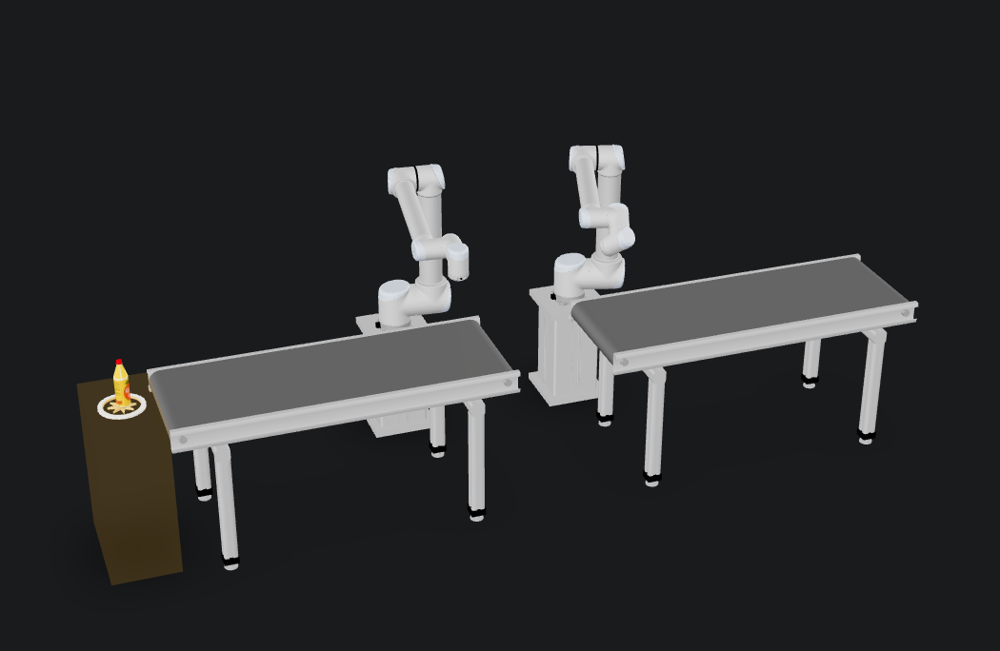

# 方法一 设备契约驱动的工艺程序编译与执行一致性验证

版本：实验设计 0.1。日期：2026-11-01。

本文将方法一组织为“领域模型/契约—DSL 工艺程序—绑定器/编译器—运行器与监测器”四个层面，给出问题定位、实现路径、起步案例、数据集和验证方案。本文是待实施、可复核的研究方案，所有样本数量、参数与验收目标均为计划，不是已取得的实验结果。

## 1 方法定位与研究边界

### 1.1 定位

本方法研究：在持续输送、离散抓放和物料交接混合的工业仿真场景中，如何从统一能力契约构建并编译工艺程序，生成明确的执行协议与监测义务，使工艺意图、预测效果、请求反馈和实际物料状态具有可追踪对应关系。

DSL 首先服务于工艺构建与复用；研究重点是契约如何参与能力绑定、协议展开、组合检查和执行验收。简短语法和代码压缩只是表达层特征，不能单独支持研究贡献。

当前主后端为自研仿真运行器。PLC/ST 是可选实现后端和重要对照方案，不将完整 PLC 编译或实机部署设为首轮实验完成的必要条件。没有实际实现和验证的后端，不纳入结果结论。

### 1.2 与方法二、三的边界

| 研究部分 | 本轮承担什么 | 本轮不以什么作为实验目标 |
| --- | --- | --- |
| 方法一 | 给定明确工艺，进行契约绑定、编译、执行与监测；定义可供规划器使用的状态/效果语义 | 从图像自动理解布局、从自然语言自动搜索工艺、求最优派工 |
| 方法二 | 后续由用户目标、场景和能力库生成候选 ProcessIR | 不通过直接写物理状态绕过方法一的执行规则 |
| 方法三 | 后续选择可执行任务、资源授权和派工顺序 | 不修改动作成功定义或代替真实停止、交接确认 |

方法一可以对人工给定流程进行符号前向推演，不要求先实现自动规划器。规划模型导出是可选扩展；若开展，需要另外定义转换语义并提供实验，不能将“生成 IR”记作“自动规划成功”。

## 2 需要解决的问题与研究问题

### 2.1 工程问题

1. **工艺与设备实现耦合。** 工步中混有命令编号、输入输出名、接受/完成握手和计时。设备替换后，同一工艺容易重复适配。
2. **条件与状态变化缺少共同语义。** 前置条件、完成信号、物料持有和实际支承分别存在于不同模块；初始 Idle、旧 done 或动画结束可能被误用为成功。
3. **并行组合的局部合法性不保证整体可执行。** 合法调用可能竞争同一物料、机械臂、交接区或驱动写入权；独立读取“空闲”也可能造成重复授权。
4. **失败状态与业务记录脱节。** 动作超时不说明设备未动作；抓取后失败时物料可能仍在夹具，不能自动回滚归属或释放全部资源。
5. **验证证据难以关联。** 需要定位哪个工艺节点、哪次请求、哪件物料、哪个事实版本导致等待、成功或失败，而不仅输出 Step 编号和日志文本。

这些问题在 ST/LD 中也可用成熟功能块与统一运行框架解决。本研究须与具有同等能力封装的方案比较，不能以“PLC 不支持抽象/协调”为前提。

### 2.2 研究问题与可检验假设

| 研究问题 | 待验证假设 | 主要证据 |
| --- | --- | --- |
| RQ1：统一契约能否减少工艺与设备适配的耦合？ | 更换实例、信号或兼容协议时，业务工艺的必要修改减少 | 修改位置/类别、适配工作量、回归结果；计入契约与适配器准备成本 |
| RQ2：契约参与编译能否更早发现错误组合？ | 在同等输入信息下，参数、引用、作用域和确定性写冲突的诊断更准确 | 错误检出率、误拒绝率、定位准确率与检测阶段 |
| RQ3：统一协议与监测能否保持跨层一致性？ | 在反馈异常和物料交接异常下，错误成功、重复副作用及错误释放减少 | 独立轨迹判据、物理事实、请求/归属/资源不变量 |
| RQ4：持续控制与离散任务的组合是否具有可重复的语义？ | 相同初态/输入可重放；控制退出和并行异常遵守指定语义 | 语义事件重放、时钟边界和停止/清理故障测试 |

无故障情况下两种完善方案均可能正确执行；不能预设本方法必然有更高成功率。实验允许发现“正确性相当，但修改/诊断成本不同”的结果。

## 3 四个层面的实现方式

| 层次 | 主要产物 | 必须回答的问题 |
| --- | --- | --- |
| 领域模型/契约 | DeviceSpec、公共谓词/资源/交接规则、状态效果模型 | 能做什么、需要什么、改变什么、哪些约束持续成立？ |
| DSL 工艺程序 | ac-process/0.1 文本与 ProcessIR | 本次使用哪些能力、对象和目标，按何种控制关系组织？ |
| 绑定器/编译器 | BoundProcess、协议计划、检查义务、依赖锁定和来源映射 | 引用是否匹配、组合是否可执行，如何落实请求和检查？ |
| 运行器与监测器 | 请求网关、共享仿真世界、资源/交接服务、事件与独立验收 | 当前执行到哪里、实际结果怎样、失败后现场处于什么状态？ |

### 3.1 领域契约及状态效果

沿用 [设备契约](../docs/设备契约.md)、[行为契约](../docs/schema.md) 和 [参数契约](../docs/参数契约.md)，增加版本化的公共语义定义。新增规划/效果字段是研究提案，不默认现行 JSON 和运行器已经支持。

每个能力至少关联：参数及名义类型、启动条件、持续条件、成功效果、成功证据、所需资源、协议、停止/释放条件和失败状态处理。描述性 effects 不能直接 eval 或代替实际观测。

| 状态或关系 | 权威提供者 | 用途与边界 |
| --- | --- | --- |
| holder(material) | 交接服务事务记录 | 唯一业务归属；可为台座、输送机、夹具或目标区域 |
| supported_by(material, support) | 物理接触/支承监测 | 真实支承，可与交接过程的业务归属暂时不同 |
| held_by(material, robot) | 实际抓取约束及持有观测 | 不以闭合夹爪命令代替；抓住不等于已移离源区域 |
| at_region(material, region) | 已标定区域检测 | 关联主体、场景版本和时间；到出口不等于已交接 |
| stopped(conveyor) | 实际速度及静止判据 | run=false 是命令，不能直接成为 stopped=true |
| reserved(target, task) / occupied(target, material) | 资源/交接服务 | 预留与实际占用分别记录，提交时转换而非重复计数 |
| granted(resource, activation) | 集中授权管理者 | 带版本、作用域和代次；不得由动作自行声明 |

“预测状态”是选定抽象层上的结果，不是对完整刚体世界的精确预测。由已知初态按动作成功效果前向推演；未被效果明确修改的符号状态保持不变。未知事实不默认当作 false。存在未知、缺失几何证明或不确定结果时，记录条件性计划/运行检查义务，不伪造确定预测。

成功效果和后置检查可引用同一类型化谓词，但用途不同：前者用于预演，后者需要实际证据。计时器到期、设备空闲或一次 done 本身不能推导完整物料状态。失败时将受影响状态标为待观测/隔离；不能机械应用成功效果的逆变换。

### 3.2 DSL 与具体任务

保留 [现有文法](language.ebnf) 及 [语言语义](01-language.md)。顺序、并行、分支、有限重复、等待、持续控制和失败节点组成工艺，动作继续引用稳定能力 ID。

任务内容包括物料、源/目标位置、明确顺序与业务分支。设备协议、身份编码和默认超时策略放在契约/环境中，绑定器展开后允许查看。源程序与工艺图共享 IR，不独立维护两份权威流程。

当前 v0.1 只支持标量、量纲值及名义引用/索引，不支持直接写 Pose、关节数组或 steps。机器人 1.4 的 robot-command@1 则使用结构化命令。首轮通过显式业务能力适配器将“物料＋源位置＋目标位置”转换为经校准的命令载荷，不能把向量塞入 REAL 或 JSON 字符串。

拟登记的业务适配能力为 `cell.transfer_material@0.1`：主体 reference<material>、源/目标 reference<location>；包含源检查、目标预留、接近、夹持、移离、放置与确认。它引用正式机械臂定义和底层 pick_and_place，补充跨设备工艺约束，不能覆盖或削弱底层契约。location 类型及参数绑定规则必须明确注册；本方案不据此宣称现有 DSL 已接受该能力。

### 3.3 绑定与编译

输入为明确 ProcessIR、场景/任务、能力库、适配器和执行配置。输出包括：

- 不可变 BoundProcess 与全部依赖版本/哈希。
- 解析后的物料、设备、位置、信号和身份映射。
- 启动/持续/成功/停止检查义务与监测关联规则。
- 协议状态机、集中资源需求、控制进入/退出及异常传播计划。
- 语义节点到代码、请求与诊断的来源映射。

检查分层报告：语法通过、结构通过、绑定通过、可执行条件通过与实际运行通过。动态竞争通常由仲裁串行化，不因 par 中共享资源就一概静态拒绝；明确不可协调的写冲突、非法共享状态及不满足声明并发要求的组合才报静态错误。

并行/分支引用的请求支配关系、事实身份、新鲜度、单位、协议和能力依赖必须校验。无法静态决定的事实进入运行门控或预检查，不以“编译器可检查全部物理可行性”为研究假设。

### 3.4 运行与监测

一个共享物理世界承载所有参与设备和物料。运行器按语言规定的固定 tick 分阶段处理事实、反馈、条件、授权、命令与物理推进；渲染只读运行状态。

控制源统一获得 writer 权限；有身份的动作请求通过网关接受与去重；执行器负责运动；交接服务负责业务归属；独立监测器核对事件与物理事实。取消/超时先请求受控停止；停止结果未知时保留 stopping＋attention_required 和相关隔离，不报告虚假清理完成。

对齐关系为：`process node → activation → request → backend command → subject/target → observed evidence`。每条反馈保留 tick、epoch、revision 和身份；仅名称相同不足以关联。协议重发的幂等性与进程重启后的持久去重分开测试，不宣称端到端恰好一次执行。

### 3.5 “一致性”具体检查什么

将契约 C 的状态抽象记为 π_C：它把物理/业务快照投影成带有效性、身份和时间的领域事实。动作 a 的成功效果给出允许的抽象后继集合 T_C(s,a)，不要求所有动作都是确定转移。人工给定工艺可按该模型前向推演，并记录无法确定的部分。

| 一致性类别 | 本轮可检验要求 |
| --- | --- |
| 绑定一致性 | 生成的调用满足源契约类型、能力和协议要求；适配不得削弱设备必需条件 |
| 协议一致性 | 成功关联已接受的同一请求；重复/迟到消息不重复产生业务副作用 |
| 状态一致性 | 在动作提交成功的证据时刻，对动作影响的状态与后置要求，实际投影属于预期允许结果并满足有效性/关联要求 |
| 来源一致性 | 诊断和证据可追溯到当前版本工艺、激活、设备/物料/目标以及所用契约 |

状态对齐采用动作影响范围和对应证据时刻，不把整车间最终快照与某一步的历史预测逐项相等；其他任务及环境可能改变无关状态。未知事实表示证据不足，与已观测到相反状态分别报告。物理数值按标定的几何/速度容差投影，不将近似数值相等作为通用要求。

这些是拟检查的性质，不因使用同一契约就自动成立。必须分别验证效果到检查义务的转换、后端适配和 π_C 的观测实现；只有在声明的模型/环境假设下证明的性质才可使用相应形式化结论。

## 4 从图示简单场景构造首个案例



### 4.1 图像可确认的信息与设计假设

图中可见两台机械臂、两条输送带，以及左侧台座上的一个瓶状物料。图片不能证明尺寸、坐标、连接、可达性、质量、摩擦和功能；下述 ID、角色及流程是实验设计。

| 逻辑对象 | 本轮角色 | 模型与配置来源 |
| --- | --- | --- |
| S | 被动物料源支承台座 | 新增静态支承及取料区域定义；不假设能自动出料 |
| R1 / R2 | 上料与跨带转移机械臂 | robot_UR10 的两个实例；共享能力定义，分别校准基座/TCP/路径 |
| C1 / C2 | 两段连续输送面 | Conveyor_aankws 的两个实例；入口、出口与驱动独立命名 |
| M | 单件实验物料 | 首期使用已有 engine_block 及其声明式碰撞体；瓶状外观需另建/标定代理后再启用 |
| C1.in / C1.out / C2.in / C2.out | 交接/到达区域 | 场景中的有类型位置引用，不使用空间吸附接口替代检测或抓放点 |

图中的瓶子不意味着需要新增瓶装生产工艺。首期只研究搬运/输送及状态一致性，不设置加工、装配和质量检测能力。

### 4.2 案例 T0 的任务与边界

**任务：**将初始稳定支承在 S 上的 M，经 R1 上料至 C1；C1 输送到出口并停稳；R2 将 M 转移到 C2 入口；C2 输送至出口并停稳，确认 M 仍有有效支承且位于目标区域。

初态：两带实际静止，两夹具空，M 的唯一业务 holder 为 S，两个目标区域可接收，无遗留请求/预留。目标不是“物料消失”或“动画结束”，而是目标区域、支承、归属、停带、夹具和清理事实共同成立。

先采用单物料、固定顺序、固定实例，不自动挑选机器人、载位或工艺路线；不把人工布局作为自动场景理解结果。M 不在启动时自动移到期望位置，也不能用全局 reset 作为流程成功的最后一步。

### 4.3 明确工艺与状态演进

T0 已有对应的 [正式 Lisp 源码](examples/t0-two-robot/process.acp)、[环境绑定](examples/t0-two-robot/cell.design.json)、[业务适配定义](examples/t0-two-robot/transfer.adapter.json) 和 [绑定设计报告](examples/t0-two-robot/process.binding.json)，说明见 [T0 README](examples/t0-two-robot/README.md)。它们通过参考静态检查，mode 仍为 design_only；下列缩进表示保留作工艺概览。


下列为能力级工艺示意，不是现有解释器可直接执行的新语法；正式源码由已注册业务适配能力和场景绑定生成，继续遵守 ac-process 文法。

```text
T0 / seq
  load: R1.transfer_material(M, S, C1.in)
  feed_1: with-control C1.drive
    arrive_1: track_to_exit(C1, M)
  recheck_1: await 当前 M 仍位于 C1.out 且 C1 实际静止
  bridge: R2.transfer_material(M, C1.out, C2.in)
  feed_2: with-control C2.drive
    arrive_2: track_to_exit(C2, M)
  verify: await 当前 M 位于 C2.out、实际支承成立且归属已确认
```

| 阶段 | 成功后的抽象状态 | 核验所需证据 |
| --- | --- | --- |
| R1 取料并移离 S | holder(M)=R1.gripper，源区域已清空 | 约束有效、实际持有、M 已移离源区域；不能仅凭 grip 即清空 |
| R1 放置到 C1.in | holder(M)=C1，R1 空 | 释放、C1 有效支承/区域进入、交接事务提交 |
| C1 到出口并停稳 | holder(M)=C1，at_region(M,C1.out)，stopped(C1) | 当前请求到达证据、退出写入确认、实际速度和最新位置 |
| R2 取走并放入 C2.in | holder(M)=C2，两夹具空 | 两次交接提交、目标预留转占用、实际支承 |
| C2 到出口并停稳 | holder(M)=C2，at_region(M,C2.out)，stopped(C2) | 最终物料事实、目标支承、停带及无泄漏执行许可 |

原始物料实际占用保留，不将其误计为资源泄漏。执行许可、临时预留、业务 holder 和物理支承分别验收。

### 4.4 资源、互锁与失败

基础资源包括 R1.motion、R2.motion、material_claim(M)、C1.writer、C2.writer 和交接区域。接收容量/区域预留由服务提供，不把“区域检测为空”当作已获授权。

R1 放入 C1 时，禁止其他控制源启动 C1；R2 从 C1 抓取并向 C2 放置时，对两带相关 writer 及交接区域实施互斥。R2 得到授权后重新检查停稳和主体位置，不能沿用一次历史 await。需要一次获得的资源集合原子授权，释放按退出/交接证据执行。

with-control 管理驱动写权，内部 track_to_exit 只跟踪指定主体。若底层动作契约要求 drive_authorized，须由适配器明确声明继承父控制授权的范围，不能重复申请同一排他驱动而自锁，也不能暗中覆盖父作用域设定值。

失败示例：R2 已抓取 M 后目标条件失效，系统应受控保持，保留实际 holder/约束及必要隔离；不能将 M 重新记为 C1 持有。若停止确认超时，工艺进入 attention_required，不以恢复作者初始姿态“修复”任务。

### 4.5 计时与标定

固定步长 1/60 s；超时使用整数 tick，实际预算经开发集试验冻结。可采用 0.2/0.4 m/s 作为候选输送速度，但须验证在当前长度、加减速和区域下能及时制动；不能把候选值当作硬件指标。区域检测应考虑物料外形与支承，不能只检验中心点穿过端点。

图像不用于填写精确坐标。逐项记录机器人基座、源/目标框架、TCP、捕获参考、路径、接触材料、碰撞代理、静止与到位判据；先预检查所有运动阶段，再允许运行。质量和尺寸选取需同时满足物料碰撞、输送支承和机器人实验载荷约束。

### 4.6 当前实现到案例的接入门槛

已有单输送实验及机器人虚拟约束抓放可复用，但当前机器人文档的物理世界只含选定工具/物料/静态支承等有限参与者；不能启动两个独立会话便声称实现共享产线。

完整 T0 前须完成：多实例共享世界；S/C1/C2 全部支承与区域；R1/R2 命令适配；统一请求关联；持续控制退出确认；writer/资源仲裁；物料交接；独立监测。当前 stop/reset 恢复作者基线的实验行为还需与生产 stop/hold 分开，故障中不可直接销毁持有约束并把物料复位。

实施顺序为：现有单机能力回归 → 协议脚本植物模型中的 T0 → 一个机器人与两支承的闭环 → 图示双机械臂完整共享世界。每阶段分别报告，不把协议模拟、Mock 或单机通过作为最终物理验收。

## 5 数据集设计与构造

### 5.1 数据集的用途与组成

本数据集主要用于编译、执行和验证评测，不是默认的 LLM 训练集。每个样本包含设备/公共契约、场景与任务、明确工艺、版本依赖、预期结果及其依据。图像仅辅助描述，不作为已验证布局数据。

| 集合 | 内容 | 标签/真值来源 |
| --- | --- | --- |
| D-S 静态设计集 | 合法工艺和单缺陷变异 | 独立标注的期望检测阶段、错误类别、节点/字段 |
| D-P 协议执行集 | 可控设备状态/反馈脚本、调度与交接情形 | 预先编写的事件偏序、期望状态与禁止事件 |
| D-C 物理闭环集 | 已标定布局、物料、驱动与实际接触 | 物理状态和独立任务验收，不以执行器 done 作唯一标签 |
| D-T 错误轨迹集 | 手工/变异产生的错误成功、串号、重复交接等日志 | 独立预标注异常及证据区间，用于验证监测器本身 |

### 5.2 静态集 D-S：首轮计划 240 条

构造 60 个合法父样本，每个生成 3 个经审核的单缺陷变异，合计 60 正例＋180 负例。五类父样本各 12 个：单物料串行、绑定/实例替换、已标定布局变化、有限多件流程、具有共享资源的并行流程。后两类基于语言允许的明确绑定构造，不用 repeat 自动选择下一件物料。

12 类负例计划各 15 条，按父样本与适用条件分配：

| 代码 | 单缺陷类型 | 预期处理 |
| --- | --- | --- |
| S01 | 在声明的封闭子模型中，初态/成功效果与后续动作的状态依赖矛盾 | 符号前向检查拒绝或定位；未知及外部可变事实不得据此拒绝 |
| S02 | 节点重复、环、共享状态子树或悬空引用 | IR 结构拒绝 |
| S03 | 设备/能力不存在或不可调用 | 绑定拒绝 |
| S04 | 参数类型、范围或必填错误 | 类型/参数拒绝 |
| S05 | 单位或坐标框架不匹配 | 绑定拒绝；不隐式换算 |
| S06 | 物料/位置/载位名义类型错误 | 引用类型拒绝 |
| S07 | 登记表重复、索引悬空或版本不一致 | 身份映射拒绝 |
| S08 | 引用未登记条件/提供者或错误关联类型 | 条件绑定拒绝 |
| S09 | 请求引用未来节点、错误分支或循环轮次 | 作用域/支配关系拒绝 |
| S10 | 无仲裁的重复 writer 或非法父子授权继承 | 控制/资源检查拒绝 |
| S11 | 调用 continuous 为离散成功动作、observer 为生产任务 | 能力语义拒绝 |
| S12 | 缺失必要停止/持续监控/执行器能力 | 可执行性拒绝，不能仅因结构合法放行 |

S12 可以在设计模式保留草稿，但不得标为 executable。合法资源竞争属于正例：由仲裁等待/串行化，不把“共享区域”本身标为非法工艺。若某变异引入多个缺陷，修正或剔除并记录原因，不能将级联报错数当作多个检出。

词法、括号、未知关键字和未知语言版本仍在解析器单元测试中覆盖，不用大量纯语法错误替代领域语义样本。S01 必须声明分析边界与外部状态变化假设，并经独立参考状态序列核实，不能用“当前条件未满足”直接推断整个工艺永远不可执行。

父样本按开发/验证/封闭测试划分为 12/12/36，全部子变异随父样本分组，因此对应 48/48/144 条。将至少一种布局模板及一种协议适配变体整体留在测试组，用于单独报告域外适配；不能仅换 ID/随机数就称泛化。划分在调试前冻结，保存 parent_id、模板来源及结构归一化哈希，防止近重复泄漏。

协议变体可以由明确的模拟后端产生，不能冒称不同厂商实机。现有 UR10 只有一个实验模型；设备级泛化结论需另接独立设备/执行器后成立。

### 5.3 协议集 D-P 与物理集 D-C

首轮闭环候选选择 24 个冻结的场景任务：8 个 T0 参数/绑定变体、8 个合法布局变体、8 个双物料资源竞争变体。多物料使用独立任务激活与明确物料身份，不能重复执行同一个静态物料绑定并声称多件生产。

先以 D-P 执行全部 24 个场景，确认控制与协议；物理依赖满足后才进入 D-C。物理布局先在开发阶段独立校准，可用与不可用样本都保留标签。不可达布局应进入拒绝/异常测试，不能在得知方法运行失败后悄悄从名义成功集合移除。

有明确随机扰动时每场景采用 5 个配对种子，名义运行计划为每方法 120 次。扰动的分布、界限和生成器版本须记录，且不能改变合法样本的定义。无随机因素时每场景运行一次即可；重复重放用于确定性检查，不计为独立样本。

故障计划选择下列 12 类，在 4 个冻结场景中，于预先指定语义阶段注入；有随机扰动时每组 5 个配对种子，最多 240 次/方法。注入脚本按“接受后、夹持后、释放前”等状态触发，不依据墙钟或针对某方法的内部工步编号。

| 代码 | 注入内容 | 期望性质 |
| --- | --- | --- |
| F01 | 观测过期 | 阻止依赖动作启动或按持续条件处理 |
| F02 | provider 重启/epoch 改变 | 不使用旧代次事实 |
| F03 | 正确值但错误物料身份 | 不给当前物料记成功 |
| F04 | 残留或其他请求的 done | 没有本次证据不推进 |
| F05 | 接受回复丢失，但设备可能已动作 | 不新建身份盲重试；停止/查询并保留占用 |
| F06 | 重复或乱序反馈/交接确认 | 不重复动作或增加占用 |
| F07 | 目标在授权竞争中被其他任务占用 | 集中授权，不出现双预留/双占用 |
| F08 | 抓取期间其他控制源请求重启输送带 | writer/区域互锁有效 |
| F09 | 停带命令已发但实际速度尚未为零 | 不提前抓取 |
| F10 | 夹持并抬离后执行失败 | 保持实际 holder，受控停止或隔离 |
| F11 | 释放但物料未进入目标支承区 | 不误报交接或任务成功 |
| F12 | 停止确认丢失/超时 | stopping＋attention_required；资源不虚假释放 |

故障场景的正确结果可能是等待、拒绝、受控失败或 attention_required，不要求都继续生产或完成任务。“故障后任务未完成”不能直接记作方法失败；关键是是否遵守该故障的结果标签与状态约束。

### 5.4 样本结构与标签

建议目录按 cases/<case_id>/ 保存 contracts.lock、scene、task、process、bindings、fault_schedule、expected、provenance 与结果。大模型资产用受控引用及哈希共享，避免每个样本复制 GLB；暂不承诺具体文件后缀和存储实现。

以下为计划的样本记录示例，所有 design_only/pending 均有意保留。它不是当前 apps 项目格式，不表示数据集已经生成。

```json
{
  "dataset_version": "method1-benchmark/0.1",
  "case_id": "T0_nominal_001",
  "parent_id": "T0_family_001",
  "split": "development",
  "mode": "design_only",
  "scene_ref": "scenes/two_robot_cell_r1",
  "task": {
    "material_id": "M1",
    "initial_location": "S",
    "target_location": "C2.out"
  },
  "contract_refs": [
    { "spec_id": "Conveyor_aankws", "contract_version": "1.3", "definition_version": "0.6.0" },
    { "spec_id": "robot_UR10", "contract_version": "1.4", "definition_version": "0.1.0" }
  ],
  "seed": 101,
  "fault_schedule": [],
  "expected": {
    "static_result": "accept_design",
    "runtime_result": "blocked_until_integration",
    "future_closed_loop_result": "success",
    "acceptance_ref": "T0_acceptance_v1"
  },
  "integration_status": "pending_shared_world_and_services",
  "label_status": "requires_independent_review"
}
```

实际样本还须包含文件哈希、初态物理与业务归属、输入记录、动作/区域标定、完整执行配置和预算、标签理由及来源。contract_refs 不能只锁名称或人工版本。正常/故障记录的 expected_phase 与 expected_outcome 应明确，不把静态拒绝、运行失败和监测检出混为一个“失败率”。

### 5.5 真值与数据质量

至少两人对任务目标、单缺陷标签及预期结果独立复核，分歧记录并裁定；资源等待正例尤其需要防止误标。人力不足时先形成小规模双审核心集，再扩大样本，不伪造审核覆盖。

真值不由被评估编译器单独生成。使用人工参考工艺、独立协议脚本及物理状态进行交叉检查。模型检查器验证的范围和物理运行范围分别记录；参考 DSL 工具通过不等于整个工艺正确。

构造 D-T：对正确轨迹注入旧请求成功、重复提交、错误 holder、负容量、未授权写入和无支承成功等违例，也保留合法等待及交接过渡轨迹。监测器必须检出坏轨迹并接受合法轨迹。不能将“用同一函数生成期望和实际，再比较相等”当作独立验证。

## 6 对照方案与公平性

### 6.1 核心对照

| 方法 | 定义 | 目的 |
| --- | --- | --- |
| B-STFB | ST＋完善的设备功能块、同等驱动/请求/资源服务和接口绑定；由作者组织工步与所需检查 | 回答在同等高层封装下，DSL 还减少哪些工作 |
| B-DSL | 普通结构化工艺解释＋设备调用；具有基础类型/名称检查，组合、反馈关联和监测需显式配置 | 回答收益来自语法还是契约驱动的生成/一致性机制 |
| M-Full | 四层方法完整版本 | 评价绑定、协议展开、条件关联、物料/资源及诊断的整体效果 |

B-STFB 不能把原始 test.st 直接换变量名后算作基线：该文件有模板与源项目 LD 文本，也不是当前场景。应实现纯 ST 的共同子集、固定扫描配置和同等设备功能块，并在选定解释器/编译器中验证。主指标比较共享的语义事件和物料结果，不要求内部工步编号或每个扫描状态相同。

若首轮尚无经过验证的 ST 执行后端，先完成 B-DSL 与 M-Full 的阶段性评测，明确未完成直接 PLC 对照；可以提供人工 ST 设计的修改工作量研究，但不能将未运行代码列入闭环成功率。旧 DSL 同理，须有对应参考运行实现后才能参与执行指标。

所有方法使用同一设备算法、场景、初态、能力库、底层请求/资源服务及独立评测器。完善的 B-STFB 可以人工写出与 M-Full 等效的条件和监测；本方法要证明减少重复维护、提高诊断或一致性，而不是让基线故意省掉正确性规则。

### 6.2 消融与层次归因

在保留同一执行服务和外部真值的前提下，设置：M-NoBind（去掉契约语义绑定检查）、M-NoCorrelation（去掉请求/主体/代次关联）、M-NoFreshness（不做新鲜度检查）、M-NoEffectProjection（去掉符号效果前向推演和预期—观测对齐）、M-NoAutoMonitor（不自动生成监测义务但保留外部评测）。每个变体说明仍保留的能力，避免多个模块同时被删却归因于一个因素。

上述消融用于受控仿真故障实验；所有方法的坏行为均由同一外部评测器记录。物理算法、故障注入、运行预算、资源策略与数据划分保持一致。去掉资源仲裁的场景可单独作为故障对照，但不用于宣称其他模块单独解决了资源竞争。

## 7 指标与验收判据

### 7.1 静态与适配指标

- **合法接受率**＝正确接受的合法设计/全部合法设计；另报实际 executable 的比例，不混用。
- **非法检出率**＝正确定位到期望缺陷的非法样本/全部非法样本；误拒绝率＝被错误拒绝的合法样本/全部合法样本。
- **诊断定位**：分别报告根因类别、节点、字段及关联证据是否匹配真值；检测阶段按解析/绑定/运行区分。
- **修改成本**：分别记录工艺正文、设备适配、契约、场景绑定和测试的修改数量、操作步骤与耗时。初始库建设成本与跨任务复用成本分开核算。
- **生成/检查成本**：墙钟时间、峰值内存及人工修订；LLM 若参与再报告调用、token 与费用，固定模型版本和提示输入。

### 7.2 运行指标

| 指标 | 定义与分母 |
| --- | --- |
| 任务成功率 | 满足全部 T0 目标及清理判据的名义运行/全部名义运行；拒绝和超时仍保留在分母 |
| 错误成功率 | 系统报告成功但独立验收失败的运行/全部已报告成功运行，同时报告占全部运行的比例 |
| 故障处理符合率 | 达到预定正确结果/该故障全部有效注入；单独统计注入未触发 |
| 重复副作用率 | 同一请求产生重复接受、抓取或交接提交的运行/相关故障运行 |
| 不变量违反 | 同时报告发生违反的运行数和按时间/事件归并的违例段，避免每 tick 重复计数放大 |
| 隔离/许可泄漏 | 已确认可清理但未清理的许可；与物料实际占用、正确保留的隔离分开统计 |
| 可追踪率 | 应关联事件中，能关联到工艺/激活/请求/主体/目标及有效证据的比例；统计无法关联和歧义 |
| 重放一致性 | 相同初态与输入下语义事件/目标结果一致；物理数值采用预先冻结的容差，不要求逐位相同 |

T0 成功必须同时满足：M 在 C2.out 且实际有效支承；业务 holder=C2；R1/R2 均不持有 M；两带实际停止；根节点成功；无活动请求；控制退出确认且执行许可清理；无双归属、容量或未授权写入违例。未提供有效证据的条件记为未知，不能记成功。

所有空间、速度、约束误差、稳定持续时间及新鲜度阈值，须在开发集校准并写入 acceptance profile、锁定后使用。不能根据封闭测试结果临时调大容差，也不能只给出“不穿模/看起来到位”的人工判断。

故障验收不要求自动重规划。若环境可恢复且方法支持显式恢复，再评价恢复时间与后续完成；否则评价正确保持状态和诊断。全局 reset 恢复作者初态不能算故障恢复成功。

## 8 统计、复现与执行步骤

### 8.1 统计设计

同一 case/seed/fault 对各方法配对，运行顺序随机化并保存。以场景/父样本为主要统计单位；同一父样本的变异及重复种子采用分组统计/聚类重采样，不当成完全独立的大样本。报告每类结果、分子分母、置信区间及失败实例。

二元配对指标可使用精确 McNemar 检验；耗时/修改成本采用配对差值与适用的非参数检验；置信区间按场景分组 bootstrap。样本或事件过少时以描述统计和区间为主，不仅报告 p 值。多指标检验预先指定主指标并处理多重比较。

人为编写成本建议额外开展小规模交叉任务研究：同一参与者使用 B-STFB 与 DSL 完成等价但不同实例的任务，平衡顺序并统一训练时间，记录经验。没有真实参与者研究时只报告机械修改量和复现实验，不把研究者自行操作时间解释成普遍人因收益。

### 8.2 实施路线与阶段门槛

| 阶段 | 必须交付 | 允许报告的结论 |
| --- | --- | --- |
| E0 契约与样本冻结 | 类型化效果/状态定义、T0 绑定、语义规则、开发/测试划分 | 方案完整性和可检查性；无执行性能结论 |
| E1 参考绑定器 | 正反例集、IR/来源映射、依赖锁定、可执行性分层 | 静态检出、误拒绝、适配修改与成本 |
| E2 协议闭环 | 单动作网关、控制退出、资源/交接模拟服务、事件和监测器 | 受控模型内协议与一致性性质 |
| E3 单臂实体仿真 | 正式机器人载荷适配及真实物料接触，停止保持与 reset 分开 | 所选单臂/支承/物料范围的物理验收 |
| E4 图示完整场景 | 共享世界、两臂两带及台座、区域标定、交接与互锁 | T0 及冻结变体内的任务/故障效果 |
| E5 扩展与对照 | 有限多件、并行竞争、经验证 ST 后端及可选规划投影 | 对应实现范围内的泛化与对比 |

最小启动任务为：将一条输送链的静态绑定与监测义务跑通，并分别复核已有 C1、R1 单机实验；随后构建 D-P 的 T0，再补共享世界。不要为了生成完整界面演示而提前使用位置插值或默认 true 绕过关键依赖。

### 8.3 复现记录

每次运行记录应用/编译器/执行器提交版本、设备/场景/工艺/登记表/标定哈希、物理版本与配置、系统环境、初始状态、外部输入、随机种子、预算、事件、最终快照、监测结果和失败原因。记录模拟加速倍率及墙钟耗时；仿真时间与计算性能分开。

允许记录当前未支持能力导致的拒绝，但不以 Mock 填补真实结果。公开范围取决于资产许可；可复现包应至少提供合法模型引用、抽象几何代理或取得授权的资产，以及足够重建场景的参数。

## 9 与已有研究的关系及预期论证

| 工作 | 已有基础 | 本方法需要额外论证的候选内容 |
| --- | --- | --- |
| [SkiROS2](../papers/dsl/2306.17030v1.pdf)，§IV-A | 技能前置/持续/后置条件、规划与反应式执行 | 本项目持续输送/物料交接/请求证据的具体语义与实验差异 |
| [EzSkiROS](../papers/dsl/frobt-11-1363443.pdf)，§3.2.4、§4.1 | 技能 DSL、早期错误和来源定位 | 跨 IR、请求、实际物料状态的监测关系与检测增益 |
| [抽象规划域适配](../papers/dsl/s10845-023-02211-3.pdf)，方法部分 | 从抽象技能/领域知识适配具体应用 | 持续控制、停止保持与部分交接失败的状态对应 |
| [能力模型＋SMT](../papers/dsl/2312.08801v1.pdf)，§3–4 | 能力约束到规划编码，当前版本的瞬时动作范围 | 本方法选定运行语义如何处理持续过程和证据未知；不据此断言所有 SMT 方法不能处理 |
| [AAS 到 PDDL](../papers/dsl/2606.02167v1.pdf)，§III、§V | 设备能力模型生成规划描述 | 同源模型到执行义务及实际反馈的对齐；转换本身不是新贡献 |

上述为候选定位，不宣称首次提出领域模型、DSL、资源管理、协议封装或代码生成。预期以可测量的语义错误、适配成本和执行一致性证据支撑方法价值；结论限制在所选抽象、设备、环境及验证假设内。

## 10 开展实验前的检查清单

- [ ] 图中对象的真实角色已确认；台座不被错误当作自动出料设备。
- [ ] 单物料 T0 的初态、目标、位置和全部运动阶段已标定；没有使用图像猜测坐标。
- [ ] 1.4 机器人结构载荷与 DSL 业务参数的适配契约已明确；不使用旧 robot.design.json 冒充当前设备接口。
- [ ] 持续控制、实际停稳、交接和失败保持均有有效证据；生产停止与预览 reset 已分开。
- [ ] 共享物理世界及全部参与支承已接入；多个独立会话没有各自复制同一物料。
- [ ] 域模型、工艺、绑定计划、运行记录和独立判据均有版本和来源。
- [ ] 合法竞争、非法冲突、待接入草稿和实际运行失败有不同标签。
- [ ] 对照获得同等设备能力及服务，静态工具与物理运行结果分别统计。
- [ ] 测试集、故障、阈值、预算和统计单位冻结；监测器已用错误轨迹单独检验。
- [ ] 结果报告包含不支持、失败、注入未触发及隔离保留情形，不仅展示成功截图。
